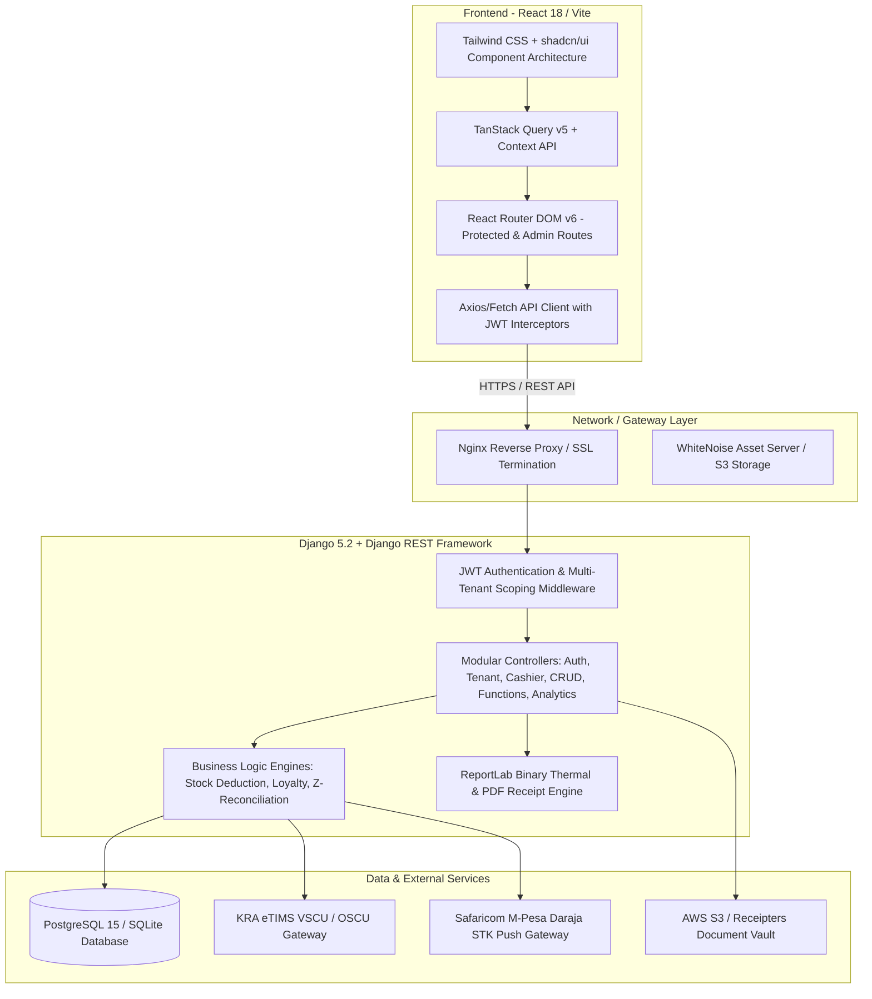
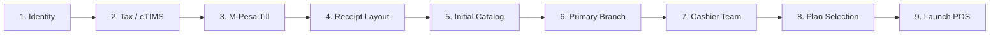
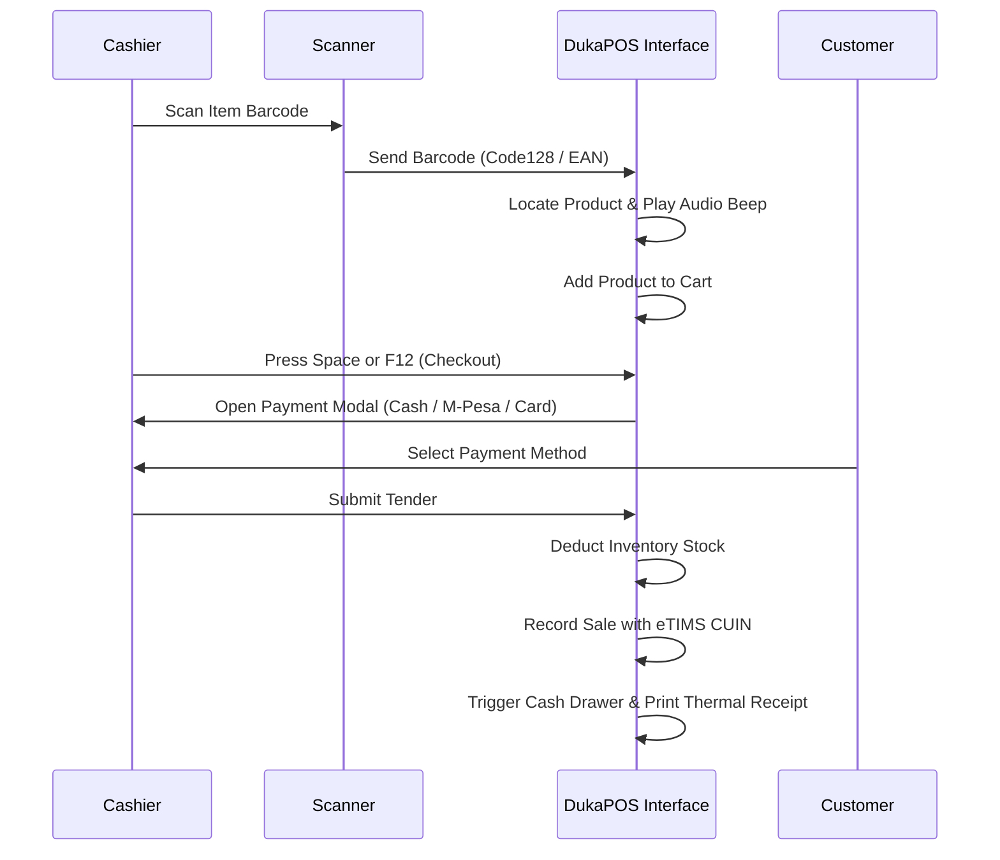
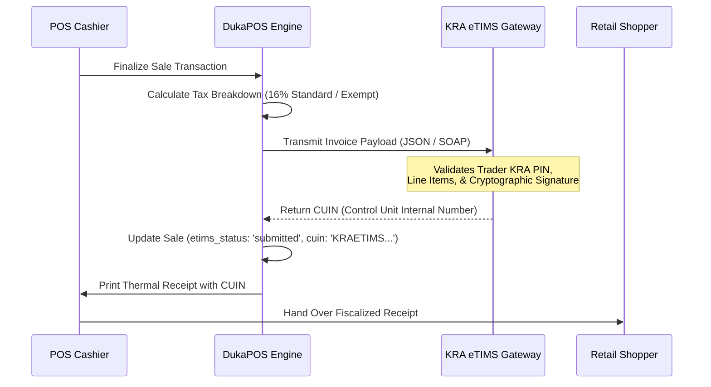
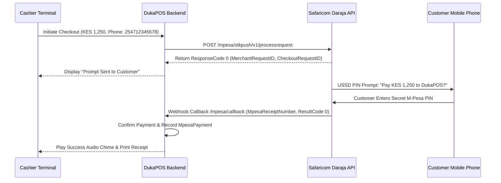

# DukaPOS — The Complete Technical & Operations Master Handbook

> **System**: DukaPOS Multi-Tenant Retail Point of Sale & ERP  
> **Version**: 1.0.0 Enterprise  
> **Target Market**: Kenya & East Africa  
> **Stack**: React 18 (Vite) + Tailwind CSS + Django 5.2 (REST Framework) + PostgreSQL / SQLite  
> **Integrations**: Kenya Revenue Authority (KRA) eTIMS, Safaricom Lipa Na M-Pesa (Daraja API)  

---

# Table of Contents

- [1. Executive Summary & System Overview](#1-executive-summary--system-overview)
  - [1.1 Purpose & Problem Statement](#11-purpose--problem-statement)
  - [1.2 Key Platform Capabilities](#12-key-platform-capabilities)
  - [1.3 Intended Audience](#13-intended-audience)
- [2. System Architecture & Engineering Principles](#2-system-architecture--engineering-principles)
  - [2.1 High-Level Architecture Diagram](#21-high-level-architecture-diagram)
  - [2.2 Technology Stack Breakdown](#22-technology-stack-breakdown)
  - [2.3 Codebase & Repository Directory Structure](#23-codebase--repository-directory-structure)
- [3. Multi-Tenancy, Data Isolation & Security](#3-multi-tenancy-data-isolation--security)
  - [3.1 Row-Level Shared Database Multi-Tenancy](#31-row-level-shared-database-multi-tenancy)
  - [3.2 4-Tier Tenant Resolution Strategy](#32-4-tier-tenant-resolution-strategy)
  - [3.3 Scoped Queryset Algorithm](#33-scoped-queryset-algorithm)
  - [3.4 Cross-Tenant Data Leak Prevention](#34-cross-tenant-data-leak-prevention)
- [4. Role-Based Access Control (RBAC)](#4-role-based-access-control-rbac)
  - [4.1 System Roles & Hierarchy](#41-system-roles--hierarchy)
  - [4.2 Comprehensive Permissions Matrix](#42-comprehensive-permissions-matrix)
  - [4.3 Backend Security Enforcement Implementation](#43-backend-security-enforcement-implementation)
- [5. Complete Database Schema & Models Reference](#5-complete-database-schema--models-reference)
  - [5.1 Entity Relationship Diagram (ERD)](#51-entity-relationship-diagram-erd)
  - [5.2 Detailed Specification of All 22 Database Models](#52-detailed-specification-of-all-22-database-models)
    - [5.2.1 Tenant](#521-tenant)
    - [5.2.2 UserProfile](#522-userprofile)
    - [5.2.3 BusinessSettings](#523-businesssettings)
    - [5.2.4 Branch](#524-branch)
    - [5.2.5 CashierInvite](#525-cashierinvite)
    - [5.2.6 Product](#526-product)
    - [5.2.7 Customer](#527-customer)
    - [5.2.8 Supplier](#528-supplier)
    - [5.2.9 Shift](#529-shift)
    - [5.2.10 Sale](#5210-sale)
    - [5.2.11 Expense](#5211-expense)
    - [5.2.12 EmployeeRating](#5212-employeerating)
    - [5.2.13 EmployeeSchedule](#5213-employeeschedule)
    - [5.2.14 Promotion](#5214-promotion)
    - [5.2.15 MpesaPayment](#5215-mpesapayment)
    - [5.2.16 ShiftAudit](#5216-shiftaudit)
    - [5.2.17 CashFlow](#5217-cashflow)
    - [5.2.18 PurchaseOrder](#5218-purchaseorder)
    - [5.2.19 VaultDocument](#5219-vaultdocument)
    - [5.2.20 ReceiptFeedback](#5220-receiptfeedback)
    - [5.2.21 Subscription](#5221-subscription)
    - [5.2.22 ReceiptersEngine & ReceiptersVaultHub](#5222-receiptersengine--receiptersvaulthub)
- [6. Complete REST API Specification](#6-complete-rest-api-specification)
  - [6.1 Authentication & Request Headers](#61-authentication--request-headers)
  - [6.2 Authentication & User Endpoints](#62-authentication--user-endpoints)
  - [6.3 Tenant & Staff Administration Endpoints](#63-tenant--staff-administration-endpoints)
  - [6.4 Generic Scoped Entity CRUD Engine](#64-generic-scoped-entity-crud-engine)
  - [6.5 Custom Business Functions Engine (`/api/functions/invoke`)](#65-custom-business-functions-engine-apifunctionsinvoke)
  - [6.6 Real-Time Analytics & P&L Endpoint (`/api/analytics`)](#66-real-time-analytics--pl-endpoint-apianalytics)
- [7. Core Business Engines & Automation](#7-core-business-engines--automation)
  - [7.1 Automated Stock Deduction Engine](#71-automated-stock-deduction-engine)
  - [7.2 Automated Procurement Stock Increment Engine](#72-automated-procurement-stock-increment-engine)
  - [7.3 Customer Loyalty & Dynamic Tier Engine](#73-customer-loyalty--dynamic-tier-engine)
  - [7.4 Shift Reconciliation & Z-Report Variance Engine](#74-shift-reconciliation--z-report-variance-engine)
  - [7.5 Binary ESC/POS PDF Thermal Receipt Generator](#75-binary-escpos-pdf-thermal-receipt-generator)
- [8. Operations & User Manual](#8-operations--user-manual)
  - [8.1 9-Step Store Setup Wizard](#81-9-step-store-setup-wizard)
  - [8.2 Shift Lifecycle & Cash Float Management](#82-shift-lifecycle--cash-float-management)
  - [8.3 Point of Sale Checkout Workflow](#83-point-of-sale-checkout-workflow)
  - [8.4 POS Keyboard Shortcuts Reference](#84-pos-keyboard-shortcuts-reference)
  - [8.5 Held Transactions & Price Checks](#85-held-transactions--price-checks)
  - [8.6 Customer Loyalty & Points Redemption](#86-customer-loyalty--points-redemption)
  - [8.7 End-of-Day Z-Report Reconciliation](#87-end-of-day-z-report-reconciliation)
  - [8.8 Inventory Management, Restocking & Barcode Printing](#88-inventory-management-restocking--barcode-printing)
  - [8.9 Expenses & Multi-Channel Cash Flow](#89-expenses--multi-channel-cash-flow)
- [9. Kenyan Regulatory & Payment Integrations](#9-kenyan-regulatory--payment-integrations)
  - [9.1 KRA eTIMS Electronic Fiscal Invoicing](#91-kra-etims-electronic-fiscal-invoicing)
  - [9.2 Safaricom Lipa Na M-Pesa (Daraja API)](#92-safaricom-lipa-na-m-pesa-daraja-api)
- [10. Installation, Setup & Environment Configuration](#10-installation-setup--environment-configuration)
  - [10.1 System Prerequisites](#101-system-prerequisites)
  - [10.2 Local Development Quickstart](#102-local-development-quickstart)
  - [10.3 Frontend Environment Configuration](#103-frontend-environment-configuration)
  - [10.4 Backend Environment Configuration](#104-backend-environment-configuration)
- [11. Containerization & Docker Orchestration](#11-containerization--docker-orchestration)
  - [11.1 Docker Compose Development Environment](#111-docker-compose-development-environment)
  - [11.2 Docker Compose Production Environment](#112-docker-compose-production-environment)
- [12. Production Linux Deployment Architecture](#12-production-linux-deployment-architecture)
  - [12.1 Production Topology (Nginx, Gunicorn, PostgreSQL)](#121-production-topology-nginx-gunicorn-postgresql)
  - [12.2 Systemd Application Daemon Configuration](#122-systemd-application-daemon-configuration)
  - [12.3 Nginx Reverse Proxy & SSL Configuration](#123-nginx-reverse-proxy--ssl-configuration)
- [13. Retail Hardware Peripherals Integration](#13-retail-hardware-peripherals-integration)
  - [13.1 Thermal Receipt Printers (80mm & 58mm ESC/POS)](#131-thermal-receipt-printers-80mm--58mm-escpos)
  - [13.2 Barcode Laser & 2D Image Scanners](#132-barcode-laser--2d-image-scanners)
  - [13.3 Electronic Cash Drawers (RJ11 / RJ12 24V)](#133-electronic-cash-drawers-rj11--rj12-24v)
  - [13.4 Web Audio Auditory Cashier Feedback](#134-web-audio-auditory-cashier-feedback)
- [14. Loss Prevention, Auditing & Troubleshooting](#14-loss-prevention-auditing--troubleshooting)
  - [14.1 Security Audit Trails & Manager Overrides](#141-security-audit-trails--manager-overrides)
  - [14.2 Blind Cash Drawer Counting Protocol](#142-blind-cash-drawer-counting-protocol)
  - [14.3 Common Troubleshooting & Solutions](#143-common-troubleshooting--solutions)

---

# 1. Executive Summary & System Overview

## 1.1 Purpose & Problem Statement

Retail commerce across Kenya and East Africa operates in an environment with unique operational and regulatory characteristics:
- **Stringent Fiscal Compliance**: The Kenya Revenue Authority (KRA) mandates that all businesses transmit electronic invoice data via the electronic Tax Invoice Management System (eTIMS). Failure to fiscalize receipts exposes retailers to substantial statutory penalties.
- **Predominance of Mobile Money**: Cash and mobile money (predominantly Safaricom Lipa Na M-Pesa) account for virtually all point-of-sale transactions. Manual reconciliation between cash registers and M-Pesa statement SMS messages causes significant checkout delays, cashier accounting errors, and pilferage.
- **Inventory & Loss Prevention**: Retailers frequently suffer from inventory shrinkage, unaccounted cash drawer shortages, unrecorded cash float expenditures, and stockouts of fast-moving consumer goods.
- **Multi-Store Management Complexity**: Managing separate retail branches with decentralized ledgers creates administrative fragmentation and blind spots in overall enterprise profitability.

**DukaPOS** addresses these issues by providing a unified, multi-tenant POS and ERP suite engineered specifically for dukas, supermarkets, wholesale outlets, agro-dealers, pharmacies, and general retail establishments.

## 1.2 Key Platform Capabilities

- **Row-Level Multi-Tenant Architecture**: Safely hosts multiple independent businesses or business chains on a shared backend infrastructure with zero data leakage.
- **High-Velocity POS Checkout Interface**: Fast product catalog search, barcode scanner wedge support, customizable favorites quick-keys, and full keyboard shortcut mapping (F1–F12).
- **Automated Fiscalization (KRA eTIMS)**: Generates and records Control Unit Internal Numbers (CUIN), standard 16% VAT computations, and fiscal receipts.
- **Safaricom M-Pesa Daraja Integration**: Instant Lipa Na M-Pesa STK push requests sent directly to customer phones, alongside Buy Goods Till number payment handling.
- **Cash Drawer Loss Prevention & Shift Audits**: Audited shift sessions tracking opening float cash, cash drawer petty expenses, and blind counted cash with automated variance reporting (Z-Reports).
- **Automated Inventory Engines**: Automatic stock deductions on sale checkout, automatic stock increments on purchase order delivery, low-stock threshold alerts, and thermal barcode label printing.
- **Customer Relationship Management (CRM) & Loyalty**: Automated loyalty point accrual (1 point per KES 100 spent), checkout points redemption, and automatic tier upgrades (Bronze, Silver, Gold).
- **Receipters Vault Hub**: Secure cloud archive for electronic invoices, warranty receipts, tax records, and compliance proofs.
- **Executive Real-Time Analytics**: Instant Profit & Loss calculations (Revenue, Cost of Goods Sold, Gross Profit, Operating Expenses, Net Profit), sales velocity curves, and cashier performance comparisons.

## 1.3 Intended Audience

This handbook serves as the definitive reference manual for:
- **Software Engineers & DevOps Architects**: Maintaining, developing, containerizing, or deploying DukaPOS.
- **Business Owners & General Managers**: Establishing store profiles, managing branch networks, evaluating margins, and supervising loss prevention.
- **Cashiers & Frontline Operators**: Conducting daily counter sales, ringing up items, operating scanners, and closing out cash shifts.

---

# 2. System Architecture & Engineering Principles

## 2.1 High-Level Architecture Diagram

DukaPOS follows a decoupled Client-Server architecture. The frontend is a single-page application (SPA) built with React 18 and Vite, interacting via JSON REST APIs over HTTPS with a Python Django backend.



## 2.2 Technology Stack Breakdown

### Frontend Client Stack
- **Framework & Bundler**: React 18.2.0 initialized with Vite 6.1.
- **Design System & Styling**: Tailwind CSS 3.4, Radix UI primitive primitives (`@radix-ui`), custom atomic UI components (`shadcn/ui`), and Lucide icons (`lucide-react`).
- **Server Cache & Async State**: TanStack React Query v5 (`@tanstack/react-query`) with automatic background cache synchronization and optimistic UI updates.
- **Application Routing**: React Router DOM v6 with role-aware route barriers (`ProtectedRoute`, `AdminRoute`, onboarding redirection locks).
- **Data Visualization**: Recharts 2.15 for analytics heatmaps, weekly sales velocity curves, and cashier comparisons.
- **Document & Print Processing**: `jspdf`, `html2canvas`, and native browser ESC/POS print rendering for 80mm & 58mm thermal printers.
- **Barcode & Audio**: `JsBarcode` for Code128 generation and Web Audio API for cashier auditory confirmations.

### Backend Server Stack
- **Runtime & Web Framework**: Python 3.10+ with Django 5.2 LTS and Django REST Framework (DRF) 3.17.
- **Authentication**: Stateless JSON Web Tokens (`djangorestframework-simplejwt`) with short-lived access tokens and refresh rotation.
- **Database ORM**: Django ORM supporting PostgreSQL 15 (production) and SQLite 3 (local development).
- **Document Generation**: ReportLab 5.0 generating binary PDF streams for thermal receipts, hardware guides, and fiscal manuals.
- **Storage & Cloud**: AWS S3 integration via `django-storages` and `boto3` for document archiving.
- **Security & Performance**: `django-cors-headers`, WhiteNoise 6.9 for static file serving, and cryptographic password hashing via PBKDF2 with SHA-256.

## 2.3 Codebase & Repository Directory Structure

```
dukaPOS/
├── client/                     # Frontend Single Page Application
│   ├── public/                 # Static public assets, sound effects
│   ├── src/
│   │   ├── api/
│   │   │   └── apiClient.js    # Centralized HTTP Client & API bindings
│   │   ├── components/         # Modular React components
│   │   │   ├── barcode/        # Barcode generation and print dialogs
│   │   │   ├── dashboard/      # Executive KPI cards and charts
│   │   │   ├── expenses/       # Expense creation and category modals
│   │   │   ├── inventory/      # Stock tables, restock modals
│   │   │   ├── layout/         # AppLayout, Sidebar, Navigation
│   │   │   ├── onboarding/     # 9-step store setup wizard
│   │   │   ├── pos/            # Cart, ProductGrid, Z-Report, HeldOrders
│   │   │   ├── receipters/     # Digital Receipt modal & preview
│   │   │   ├── reports/        # Cashier comparison charts, report insights
│   │   │   └── ui/             # Radix UI + shadcn atomic widgets
│   │   ├── hooks/              # Custom hooks (e.g. use-mobile)
│   │   ├── lib/                # AuthContext, QueryClient, formatters
│   │   ├── pages/              # 30+ Application Route views
│   │   ├── utils/              # Audio synthesis, string helpers
│   │   ├── App.jsx             # Main router configuration
│   │   └── main.jsx            # React root mount
│   ├── package.json
│   └── vite.config.js
│
├── server/                     # Backend Django Application
│   ├── api/
│   │   ├── management/         # Django CLI commands
│   │   ├── migrations/         # Database migration history
│   │   ├── views/              # Modular controller/view layer
│   │   │   ├── __init__.py     # Exported view signatures
│   │   │   ├── analytics_views.py # P&L, KPI, Sales velocity
│   │   │   ├── auth_views.py   # JWT, OTP, Google OAuth
│   │   │   ├── cashier_views.py# Staff management, cashier invitations
│   │   │   ├── crud_views.py   # Scoped generic entity handlers
│   │   │   ├── function_views.py# Z-report, eTIMS, PDF generation
│   │   │   ├── helpers.py      # Scoping, stock deduction, loyalty engine
│   │   │   └── tenant_views.py # Tenant onboarding & multi-branch
│   │   ├── models.py           # 22 Database models
│   │   ├── serializers.py      # Model serializers
│   │   └── urls.py             # Route definitions
│   ├── server/                 # Django settings & wsgi/asgi
│   ├── manage.py
│   └── requirements.txt
│
├── docs/                       # Modular documentation files
├── COMPLETE_DOCUMENTATION.md   # This Master technical & operations handbook
├── docker-compose.yml          # Multi-container local development setup
├── docker-compose.prod.yml     # Multi-container production setup
└── package.json                # Root orchestration scripts
```

---

# 3. Multi-Tenancy, Data Isolation & Security

## 3.1 Row-Level Shared Database Multi-Tenancy

DukaPOS implements **Row-Level Shared Database Multi-Tenancy**. In this model:
- All tenants share the same database schema and table definitions.
- Every business organization is provisioned with a distinct `Tenant` record.
- Every tenant-owned model (`Product`, `Sale`, `Customer`, `Shift`, `Expense`, etc.) maintains a foreign key link to `Tenant`.
- Logical separation is enforced at the ORM layer during query execution.

## 3.2 4-Tier Tenant Resolution Strategy

The backend dynamically resolves the active tenant for every incoming request in `get_tenant_for_user(request)`:
1. **Explicit Request Header / Query Parameter**:
   - Checks HTTP Header `X-Tenant-Id: <id>` or URL parameter `?tenant_id=<id>`.
2. **User Profile Association**:
   - Checks `request.user.profile.tenant` (the business currently activated for the user).
3. **Superuser / Staff Fallback**:
   - For administrative operations, automatically links or scopes across active tenants.
4. **Zero-State Fallback**:
   - If a business has just completed registration, points to their newly provisioned workspace.

## 3.3 Scoped Queryset Algorithm

Every database read and write is constrained by `get_scoped_queryset(request, ModelClass)`:
```python
def get_scoped_queryset(request, ModelClass):
    queryset = ModelClass.objects.all()

    if ModelClass == User:
        tenant = get_tenant_for_user(request)
        if tenant:
            return User.objects.filter(profile__tenant=tenant)
        elif not is_admin_user(request.user):
            return User.objects.none()
        return queryset

    model_field_names = [f.name for f in ModelClass._meta.get_fields()]
    if 'tenant' not in model_field_names:
        return queryset

    tenant = get_tenant_for_user(request)
    if tenant:
        queryset = queryset.filter(Q(tenant=tenant) | Q(tenant__isnull=True))
    elif not is_admin_user(request.user):
        queryset = queryset.none()

    return queryset
```

## 3.4 Cross-Tenant Data Leak Prevention

- If a user from **Tenant A** attempts to fetch `GET /api/entities/Sale/sale_84` where `sale_84` belongs to **Tenant B**, the query returns HTTP 404 Not Found.
- Sequential ID attacks or brute-force ID guessing cannot leak sales, financial records, customer phone numbers, or inventory data across business boundaries.

---

# 4. Role-Based Access Control (RBAC)

## 4.1 System Roles & Hierarchy

1. **Admin (Business Owner / Superadmin)**: Complete control over the organization's configuration, billing, tax setup, staff recruitment, purchase orders, financial reports, and sales.
2. **Manager (Branch Supervisor)**: Oversight of daily branch operations, cashier shift audits, inventory adjustments, purchase order tracking, and price checks. Restricted from modifying master billing or deleting business entities.
3. **Cashier (Counter Operator)**: Dedicated access to the active POS checkout counter, clocking into self shifts, ringing up sales, submitting blind cash counts, and looking up customer loyalty points. Restricted from viewing cost prices, supplier margins, or modifying catalog prices.

## 4.2 Comprehensive Permissions Matrix

| Module / Entity | Superadmin | Business Admin | Branch Manager | Cashier |
|---|:---:|:---:|:---:|:---:|
| **POS Checkout & Cart** | Full Access | Full Access | Full Access | Full Access |
| **Shift Clock-In & Float** | Full Access | Full Access | Full Access | Self Shift Only |
| **End of Day Z-Report** | Full Access | Full Access | Full Access | Submit & Blind Count |
| **Product & Pricing** | Full Access | Full Access | Read / Restock | Read Only |
| **Product Cost Price (COGS)**| Full Access | Full Access | Hidden / Masked | Hidden / Masked |
| **Inventory Adjustments** | Full Access | Full Access | Full Access | Read Only |
| **Purchase Orders** | Full Access | Full Access | Full Access | No Access |
| **Supplier Directory** | Full Access | Full Access | Full Access | No Access |
| **Expenses & Cash Flow** | Full Access | Full Access | Branch Scoped | No Access |
| **Profit & Loss Analytics** | Full Access | Full Access | Branch Scoped | No Access |
| **Staff & Scheduling** | Full Access | Full Access | Branch Staff | View Own Shift |
| **KRA eTIMS Settings** | Full Access | Full Access | Read Only | No Access |
| **Receipters Vault Hub** | Full Access | Full Access | Scoped | No Access |

## 4.3 Backend Security Enforcement Implementation

Enforced server-side in `check_entity_permission()`:
```python
ADMIN_ONLY_ENTITIES = {
    'BusinessSettings', 'Supplier', 'Expense', 'EmployeeRating',
    'EmployeeSchedule', 'Promotion', 'CashFlow', 'PurchaseOrder',
    'ShiftAudit', 'User', 'users', 'Subscription',
}

CASHIER_WRITE_ENTITIES = {
    'Sale', 'Shift', 'MpesaPayment',
}

CASHIER_READ_ONLY_ENTITIES = {
    'Product', 'Customer',
}
```
Any unprivileged request attempting write actions against restricted entities is immediately rejected with `HTTP 403 Forbidden`.

---

# 5. Complete Database Schema & Models Reference

## 5.1 Entity Relationship Diagram (ERD)

```mermaid
erDiagram
    Tenant ||--o{ UserProfile : has
    Tenant ||--o{ BusinessSettings : configures
    Tenant ||--o{ Branch : operates
    Tenant ||--o{ CashierInvite : issues
    Tenant ||--o{ Product : stocks
    Tenant ||--o{ Customer : registers
    Tenant ||--o{ Supplier : purchases_from
    Tenant ||--o{ Shift : records
    Tenant ||--o{ Sale : transacts
    Tenant ||--o{ Expense : tracks
    Tenant ||--o{ EmployeeRating : reviews
    Tenant ||--o{ EmployeeSchedule : schedules
    Tenant ||--o{ Promotion : publishes
    Tenant ||--o{ MpesaPayment : receives
    Tenant ||--o{ ShiftAudit : audits
    Tenant ||--o{ CashFlow : monitors
    Tenant ||--o{ PurchaseOrder : procures
    Tenant ||--o{ VaultDocument : archives
    Tenant ||--o{ ReceiptFeedback : collects
    Tenant ||--o{ Subscription : pays
```



## 5.2 Detailed Specification of All 22 Database Models

### 5.2.1 `Tenant`
Represents an independent business entity or retail enterprise.
- **`id`** (`AutoField`): Primary key.
- **`name`** (`CharField(255)`): Legal or trading name of the business.
- **`slug`** (`SlugField(100, unique=True)`): Unique URL-safe identifier.
- **`owner_name`** (`CharField(255)`): Full legal name of the primary proprietor.
- **`owner_email`** (`EmailField`): Contact email for billing, alerts, and owner notifications.
- **`owner_phone`** (`CharField(50, null=True, blank=True)`): Contact telephone / M-Pesa phone number.
- **`business_type`** (`CharField(100, default='sme')`): Classification (e.g., `sme`, `supermarket`, `pharmacy`, `hardware`).
- **`currency`** (`CharField(10, default='KES')`): Operating currency symbol.
- **`plan`** (`CharField(50, default='starter')`): SaaS subscription tier (`starter`, `professional`, `enterprise`).
- **`is_active`** (`BooleanField(default=True)`): Operational status flag.
- **`is_onboarded`** (`BooleanField(default=False)`): Indicates if initial setup wizard is completed.
- **`created_at`** / **`updated_at`** (`DateTimeField`): Automatic ISO audit timestamps.

### 5.2.2 `UserProfile`
Links a Django `User` model to a specific `Tenant` and associates an application role.
- **`user`** (`OneToOneField(User, on_delete=CASCADE, related_name='profile')`): Underlying auth record.
- **`tenant`** (`ForeignKey(Tenant, on_delete=CASCADE, null=True, blank=True)`): Operating business context.
- **`role`** (`CharField(50, default='admin')`): System role (`admin`, `manager`, `cashier`).

### 5.2.3 `BusinessSettings`
Granular store operational configurations, tax parameters, and payment preferences.
- **`tenant`** (`ForeignKey(Tenant, on_delete=CASCADE, related_name='settings')`): Owner business.
- **`business_name`** (`CharField(255, default='Duka Smart Shop')`): Official store name.
- **`trading_name`** (`CharField(255, null=True, blank=True)`): Customer-facing brand name.
- **`business_type`** (`CharField(100, default='sme')`): Store classification.
- **`pos_type`** (`CharField(100, null=True, blank=True)`): Retail hardware layout type.
- **`business_phone`** (`CharField(50)`), **`business_email`** (`EmailField`), **`business_address`** (`TextField`): Contact info.
- **`kra_pin`** (`CharField(50, default='A001234567Z')`): Kenya Revenue Authority tax identifier.
- **`vat_number`** (`CharField(50, null=True, blank=True)`), **`vat_registered`** (`BooleanField(default=False)`).
- **`etims_enabled`** (`BooleanField(default=False)`): KRA eTIMS automated submission toggle.
- **`default_tax_rate`** (`FloatField(default=16.0)`): Standard VAT rate (16%).
- **`mpesa_paybill`** (`CharField(50, default='174379')`), **`mpesa_till`** (`CharField(50, default='543210')`), **`mpesa_account`** (`CharField(255)`): Payment routing.
- **`receipt_header`** (`TextField, blank=True`), **`receipt_footer`** (`TextField, default='Thank you for shopping with us! Welcome again.'`): Custom receipt text.
- **`return_policy`** (`TextField`), **`exchange_policy`** (`TextField`): Store policy guidelines.
- **`branches`**, **`selected_goods`**, **`selected_services`** (`JSONField`): Metadata lists.
- **`logo_url`** (`TextField, null=True, blank=True)`): Receipt branding image URL.

### 5.2.4 `Branch`
Multi-location store management entity.
- **`tenant`** (`ForeignKey(Tenant, on_delete=CASCADE, related_name='branches_list')`).
- **`name`** (`CharField(255)`): Branch title (e.g. `Nairobi CBD`, `Westlands`).
- **`code`** (`CharField(50)`): Internal code (e.g. `NBI-01`).
- **`location`** (`TextField`): Physical street address.
- **`manager`** (`CharField(255)`): Branch supervisor.
- **`phone`** (`CharField(50)`), **`working_hours`** (`CharField(100, default='08:00 - 20:00')`).
- **`status`** (`CharField(50, default='active')`): `active`, `maintenance`, `closed`.
- **`monthly_rent`** (`FloatField(default=0.0)`), **`debt`** (`FloatField(default=0.0)`): Overheads for branch P&L.

### 5.2.5 `CashierInvite`
Tokenized invitation management for employee onboarding.
- **`tenant`** (`ForeignKey(Tenant, on_delete=CASCADE, related_name='cashier_invites')`).
- **`email`** (`EmailField`): Invitee destination email.
- **`role`** (`CharField(50, default='cashier')`): Role assigned upon acceptance.
- **`token`** (`UUIDField(default=uuid.uuid4, unique=True, editable=False)`): Secure invite token.
- **`invited_by`** (`ForeignKey(User, on_delete=SET_NULL, null=True, blank=True)`): Inviting administrator.
- **`accepted`** (`BooleanField(default=False)`): Status flag.
- **`expires_at`** (`DateTimeField`): Expiry timestamp (default: 48 hours).

### 5.2.6 `Product`
Master catalog item record storing pricing, tax rates, inventory levels, and replenishment triggers.
- **`tenant`** (`ForeignKey(Tenant, on_delete=CASCADE, related_name='products')`).
- **`name`** (`CharField(255)`): Product title.
- **`sku`** (`CharField(100, unique=True, null=True, blank=True)`): Barcode / Stock Keeping Unit.
- **`category`** (`CharField(100)`): Product classification.
- **`price`** (`FloatField`): Retail selling price.
- **`cost_price`** (`FloatField`): Wholesale purchase cost for Gross Profit calculations.
- **`stock_quantity`** (`IntegerField(default=0)`): Current shelf inventory.
- **`low_stock_threshold`** (`IntegerField(default=10)`): Low stock alert threshold.
- **`unit`** (`CharField(50, default='piece')`): Unit of measurement (`piece`, `kg`, `litre`, `pack`).
- **`tax_rate`** (`FloatField(default=16.0)`): Applicable VAT percentage.
- **`is_active`** (`BooleanField(default=True)`): Soft delete visibility flag.

### 5.2.7 `Customer`
Customer relationship profile with automated loyalty engine calculations.
- **`tenant`** (`ForeignKey(Tenant, on_delete=CASCADE, related_name='customers')`).
- **`name`** (`CharField(255)`): Customer full name.
- **`phone`** (`CharField(50)`): Primary identifier / SMS destination.
- **`email`** (`EmailField, null=True, blank=True)`).
- **`loyalty_points`** (`IntegerField(default=0)`): Earned loyalty points balance.
- **`total_spending`** (`FloatField(default=0.0)`): Cumulative purchase amount.
- **`total_transactions`** (`IntegerField(default=0)`): Total checkout counter visits.
- **`tier`** (`CharField(50, default='bronze')`): Dynamic tier (`bronze`, `silver`, `gold`).
- **`is_active`** (`BooleanField(default=True)`).

### 5.2.8 `Supplier`
Vendor profile for inventory sourcing and credit terms.
- **`tenant`** (`ForeignKey(Tenant, on_delete=CASCADE, related_name='suppliers')`).
- **`name`** (`CharField(255)`): Supplier company title.
- **`contact_person`** (`CharField(255)`), **`phone`** (`CharField(50)`), **`email`** (`EmailField, null=True)`).
- **`address`** (`TextField, null=True)`), **`products_supplied`** (`TextField, null=True)`).
- **`payment_terms`** (`CharField(100, default='net_30')`): Credit terms (`cash_on_delivery`, `net_15`, `net_30`, `net_60`).
- **`is_active`** (`BooleanField(default=True)`).

### 5.2.9 `Shift`
Tracks cashier work sessions and cash drawer balances.
- **`tenant`** (`ForeignKey(Tenant, on_delete=CASCADE, related_name='shifts')`).
- **`cashier_id`** (`CharField(100)`), **`cashier_name`** (`CharField(255)`): Staff identification.
- **`status`** (`CharField(50, default='active')`): `active` or `closed`.
- **`started_at`** (`DateTimeField(auto_now_add=True)`), **`ended_at`** (`DateTimeField, null=True)`).
- **`starting_cash`** (`FloatField(default=0.0)`): Opening float in the physical drawer.
- **`total_sales`** (`FloatField(default=0.0)`): Gross sales processed in the session.
- **`total_transactions`** (`IntegerField(default=0)`): Number of checkouts completed.

### 5.2.10 `Sale`
Immutable checkout transaction record.
- **`tenant`** (`ForeignKey(Tenant, on_delete=CASCADE, related_name='sales')`).
- **`receipt_number`** (`CharField(100, unique=True)`): Unique receipt code (e.g. `RC-2026-0045`).
- **`shift_id`** (`CharField(100, null=True, blank=True)`): Active shift linkage.
- **`cashier_id`** (`CharField(100)`), **`cashier_name`** (`CharField(255)`): Operating cashier.
- **`subtotal`** (`FloatField`), **`tax_total`** (`FloatField`), **`total_amount`** (`FloatField`): Totals.
- **`payment_method`** (`CharField(50)`): `cash`, `mpesa`, `card`, `split`.
- **`status`** (`CharField(50, default='completed')`): `completed`, `refunded`, `voided`.
- **`items`** (`JSONField`): Array of line items snapshotting product ID, name, quantity, unit price, and total.
- **`etims_status`** (`CharField(50, default='pending')`): `pending`, `submitted`, `failed`.
- **`cuin`** (`CharField(100, null=True, blank=True)`): KRA eTIMS Control Unit Internal Number.

### 5.2.11 `Expense`
Operational expenditure logging.
- **`tenant`** (`ForeignKey(Tenant, on_delete=CASCADE, related_name='expenses')`).
- **`shift_id`** (`CharField(100, null=True)`): Linked shift if paid out of drawer float.
- **`amount`** (`FloatField`): Expenditure sum.
- **`category`** (`CharField(100)`): Category (e.g., `Utilities`, `Rent`, `Salaries`, `Repairs`, `Restock`).
- **`description`** (`TextField`), **`date`** (`DateField, null=True)`).
- **`payment_method`** (`CharField(50, default='cash')`): `cash`, `mpesa`, `card`, `bank_transfer`, `cheque`.
- **`reference_number`** (`CharField(255, null=True)`): Voucher or M-Pesa transaction reference.
- **`receipt_url`** (`URLField(1000, null=True)`): Uploaded receipt image URL.
- **`is_recurring`** (`BooleanField(default=False)`), **`status`** (`CharField(50, default='approved')`).

### 5.2.12 `EmployeeRating`
Cashier customer satisfaction and performance ratings.
- **`tenant`** (`ForeignKey(Tenant)`), **`cashier_name`** (`CharField(255)`), **`rating`** (`IntegerField(default=5)`), **`notes`** (`TextField, null=True)`).

### 5.2.13 `EmployeeSchedule`
Staff work calendar and shift allocation.
- **`tenant`** (`ForeignKey(Tenant)`), **`cashier_name`** (`CharField(255)`), **`date`** (`DateField`), **`shift_type`** (`CharField(100)`), **`notes`** (`TextField, null=True)`).

### 5.2.14 `Promotion`
Store marketing promotions and discount vouchers.
- **`tenant`** (`ForeignKey(Tenant)`), **`name`** (`CharField(255)`), **`code`** (`CharField(100, unique=True)`), **`discount_type`** (`CharField(50)`: `percentage` or `fixed`), **`discount_value`** (`FloatField`), **`start_date`** / **`end_date`** (`DateTimeField`), **`is_active`** (`BooleanField(default=True)`).

### 5.2.15 `MpesaPayment`
Mobile money transaction log via Safaricom Daraja API.
- **`tenant`** (`ForeignKey(Tenant)`), **`merchant_request_id`** (`CharField(100)`), **`checkout_request_id`** (`CharField(100)`), **`amount`** (`FloatField`), **`phone_number`** (`CharField(50)`), **`status`** (`CharField(50, default='pending')`), **`receipt_number`** (`CharField(100, null=True)`), **`transaction_date`** (`DateTimeField, null=True)`).

### 5.2.16 `ShiftAudit`
Loss prevention audit trail for cash drawer events and End-of-Day Z-Reports.
- **`tenant`** (`ForeignKey(Tenant)`), **`shift_id`** (`CharField(100)`), **`action`** (`CharField(100)`), **`performed_by`** (`CharField(255)`), **`timestamp`** (`DateTimeField(auto_now_add=True)`), **`notes`** (`TextField, null=True)`).

### 5.2.17 `CashFlow`
Comprehensive liquidity ledger across banking, till, and physical drawer channels.
- **`tenant`** (`ForeignKey(Tenant)`), **`transaction_type`** (`CharField(50, default='inflow')`: `inflow` or `outflow`), **`amount`** (`FloatField`), **`category`** (`CharField(100)`), **`payment_method`** (`CharField(50, default='cash')`), **`reference_number`** (`CharField(100, null=True)`), **`notes`** (`TextField, null=True)`), **`date`** (`DateTimeField(auto_now_add=True)`).

### 5.2.18 `PurchaseOrder`
Procurement document managing inventory purchases and automated restock triggers.
- **`tenant`** (`ForeignKey(Tenant)`), **`order_number`** (`CharField(100, unique=True)`), **`supplier_id`** (`CharField(100)`), **`supplier_name`** (`CharField(255)`), **`order_date`** (`DateField`), **`expected_delivery_date`** (`DateField, null=True)`), **`items`** (`JSONField`), **`subtotal`** (`FloatField`), **`tax_amount`** (`FloatField`), **`total_amount`** (`FloatField`), **`status`** (`CharField(50, default='draft')`: `draft`, `submitted`, `approved`, `delivered`, `cancelled`).

### 5.2.19 `VaultDocument`
Digital archiving for receipts, warranties, tax records, and compliance proofs.
- **`tenant`** (`ForeignKey(Tenant)`), **`title`** (`CharField(255)`), **`document_type`** (`CharField(50)`), **`source`** (`CharField(100, default='DukaPOS')`), **`file_url`** (`URLField(1024)`), **`file_name`** (`CharField(255)`), **`file_type`** (`CharField(50)`), **`tags`** (`JSONField`), **`amount`** (`FloatField`), **`reference_number`** (`CharField(100)`), **`is_locked`** (`BooleanField(default=False)`), **`is_archived`** (`BooleanField(default=False)`).

### 5.2.20 `ReceiptFeedback`
Customer satisfaction feedback and 1-to-5 star ratings per receipt.
- **`tenant`** (`ForeignKey(Tenant)`), **`receipt_number`** (`CharField(100)`), **`merchant_name`** (`CharField(255)`), **`rating`** (`IntegerField(default=5)`), **`comment`** (`TextField, null=True)`), **`customer_name`** (`CharField(255, null=True)`).

### 5.2.21 `Subscription`
Tenant SaaS licensing and recurring billing.
- **`tenant`** (`ForeignKey(Tenant)`), **`plan_name`** (`CharField(100, default='Starter')`), **`amount`** (`FloatField`), **`billing_cycle`** (`CharField(50, default='monthly')`), **`status`** (`CharField(50, default='active')`), **`payment_status`** (`CharField(50, default='paid')`), **`mpesa_reference`** (`CharField(100, null=True)`), **`start_date`** / **`end_date`** (`DateTimeField`).

### 5.2.22 `ReceiptersEngine` & `ReceiptersVaultHub`
System telemetry, AI query counters, and document vault storage metrics.
- `ReceiptersEngine`: `engine_name`, `status`, `total_processed_receipts`, `last_sync`.
- `ReceiptersVaultHub`: `hub_name`, `storage_used_mb`, `encrypted_documents_count`, `status`.

---

# 6. Complete REST API Specification

## 6.1 Authentication & Request Headers

All protected endpoints require an `Authorization` header containing a valid JWT Bearer token:
```http
Authorization: Bearer <jwt_access_token>
```
To specify or switch between multi-tenant business accounts, pass the optional tenant header:
```http
X-Tenant-Id: <tenant_id>
```

## 6.2 Authentication & User Endpoints

### `POST /api/auth/register-tenant/`
Registers a new enterprise organization and initializes its primary business administrator account.
- **Access**: Public
- **Request Body**:
  ```json
  {
    "business_name": "Mega Duka Supermarket",
    "owner_email": "owner@megaduka.co.ke",
    "owner_name": "David Kamau",
    "owner_phone": "+254712345678",
    "password": "SecurePassword123!",
    "business_type": "supermarket",
    "currency": "KES",
    "plan": "starter"
  }
  ```
- **Response (201 Created)**:
  ```json
  {
    "message": "Business registered successfully!",
    "user": { "id": "u_1", "email": "owner@megaduka.co.ke", "role": "admin" },
    "tenant": { "id": 1, "name": "Mega Duka Supermarket", "slug": "mega-duka-supermarket" },
    "token": "<jwt_access_token>",
    "access_token": "<jwt_access_token>",
    "refresh_token": "<jwt_refresh_token>"
  }
  ```

### `POST /api/auth/login/`
Authenticates a user via email and password, returning JWT tokens and user profile data.
- **Access**: Public
- **Request Body**:
  ```json
  {
    "email": "cashier@megaduka.co.ke",
    "password": "CashierPassword123",
    "role": "cashier"
  }
  ```
- **Response (200 OK)**:
  ```json
  {
    "id": 2,
    "username": "cashier_megaduka",
    "email": "cashier@megaduka.co.ke",
    "token": "<jwt_access_token>",
    "access_token": "<jwt_access_token>",
    "refresh_token": "<jwt_refresh_token>",
    "profile": {
      "role": "cashier",
      "tenant": { "id": 1, "name": "Mega Duka Supermarket" }
    }
  }
  ```

### `GET /api/auth/me/`
Returns the active authenticated user profile, assigned role, and current tenant details.

### `POST /api/auth/google/`
Verifies a Google OAuth ID token from Google Sign-In and creates or signs into the user account.
- **Request Body**: `{ "credential": "<google_id_token>" }`

### `GET & POST /api/auth/invite/accept/`
- **GET `?token=<uuid>`**: Validates an invitation link and returns the associated email, tenant name, and role.
- **POST**: Sets the new employee's name and password to finalize account activation.

## 6.3 Tenant & Staff Administration Endpoints

### `POST /api/tenants/onboard/`
Completes the 9-step store onboarding wizard.
- **Access**: Admin (Bearer Token)
- **Request Body**:
  ```json
  {
    "business_name": "Mega Duka Supermarket",
    "kra_pin": "P051234567Z",
    "vat_registered": true,
    "default_tax_rate": 16.0,
    "mpesa_till": "543210",
    "business_phone": "+254712345678",
    "business_address": "Kenyatta Avenue, Nairobi",
    "initial_products": [
      { "name": "Milk 500ml", "price": 65, "cost_price": 50, "stock_quantity": 40 }
    ]
  }
  ```

### `GET & POST /api/tenants/my-tenants/`
- **GET**: Lists all tenant organizations the user has access to.
- **POST**: Provisions an additional store or branch organization.

### `POST /api/tenants/switch/`
Switches the user's active tenant session context.
- **Request Body**: `{ "tenant_id": 2 }`

### `GET & POST /api/tenants/cashiers/`
- **GET**: Lists all cashiers belonging strictly to the active business tenant.
- **POST**: Provisions a new cashier account directly with a name, email, and PIN.

### `POST /api/tenants/cashiers/invite/`
Dispatches a tokenized email invitation to an employee:
- **Request Body**: `{ "email": "staff@gmail.com", "role": "cashier" }`

## 6.4 Generic Scoped Entity CRUD Engine

DukaPOS exposes a unified, high-performance CRUD engine for all major domain entities:
`BusinessSettings`, `Branch`, `Product`, `Customer`, `Supplier`, `Shift`, `Sale`, `Expense`, `EmployeeRating`, `EmployeeSchedule`, `Promotion`, `MpesaPayment`, `ShiftAudit`, `CashFlow`, `PurchaseOrder`, `VaultDocument`, `ReceiptFeedback`, `Subscription`.

### `GET /api/entities/<entity_name>`
Retrieves records scoped to the tenant.
- **Query Parameters**:
  - `sort`: Field to sort by. Prefix with `-` for descending (e.g., `?sort=-created_at`).
  - `limit`: Integer count of items to return.
  - `low_stock=true`: Specifically for `Product`, filters items where `stock_quantity <= low_stock_threshold`.

### `POST /api/entities/<entity_name>`
Creates a new record automatically assigned to the current tenant.

### `GET, PUT, DELETE /api/entities/<entity_name>/<pk>`
- **GET**: Retrieves entity details (accepts prefixed IDs like `p_4` or integer PKs).
- **PUT**: Updates existing record fields.
- **DELETE**: Deletes the entity record.

### `POST /api/entities/<entity_name>/filter`
Runs structured queries matching multiple criteria.
- **Request Body**:
  ```json
  { "category": "Beverages", "is_active": true }
  ```

## 6.5 Custom Business Functions Engine (`/api/functions/invoke`)

**Endpoint**: `POST /api/functions/invoke`

### 1. End-of-Day Shift Close & Z-Report
```json
{
  "name": "shiftAudit",
  "payload": {
    "shift_id": "shift_12",
    "actual_cash": 14500,
    "action": "close",
    "notes": "Evening drawer count completed."
  }
}
```
**Response**:
```json
{
  "status": "success",
  "message": "Shift audit action 'close' processed successfully",
  "z_report": {
    "shift_id": "shift_12",
    "cashier_name": "David Mwangi",
    "total_transactions": 84,
    "total_revenue": 34800,
    "cash_sales": 15000,
    "mpesa_sales": 18200,
    "card_sales": 1600,
    "starting_cash": 2000,
    "cash_expenses": 2500,
    "expected_cash": 14500,
    "actual_cash": 14500,
    "variance": 0.0,
    "is_balanced": true
  }
}
```

### 2. KRA eTIMS Invoice Submission
```json
{
  "name": "submitEtimsInvoice",
  "payload": {
    "sale": { "id": "sale_45" }
  }
}
```
**Response**:
```json
{
  "status": "success",
  "message": "Invoice submitted to eTIMS successfully",
  "cuin": "KRAETIMS9482710394",
  "etims_status": "submitted"
}
```

### 3. Safaricom M-Pesa STK Push
```json
{
  "name": "mpesaStkPush",
  "payload": {
    "phone": "254712345678",
    "amount": 1500,
    "account_reference": "POS-SALE-45"
  }
}
```

### 4. Loss Prevention Audit Logging
```json
{
  "name": "logAuditAction",
  "payload": {
    "action": "openDrawer",
    "notes": "Manager opened drawer to replenish small change.",
    "shift_id": "shift_12"
  }
}
```

### 5. Binary PDF Generation
Returns a binary `application/pdf` stream:
- `generateReceiptPDF`: Generates 80mm ESC/POS formatted thermal receipt.
- `generateHardwarePDF`: Downloads POS hardware guide.
- `generateBrandingPDF`: Downloads store branding guide.
- `generateUserManualPDF`: Downloads operator guide.
- `generateEtimsRoadmapPDF`: Downloads eTIMS compliance steps.

## 6.6 Real-Time Analytics & P&L Endpoint (`/api/analytics`)

**Endpoint**: `GET /api/analytics`  
**Query Parameters**: `range` (`today`, `7d`, `30d`, `90d`, `ytd`), `branch_id` (`all` or specific ID).

**Response Excerpt**:
```json
{
  "range_label": "Today",
  "live_status": {
    "live_sales_count": 42,
    "live_sales_revenue": 68450.0,
    "active_shifts_count": 2,
    "active_cashiers": ["David Mwangi", "Grace Njeri"]
  },
  "kpis": {
    "today_revenue": 68450.0,
    "yesterday_revenue": 59100.0,
    "today_expenses": 3200.0,
    "net_profit": 18450.0,
    "transactions_count": 42,
    "avg_transaction": 1630.0,
    "low_stock_count": 3
  },
  "profit_loss": {
    "revenue": 68450.0,
    "cogs": 46800.0,
    "gross_profit": 21650.0,
    "operating_expenses": 3200.0,
    "net_profit": 18450.0,
    "gross_margin_pct": 31.6,
    "vat_collected": 9441.38
  },
  "customer_loyalty": {
    "total_customers": 184,
    "loyalty_members": 142,
    "top_customers": [...]
  },
  "compliance_health": {
    "etims_submitted": 42,
    "etims_failed": 0,
    "cuin_coverage_pct": 100.0
  }
}
```

---

# 7. Core Business Engines & Automation

## 7.1 Automated Stock Deduction Engine

Implemented in `server/api/views/helpers.py` within `process_sale_stock_deduction()`:
- Whenever a sale is recorded as `completed`, the system iterates over its line items.
- It parses each product ID (supporting both raw integer and prefixed string IDs like `p_12`).
- It decrements `product.stock_quantity` by the sold count:
  $$\text{New Stock} = \max(0, \text{Stock Quantity} - \text{Quantity Sold})$$
- Prevents negative inventory drift while keeping inventory levels updated in real time.

## 7.2 Automated Procurement Stock Increment Engine

Implemented in `process_purchase_order_stock_increase()`:
- Monitors `PurchaseOrder` state transitions.
- When an administrator or manager marks a PO status as `delivered`:
  - Iterates through the order's items array.
  - Matches items by product ID, SKU, or name.
  - Automatically increments `product.stock_quantity` by the delivered quantity count.
  - Removes the need for manual stock adjustment after supplier shipments arrive.

## 7.3 Customer Loyalty & Dynamic Tier Engine

Implemented in `process_customer_loyalty_and_tier()`:
- **Points Accumulation**: Adds **1 Point per 100 KES spent**:
  $$\text{Earned Points} = \lfloor \frac{\text{Sale Total}}{100} \rfloor$$
- **Points Redemption**: If points were redeemed at checkout, decrements `customer.loyalty_points` accordingly.
- **Dynamic Tier Upgrades**:
  - **Bronze**: Default starting tier.
  - **Silver**: Automatically achieved once `customer.total_spending >= 5,000` KES.
  - **Gold**: Automatically achieved once `customer.total_spending >= 20,000` KES.

## 7.4 Shift Reconciliation & Z-Report Variance Engine

Implemented in `functions_invoke('shiftAudit')`:
- Analyzes all sales and expenses logged between `shift.started_at` and shift close.
- Calculates exact expected drawer cash:
  $$\text{Expected Cash} = \text{Starting Float} + \text{Cash Sales} - \text{Cash Drawer Expenses}$$
  $$\text{Variance} = \text{Actual Counted Cash} - \text{Expected Cash}$$
- Determines drawer balance state:
  $$\text{Balanced} = (|\text{Variance}| < 1.0)$$
- Generates an immutable audit trail record in `ShiftAudit`.

## 7.5 Binary ESC/POS PDF Thermal Receipt Generator

Implemented using ReportLab 5.0 in `functions_invoke('generateReceiptPDF')`:
- Configures custom canvas dimensions matching standard **80mm thermal receipt paper** (`pagesize=(226, 600)`).
- Dynamically centers trading name, address, telephone, and trader KRA PIN.
- Itemizes product names, quantities, unit prices, and line totals.
- Displays Subtotal, Standard 16% VAT, Total Tendered, and Payment Method.
- Formats KRA eTIMS CUIN number and official thank-you footer.
- Streams binary octet data directly to the client for printing.

---

# 8. Operations & User Manual

## 8.1 9-Step Store Setup Wizard

When a newly registered business logs in for the first time, DukaPOS launches `/onboarding`:



1. **Business Identity**: Legal business name, public trading name, business type, and address.
2. **Tax & Fiscal Setup**: KRA PIN, VAT registration toggle, standard tax rate (16%).
3. **M-Pesa Routing**: Safaricom Buy Goods Till number, Paybill number, and account reference.
4. **Receipt Customization**: Header greeting, store logo upload, return policy, and footer note.
5. **Initial Catalog**: Quick entry or CSV upload of fast-moving products.
6. **Branch Setup**: Main branch name, physical location, and operating hours.
7. **Cashier Team**: Cashier usernames and login PINs.
8. **Subscription Plan**: Starter, Growth, or Enterprise plan tier.
9. **Verification & Launch**: Completes setup, marks `tenant.is_onboarded = True`, and opens the live POS interface.

## 8.2 Shift Lifecycle & Cash Float Management

Cashiers must clock into an audited work session before ringing up sales:
1. Log in with your cashier credentials or PIN.
2. Navigate to **POS** (`/pos`) or **My Shifts** (`/my-shifts`).
3. Click **Start Shift**.
4. Enter the physical **Starting Cash Float** placed into the cash drawer (e.g., KES 2,000).
5. Click **Confirm & Open Shift**. The cashier is now ready to ring up transactions.

## 8.3 Point of Sale Checkout Workflow



1. **Add Items to Cart**:
   - **Barcode Laser Scanner**: Scan the physical product barcode. An auditory beep confirms item addition.
   - **Product Search (`F2`)**: Type item name or SKU.
   - **Favorites Bar / Quick Keys**: Click top-selling frequent items (e.g. Milk, Bread, Eggs, Sodas).
2. **Adjust Quantities & Apply Discounts**:
   - Adjust quantities with `+` and `-` buttons or click the count to enter a number.
   - Press **F9** to enter a percentage discount, fixed reduction, or promo code.
3. **Attach Customer**:
   - Search customer by phone number or name.
   - View their loyalty point balance and current tier (`Bronze`, `Silver`, `Gold`).
4. **Tender Payment (`F12` or `Space`)**:
   - **Cash**: Enter tendered sum. The UI calculates change due and plays the cash drawer chime.
   - **M-Pesa STK Push**: Enter customer phone number and tap **Send STK**. The phone immediately prompts for PIN.
   - **Card / Split**: Enter card approval codes or split payment across cash and M-Pesa.
5. **Print Receipt**:
   - The digital receipt appears with its KRA eTIMS CUIN number.
   - Click **Print Receipt** to send the ESC/POS command to the 80mm thermal printer.

## 8.4 POS Keyboard Shortcuts Reference

| Shortcut | Action | Operational Purpose |
|:---:|---|---|
| **F1** | Help Modal | Displays keyboard shortcuts guide |
| **F2** | Search Focus | Focuses cursor on product search input |
| **F4** | Hold Order | Parks current cart for shoppers who forgot an item |
| **F5** | Held Orders | Opens list of parked carts to resume checkout |
| **F8** | Price Check | Toggles price lookup mode without adding to cart |
| **F9** | Discount Panel | Opens discount and promo voucher dialog |
| **F12** or **Space** | Open Checkout | Opens the payment tender selection dialog |
| **Esc** | Dismiss Modal | Closes any open dialog or cancels active action |

## 8.5 Held Transactions & Price Checks

- **Hold Order (`F4`)**: If a customer needs to grab an additional item from the aisles, the cashier can park their cart with a single keystroke and serve the next customer.
- **Resume Held Order (`F5`)**: Re-loads the parked cart with all items intact for immediate checkout.
- **Price Check Mode (`F8`)**: Allows cashiers to scan an item to show the customer its current price and stock level without adding it to the checkout cart.

## 8.6 Customer Loyalty & Points Redemption

- **Point Accrual**: Every completed transaction credits the customer profile with **1 Point per 100 KES spent**.
- **Point Redemption**: During checkout, click **Redeem Points** to use points as a cash discount on the active bill (1 Point = 1 KES).
- **Automated Tier Upgrades**:
  - **Bronze**: Default starting tier.
  - **Silver**: Reached at KES 5,000 cumulative spend.
  - **Gold**: Reached at KES 20,000 cumulative spend.

## 8.7 End-of-Day Z-Report Reconciliation

At the conclusion of a work shift or trading day:
1. Navigate to **POS** or **My Shifts** and click **End of Day Reconciliation**.
2. Count all physical cash bills and coins present in the cash drawer.
3. Enter the counted **Actual Cash**.
4. The system calculates the **Z-Report**:
   - Compares counted cash against theoretical expected cash.
   - Computes any cash shortage or surplus variance.
5. If a variance exists, provide an explanation note.
6. Click **Confirm & Close Shift**. The shift is marked `closed`, and an entry is added to `ShiftAudit`.

## 8.8 Inventory Management, Restocking & Barcode Printing

Navigate to **Inventory** (`/inventory`):
- **Stock Status Indicators**: Green (Healthy), Amber (Low Stock Threshold reached), Red (Out of Stock).
- **Scan-to-Restock**: Click **Scan to Restock**. Scan any incoming delivery item; enter the received quantity to update inventory instantly.
- **Purchase Order Delivery**: Marking a Purchase Order as `delivered` automatically restocks all ordered items.
- **Barcode Generator**: Click **Print Barcodes** to generate standard Code128 barcode labels for unbranded bulk goods.

## 8.9 Expenses & Multi-Channel Cash Flow

Track operational overheads from the store back-office (`/expenses`):
- Categories: Rent, Utilities (KPLC, Water), Wages, Packaging, Transport, Repairs.
- Payment Channels: Cash Drawer Float, Store M-Pesa Till, Bank Account.
- **Float Expenses**: Expenses paid from the **Cash Drawer** are factored into the Z-Report reconciliation to prevent false cash shortage alerts.

---

# 9. Kenyan Regulatory & Payment Integrations

## 9.1 KRA eTIMS Electronic Fiscal Invoicing

Under Kenya Revenue Authority regulations, registered businesses must transmit electronic invoice data to the Tax Invoice Management System.



### eTIMS Data Requirements
- **Seller Trader PIN**: Validated Kenya Revenue Authority PIN (e.g. `P051234567Z`).
- **CUIN Generation**: Unique 19-character fiscal identifier generated on signature.
- **Tax Classification**:
  - **Class A**: Standard 16% VAT on taxable commodities.
  - **Class B**: Zero-rated supplies (0%).
  - **Class C**: Exempt supplies (unprocessed foodstuffs, medical supplies).
  - **Class E**: Special excise or fuel rates (8%).

## 9.2 Safaricom Lipa Na M-Pesa (Daraja API)

DukaPOS natively supports Kenyan mobile money workflows:



### Supported Channels
1. **Lipa Na M-Pesa Online (STK Push)**: Direct prompt to customer phone.
2. **Buy Goods & Services (Till Number)**: In-store payments via counter placards with transaction code verification.
3. **Paybill**: Account-referenced payments for credit purchases or branch-specific accounts.

---

# 10. Installation, Setup & Environment Configuration

## 10.1 System Prerequisites

- **Node.js**: Version 18.x or 20.x LTS
- **Python**: Version 3.10, 3.11, or 3.12
- **Package Managers**: `npm` 9+ and `pip`
- **Database**: PostgreSQL 14+ (production) or SQLite 3 (local development)
- **Memory & CPU**: Minimum 2 GB RAM, 1 vCPU (4 GB RAM recommended for multi-tenant production)

## 10.2 Local Development Quickstart

```bash
# 1. Clone repository
git clone https://github.com/your-org/dukaPOS.git
cd dukaPOS/dukaPOS

# 2. One-click dependency installation (client + server virtualenv)
npm run install:all

# 3. Start both frontend and backend concurrently
npm run dev

# Or start services individually:
npm run client   # Starts Vite dev server on http://localhost:5173
npm run server   # Starts Django API server on http://localhost:5000
```

## 10.3 Frontend Environment Configuration (`client/.env.local`)

```env
VITE_API_BASE_URL=http://localhost:5000
VITE_DUKAPOS_APP_BASE_URL=http://localhost:5000
```

## 10.4 Backend Environment Configuration (`server/.env`)

```env
DEBUG=True
SECRET_KEY=local-dev-secret-key-change-in-production
DATABASE_URL=sqlite:///db.sqlite3
ALLOWED_HOSTS=localhost,127.0.0.1
CORS_ALLOWED_ORIGINS=http://localhost:5173,http://127.0.0.1:5173
ETIMS_KRA_PIN=P051234567Z
ETIMS_ENVIRONMENT=sandbox
MPESA_ENVIRONMENT=sandbox
MPESA_CONSUMER_KEY=your_daraja_consumer_key
MPESA_CONSUMER_SECRET=your_daraja_consumer_secret
MPESA_SHORTCODE=174379
```

---

# 11. Containerization & Docker Orchestration

## 11.1 Docker Compose Development Environment (`docker-compose.yml`)

Spins up a local PostgreSQL database, Django backend, and Vite frontend with hot reload:
```bash
docker compose up --build
```
- Frontend: `http://localhost:5173`
- Backend API: `http://localhost:8000`
- PostgreSQL: `localhost:5432`

## 11.2 Docker Compose Production Environment (`docker-compose.prod.yml`)

```bash
docker compose -f docker-compose.prod.yml up -d --build
```
Includes multi-stage optimized builds, WhiteNoise static compression, and restart policies.

---

# 12. Production Linux Deployment Architecture

## 12.1 Production Topology (Nginx, Gunicorn, PostgreSQL)

```mermaid
graph LR
    Client((Browser / POS Tablet)) -->|HTTPS :443| Nginx[Nginx Reverse Proxy]
    Nginx -->|Static Assets| StaticFiles[/var/www/dukapos/client/dist]
    Nginx -->|Proxy Pass /api/| Gunicorn[Gunicorn WSGI :8000]
    Gunicorn --> Django[Django Application]
    Django --> Postgres[(PostgreSQL 15)]
    Django --> S3[(AWS S3 Vault)]
```

## 12.2 Systemd Application Daemon Configuration

Create `/etc/systemd/system/dukapos.service`:
```ini
[Unit]
Description=DukaPOS Gunicorn Service
After=network.target

[Service]
User=www-data
Group=www-data
WorkingDirectory=/var/www/dukapos/server
ExecStart=/var/www/dukapos/server/venv/bin/gunicorn \
          --access-logfile /var/log/dukapos/access.log \
          --error-logfile /var/log/dukapos/error.log \
          --workers 4 \
          --bind 127.0.0.1:8000 \
          server.wsgi:application

Restart=always
RestartSec=5

[Install]
WantedBy=multi-user.target
```

## 12.3 Nginx Reverse Proxy & SSL Configuration

Create `/etc/nginx/sites-available/dukapos`:
```nginx
server {
    listen 80;
    server_name pos.yourdomain.com;
    return 301 https://$host$request_uri;
}

server {
    listen 443 ssl http2;
    server_name pos.yourdomain.com;

    ssl_certificate /etc/letsencrypt/live/pos.yourdomain.com/fullchain.pem;
    ssl_certificate_key /etc/letsencrypt/live/pos.yourdomain.com/privkey.pem;

    root /var/www/dukapos/client/dist;
    index index.html;

    # Frontend Single Page Application Router
    location / {
        try_files $uri $uri/ /index.html;
    }

    # Backend API Proxy
    location /api/ {
        proxy_pass http://127.0.0.1:8000;
        proxy_set_header Host $host;
        proxy_set_header X-Real-IP $remote_addr;
        proxy_set_header X-Forwarded-For $proxy_add_x_forwarded_for;
        proxy_set_header X-Forwarded-Proto $scheme;
    }

    # Django Admin Interface
    location /admin/ {
        proxy_pass http://127.0.0.1:8000;
        proxy_set_header Host $host;
    }

    # Static Assets Cache
    location /static/ {
        alias /var/www/dukapos/server/staticfiles/;
        expires 30d;
        add_header Cache-Control "public, no-transform";
    }
}
```

---

# 13. Retail Hardware Peripherals Integration

## 13.1 Thermal Receipt Printers (80mm & 58mm ESC/POS)

- **Connection**: USB, Ethernet (LAN), Bluetooth.
- **Protocol**: Standard ESC/POS emulation.
- **Browser Print Settings**: Set **Margins: None** and **Print Headers and Footers: Off**.

## 13.2 Barcode Laser & 2D Image Scanners

- **Connection**: USB cable or 2.4GHz wireless USB dongle.
- **Emulation**: HID Keyboard Wedge.
- **Configuration**: Ensure the scanner is configured to send a Carriage Return (`Enter`) suffix after each scan.

## 13.3 Electronic Cash Drawers (RJ11 / RJ12 24V)

- **Connection**: Connects to the DK (Drawer Kick) port on the back of the thermal printer via RJ11 cable.
- **Triggering**: The printer sends a 24V pulse to release the drawer latch automatically upon checkout or manual trigger.

## 13.4 Web Audio Auditory Cashier Feedback

- Built using the HTML5 Web Audio API in `client/src/utils/audio.js`.
- Provides audio cues without external audio files:
  - **Success Beep (880 Hz sine wave)**: Confirms barcode scan.
  - **Error Tone (220 Hz sawtooth wave)**: Warns of out-of-stock items or invalid barcodes.
  - **Chime (523 Hz to 659 Hz chord)**: Signals completed checkout and payment receipt.

---

# 14. Loss Prevention, Auditing & Troubleshooting

## 14.1 Security Audit Trails & Manager Overrides

Loss prevention is enforced via the `ShiftAudit` model. The system requires manager authorization and logs permanent audit entries for:
- Cash drawer opening without an associated sale.
- Voiding items after they have been rang up.
- Applying manual line-item price overrides.
- Refunding completed transactions.

## 14.2 Blind Cash Drawer Counting Protocol

To prevent cash manipulation:
- The cashier is **not shown the expected cash balance** when closing a shift.
- The cashier must count and submit the physical cash blindly.
- The system then computes variance and flags any discrepancies for manager review:
  $$\text{Variance} = \text{Actual Cash} - \text{Expected Cash}$$

## 14.3 Common Troubleshooting & Solutions

### 1. Database Migrations Not Applied
```bash
cd server
venv/bin/python manage.py makemigrations
venv/bin/python manage.py migrate
```

### 2. Receipt Margins Clipping in Browser Print
- In the browser print dialog, expand **More Settings**.
- Set **Margins** to **None**.
- Uncheck **Headers and footers**.

### 3. Barcode Scanner Not Adding Items to Cart
- Test scanner output in a plain text editor (e.g., Notepad).
- If the barcode text appears but does not submit, scan the "Add Enter Suffix" configuration barcode from your scanner's user manual.

### 4. CORS Errors Between Client and Server
- Check `CORS_ALLOWED_ORIGINS` in `server/server/settings.py`.
- Verify the frontend URL matches the configured origin (e.g. `http://localhost:5173`).

---

*DukaPOS — Enterprise Retail Management, Fiscal Compliance, and High-Speed Point of Sale Technology for East Africa.*
