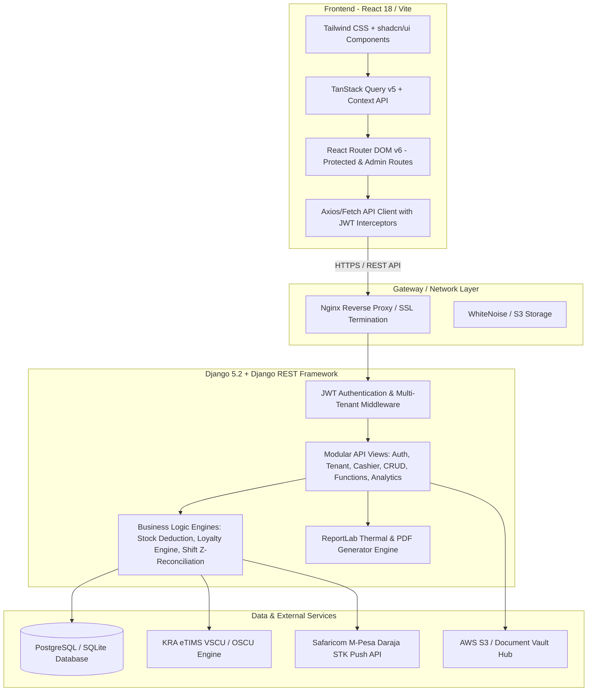

# DukaPOS — System Architecture Documentation

## 1. Architectural Overview

DukaPOS is an enterprise-grade, multi-tenant Point of Sale (POS) and Retail Enterprise Resource Planning (ERP) platform architected specifically for retail establishments in East Africa (dukas, supermarkets, wholesale outlets, mini-marts, and boutique stores). 

The platform follows a decoupled **Client-Server Architecture** with a reactive single-page application (SPA) on the frontend and a stateless RESTful service on the backend, fortified by a multi-tenant scoping layer.



---

## 2. Technology Stack

### Frontend Application
- **Core Framework**: React 18.2.0 (Single Page Application via Vite 6.1)
- **Styling & Design System**: Tailwind CSS 3.4, Radix UI primitives (`@radix-ui`), shadcn/ui component architecture, Lucide Icons (`lucide-react`)
- **State Management & Caching**: TanStack React Query v5 (`@tanstack/react-query`) for remote server-state synchronization and cache invalidation; React Context API for authentication and session persistence.
- **Routing & Guards**: React Router v6 with granular Role-Based Access Control (`ProtectedRoute`, `AdminRoute`, onboarding redirection locks).
- **Hardware & Peripherals**:
  - HTML5 Canvas & `html2canvas` for visual receipt rendering.
  - `JsBarcode` for thermal barcode label generation.
  - Web Audio API for cashier audible feedback (scan success, error tone, cash drawer trigger).
  - Web Print API / Raw ESC/POS formatting for 80mm & 58mm thermal receipt printers.
- **Data Visualization**: Recharts 2.15 for analytics heatmaps, weekly sales velocity, and cashier comparisons.

### Backend Application
- **Runtime & Web Framework**: Python 3.10+ with Django 5.2 LTS and Django REST Framework (DRF) 3.17.
- **Authentication**: Stateless JSON Web Tokens via `djangorestframework-simplejwt` with dual-token lifespan (short-lived access tokens and refresh rotation).
- **Database ORM**: Django ORM supporting PostgreSQL (production) and SQLite (zero-config local dev).
- **Document & PDF Generation**: ReportLab 5.0 for native, high-performance binary ESC/POS receipt generation and business report exports.
- **Storage & Cloud**: AWS S3 integration via `django-storages` and `boto3` for the Receipters Vault Hub.
- **Security & Headers**: `django-cors-headers`, WhiteNoise for static assets, cryptographic password hashing via PBKDF2 with SHA-256.

---

## 3. Multi-Tenancy & Data Isolation Model

DukaPOS implements **Row-Level Shared Database Multi-Tenancy**. Each business or enterprise registered on the platform is assigned a unique `Tenant` record.

### Tenant Resolution Strategy
The backend dynamically resolves the operating tenant for every incoming request using `get_tenant_for_user(request)` through a 4-tier hierarchy:
1. **Explicit Request Header / Query Parameter**:
   - HTTP Header: `X-Tenant-Id: <tenant_id>`
   - Query Parameter: `?tenant_id=<tenant_id>`
2. **User Profile Association**:
   - `request.user.profile.tenant` (the business currently activated for the user).
3. **Superuser / Staff Fallback**:
   - For administrative operations, automatically links or scopes across active tenants.
4. **Zero-State Fallback**:
   - If a business has just completed registration, points to their newly provisioned workspace.

### Scoped Querysets & Data Security
Every business entity inherits or links to a `tenant` foreign key. Scoped queries are enforced via `get_scoped_queryset(request, ModelClass)`:
```python
def get_scoped_queryset(request, ModelClass):
    queryset = ModelClass.objects.all()
    tenant = get_tenant_for_user(request)
    if tenant:
        queryset = queryset.filter(Q(tenant=tenant) | Q(tenant__isnull=True))
    elif not is_admin_user(request.user):
        queryset = queryset.none()
    return queryset
```
This guarantees that **Tenant A cannot view, query, update, or delete records belonging to Tenant B**, even if IDs are guessed or sequential.

---

## 4. Role-Based Access Control (RBAC)

DukaPOS categorizes system actors into three primary personas:

| Capability / Entity | Superadmin / Business Owner | Branch Manager | Cashier / Staff |
|---|:---:|:---:|:---:|
| **POS Checkout & Cart** | Full Access | Full Access | Full Access |
| **Shift Clock-In & Cash Float** | Full Access | Full Access | Self Shift Only |
| **End of Day Z-Report** | Full Access | Full Access | Submit & Blind Count |
| **Product & Price Catalog** | Create, Update, Delete | Read Only / Update | Read Only |
| **Inventory Stock Adjustments** | Full Access | Full Access | Read Only |
| **Purchase Orders & Procurement**| Full Access | Full Access | No Access |
| **Expenses & Cash Flow** | Full Access | Full Access | No Access |
| **Analytics & Gross Profit (COGS)**| Full Access | Branch Scoped | No Access |
| **Staff Scheduling & Invites** | Full Access | Branch Staff | No Access |
| **eTIMS Compliance Settings** | Full Access | Read Only | No Access |
| **Receipters Vault Hub** | Full Access | Scoped | No Access |

### API Guard Implementation
Enforced server-side in `check_entity_permission()`:
- `ADMIN_ONLY_ENTITIES`: `{'BusinessSettings', 'Supplier', 'Expense', 'EmployeeRating', 'EmployeeSchedule', 'Promotion', 'CashFlow', 'PurchaseOrder', 'ShiftAudit', 'User', 'Subscription'}`
- `CASHIER_READ_ONLY_ENTITIES`: `{'Product', 'Customer'}`
- `CASHIER_WRITE_ENTITIES`: `{'Sale', 'Shift', 'MpesaPayment'}`

Non-privileged requests attempting write actions against restricted entities are immediately rejected with HTTP 403 Forbidden.

---

## 5. Directory Structure

```
dukaPOS/
├── client/                     # Frontend Application (React 18 + Vite)
│   ├── public/                 # Static public assets, icons, audio cues
│   ├── src/
│   │   ├── api/
│   │   │   └── apiClient.js    # Centralized HTTP Client, JWT & entity bindings
│   │   ├── components/
│   │   │   ├── barcode/        # Barcode printing dialogs & label generators
│   │   │   ├── dashboard/      # Executive KPI cards, feedback widgets, charts
│   │   │   ├── expenses/       # Expense creation and category modals
│   │   │   ├── inventory/      # Stock tables, bulk updates, restock modal
│   │   │   ├── layout/         # Responsive Sidebar, Navbar, AppLayout wrapper
│   │   │   ├── onboarding/     # 9-Step Onboarding setup wizard components
│   │   │   ├── pos/            # POS Cart, ProductGrid, QuickKeys, HeldOrders, Z-Report
│   │   │   ├── receipters/     # Digital Receipt modal & preview
│   │   │   ├── reports/        # Cashier comparison charts, report insights
│   │   │   └── ui/             # Radix UI + shadcn atomic components (dialog, table, button, tabs)
│   │   ├── hooks/              # Custom React hooks (e.g. use-mobile, use-hotkeys)
│   │   ├── lib/                # AuthContext, QueryClient, formatters, utilities
│   │   ├── pages/              # 30+ Application Pages (POS, Inventory, Reports, Shifts, etc.)
│   │   ├── utils/              # Audio feedback synthesizer, string formatters
│   │   ├── App.jsx             # Route definitions, guards & layout providers
│   │   └── main.jsx            # React root mount
│   ├── package.json
│   └── vite.config.js
│
├── server/                     # Backend Application (Django 5.2 + DRF)
│   ├── api/
│   │   ├── management/         # Django custom management commands
│   │   ├── migrations/         # Database migration history
│   │   ├── views/              # Modular controller/view layer
│   │   │   ├── __init__.py     # Exported view signatures
│   │   │   ├── analytics_views.py # P&L, KPI, Sales velocity, COGS analytics
│   │   │   ├── auth_views.py   # JWT login, register, OTP verification, Google OAuth
│   │   │   ├── cashier_views.py# Staff management, cashier invitation tokens
│   │   │   ├── crud_views.py   # Generic & scoped entity CRUD handlers
│   │   │   ├── function_views.py# Z-report reconciliation, eTIMS sync, PDF generation
│   │   │   ├── helpers.py      # Multi-tenant scoping, stock deduction, loyalty engine
│   │   │   └── tenant_views.py # Tenant onboarding, multi-branch & switching
│   │   ├── models.py           # Relational schema (22 Core Database Models)
│   │   ├── serializers.py      # DRF ModelSerializers & serialization logic
│   │   └── urls.py             # Internal API routing table
│   ├── server/                 # Django project core
│   │   ├── settings.py         # App configuration, security, CORS, database setup
│   │   ├── urls.py             # Root URL routing table (/admin/, /api/)
│   │   └── wsgi.py / asgi.py   # Deployment gateway interfaces
│   ├── manage.py               # Django CLI management script
│   ├── requirements.txt        # Python package dependencies
│   └── Dockerfile              # Containerization definition
│
├── docker-compose.yml          # Local multi-container development environment
├── docker-compose.prod.yml     # Production Docker orchestration
└── package.json                # Root orchestration scripts
```
