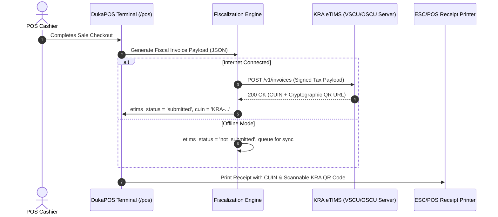
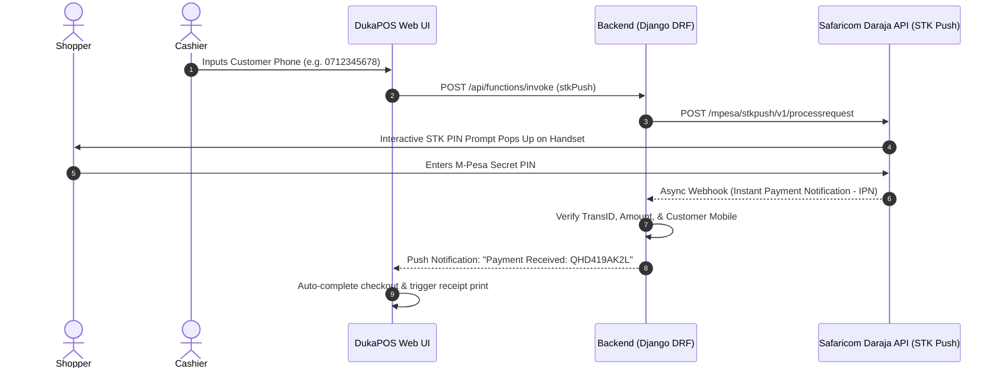

# Chapter 10: Kenyan Regulatory & Payment Integrations

---

## 10.1 Kenya Revenue Authority (KRA) eTIMS Compliance (`/etims`)

Compliance with statutory taxation laws is mandatory for all retail operators in Kenya. DukaPOS embeds direct integration with the **electronic Tax Invoice Management System (eTIMS)**, allowing dukas and supermarkets to fulfill electronic fiscalization requirements without procuring expensive standalone physical ESD hardware.



### 1. eTIMS Data Model & Tax Classifications
Every fiscal invoice transmitted structures items according to KRA VAT categorizations:
- **Class A / B (Standard 16% VAT)**: Standard consumer goods, groceries, household items, cosmetics, electronics (`vatCatCd: 'B'`).
- **Class B / Zero-Rated (0%)**: Specific agricultural inputs, export commodities.
- **Class C / Exempt**: Essential unprocessed foodstuffs (e.g. unflavored milk, maize grains), human medicines.
- **Class E (Special / Fuel 8% VAT)**: Petroleum and related hydrocarbons.

### 2. KRA Fiscal Invoice Structure
```json
{
  "business": {
    "tin": "P051234567Z",
    "name": "Duka Enterprise Limited",
    "address": "Moi Avenue, Nairobi CBD"
  },
  "invoices": [
    {
      "cisInvcNo": "RC2609092145102",
      "cuin": "KRA-ESD-20260909-084920",
      "etimsStatus": "submitted",
      "salesDt": "20260909",
      "cfmDt": "20260909214512",
      "rcptTyCd": "S",
      "pmtTyCd": "05",
      "taxblAmtB": 366.38,
      "taxAmtB": 58.62,
      "totAmt": 425.00,
      "itemList": [
        {
          "itemSeq": 1,
          "itemNm": "Unga Maize Flour 2kg",
          "qty": 2,
          "prc": 180.00,
          "splyAmt": 310.34,
          "vatCatCd": "B",
          "vatAmt": 49.66,
          "totAmt": 360.00
        }
      ]
    }
  ]
}
```

### 3. Compliance Dashboard & Offline Batch Queue (`/etims`)
- **Daily Filing Dashboard**: Displays total invoices filed, total taxable turnover, gross VAT collected, and submission health.
- **Offline Resilience & Re-sync**: If the store loses internet connection during business hours, sales continue uninterrupted with an `etims_status` of `not_submitted`. Once connectivity is restored:
  - Cashiers or managers click **Resubmit Pending Invoices** (or **Resubmit All**) to batch-transmit queued tickets.
- **Statutory Audit Exports**: One-click export of the day's fiscal summary as an official KRA-compliant **JSON** or **CSV** file for filing returns on the KRA iTax portal.

---

## 10.2 Safaricom Lipa Na M-Pesa (Daraja 2.0 API)

Mobile money accounts for over 80% of retail payments in Kenya. DukaPOS eliminates the vulnerability of cashiers manually reading SMS confirmation texts from customer smartphones.



### 1. Supported M-Pesa Channels

| Channel | Identifier Type | Operational Context |
|---|---|---|
| **Lipa Na M-Pesa Buy Goods** | **Till Number** (e.g., `849201`) | Zero-charge transaction fee for retail shoppers. Preferred channel for fast-moving retail counters and dukas. |
| **Lipa Na M-Pesa Paybill** | **Business Shortcode + Account Ref** | Ideal for multi-branch organizations requiring specific account references (e.g., Customer Account No or Branch Code). |
| **M-Pesa Express (STK Push)** | **Daraja 2.0 STK Push** | Directly initiates payment on the customer's device without requiring the shopper to navigate the SIM toolkit menu. |

### 2. Configuration Parameters
To enable automated STK push in production, configure the credentials in `Settings` (`/settings`) or environment variables:
```env
DARAJA_ENVIRONMENT=production # or sandbox
DARAJA_CONSUMER_KEY=your_daraja_consumer_key
DARAJA_CONSUMER_SECRET=your_daraja_consumer_secret
DARAJA_BUSINESS_SHORTCODE=174379 # Paybill or Buy Goods Till
DARAJA_PASSKEY=your_daraja_online_passkey
DARAJA_CALLBACK_URL=https://api.dukapos.co.ke/api/payments/mpesa/callback/
```

### 3. Fallback: Manual Reference Verification
- In instances where a customer pays via their own SIM toolkit or the mobile network experiences high latency:
  - Cashiers select **Manual M-Pesa** in the checkout modal.
  - The cashier enters the Safaricom 10-character reference (e.g. `SHB4X79Q1L`).
  - DukaPOS verifies that the reference has not been previously used in another transaction (preventing duplicate receipt fraud).

---
