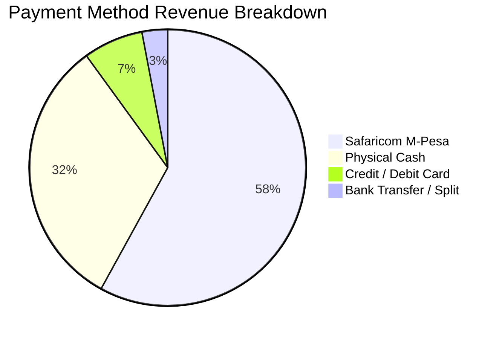
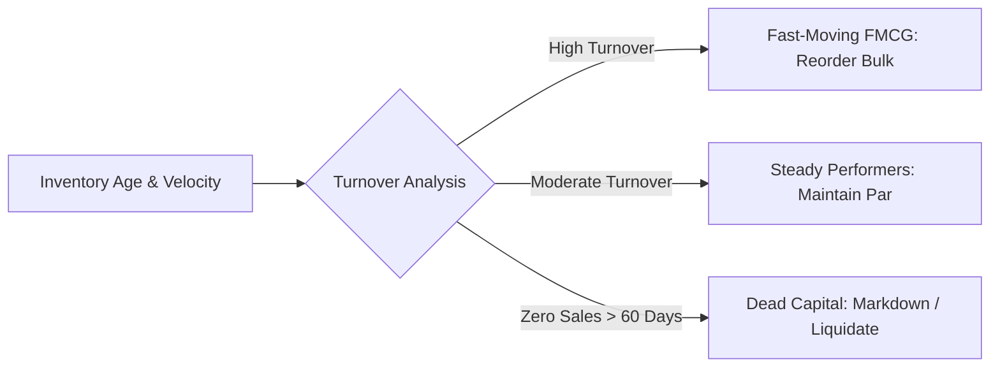

# Chapter 11: Reports, Analytics & Business Intelligence

---

## 11.1 Executive Dashboard (`/`)

The DukaPOS Executive Dashboard provides store owners and leadership teams with a real-time operational flight deck, refreshing live every 10 seconds.

```mermaid
graph TD
    subgraph Real-Time Pulse
        LiveSales[1-Hour Velocity KES]
        ActiveShifts[Open Shift Registers]
        PendingMpesa[Pending STK Callbacks]
    end

    subgraph Financial Core
        Rev[Today's Revenue]
        COGS[Cost of Goods Sold]
        Gross[Gross Profit & Margin %]
        Exp[Operating Expenses]
        Net[Net Take-Home Profit]
    end

    subgraph Inventory & Operations
        LowStock[Critical Stock Out Alerts]
        Heatmap[Hourly Sales Peak Heatmap]
        CashierLeaderboard[Cashier Velocity Leaderboard]
    end

    LiveSales --> PulseCard[Executive Control Deck]
    ActiveShifts --> PulseCard
    PendingMpesa --> PulseCard
    Rev --> Financials[Financial Performance Grid]
    Gross --> Financials
    Net --> Financials
    LowStock --> Operations[Operations & Action Center]
    Heatmap --> Operations
    CashierLeaderboard --> Operations
```

### 1. Live Status & Pulse Indicators
- **1-Hour Real-Time Velocity**: Instant gross revenue processed across all active checkouts over the past 60 minutes.
- **Active Shift Counters**: Count of registers currently logged in and trading.
- **Pending M-Pesa Verifications**: Real-time monitor of in-flight STK prompts awaiting customer PIN input.
- **Void & Refund Watchdog**: High-priority alert highlighting any cashier voids or mid-day manager overrides.

### 2. Financial KPI Metric Row
- **Gross Revenue**: Total shelf turnover rung across all tender channels.
- **Total Cost of Goods Sold (COGS)**: Wholesale cost of items sold:
  $$\text{COGS} = \sum (\text{Quantity Sold} \times \text{Product Cost Price})$$
- **Gross Profit & Margin (%)**:
  $$\text{Gross Margin (\%)} = \left( \frac{\text{Gross Revenue} - \text{COGS}}{\text{Gross Revenue}} \right) \times 100$$
- **Net Operating Profit**: Gross profit minus recorded store expenses (rent, wages, utilities, transport).
- **Average Basket Size**: Average spending per shopping ticket ($\text{Revenue} / \text{Transactions}$).

### 3. Action Center & AI Daily Brief
- Highlights urgent inventory bottlenecks (items with $< 3$ units remaining).
- Automated daily executive summary identifying top sales drivers and abnormal expense spikes.
- **Ask Your Business AI Widget**: Allows owners to query natural-language retail questions (e.g. *"What was our best-selling beverage this week?"*).

---

## 11.2 Standard Business Reports (`/reports`)

The Standard Reports module generates essential accounting and managerial reports across customizable periods (*Today, Last 7 Days, This Week, This Month, Last 30 Days*).

### 1. Daily Sales Summary & Z-Reports
- **Consolidated Daily Z-Report**: Generated at the close of trading, aggregating total gross turnover, total discounts granted, net VAT liability, and tender channel totals.
- **Cashier Sales Performance Comparison**: Multi-bar charts comparing throughput and revenue per cashier.

### 2. Category & Department Breakdown
- Visual donut and pie charts displaying revenue contribution by product department (*Groceries, Dairy, Beverages, Snacks, Bakery, Household*).
- Highlights fast-moving categories that drive customer foot-traffic versus high-margin categories that drive net profit.

### 3. Tax Liability & KRA Filing Report
- Quantifies total standard-rated (16% VAT) sales versus exempt and zero-rated turnover.
- Provides exact figures required for filing monthly KRA VAT-3 returns.

---

## 11.3 Advanced Business Intelligence (`/advanced-reports`)

The Advanced Business Intelligence module equips enterprise retail managers with predictive insights and balance-sheet level auditing.

### 1. Executive Profit & Loss (P&L) Statement
A formal accounting view calculating store profitability over arbitrary date ranges:
$$\begin{aligned}
\text{Gross Revenue} & \\
\text{less: Cost of Goods Sold (COGS)} & \longrightarrow \mathbf{\text{Gross Profit}} \\
\text{less: Operating Expenses (OPEX)} & \\
\quad \text{Rent \& Rates} & \\
\quad \text{Staff Salaries \& Wages} & \\
\quad \text{Utilities \& Power} & \\
\quad \text{Repairs, Maintenance \& Logistics} & \longrightarrow \mathbf{\text{Operating Profit (EBITDA)}} \\
\text{less: Tax Liabilities} & \longrightarrow \mathbf{\text{Net Income}}
\end{aligned}$$

### 2. Inventory Turnover & Dead Stock Detection
- **Turnover Velocity**: Identifies how many times average inventory is sold and replaced over a specified period.
- **Dead Stock Warning**: Flags products sitting in storage or shelves for more than 45–60 days with zero sales. Enables proactive price markdowns or promotions before expiry dates approach.

### 3. Export & Archival Capabilities
- All summary tables, line-item audits, and P&L statements support 1-click export to formatted `.csv` spreadsheets for ingestion into external accounting suites (QuickBooks, Sage, Xero).

---
