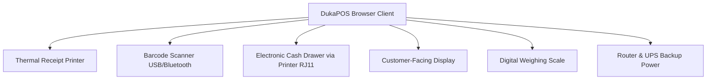

# Chapter 12: Hardware Setup & Peripherals

---

## 12.1 Supported Hardware Specifications

DukaPOS is a **software-only** platform, meaning it operates on standard commercial-off-the-shelf (COTS) retail hardware. Businesses are free to pair DukaPOS with any compatible ESC/POS-capable thermal printer, keyboard-wedge barcode scanner, or RJ11 cash drawer.

---

## 12.2 Essential Hardware (Critical Tier)

### 1. POS Terminal Device
DukaPOS runs inside any modern web browser (Chrome, Edge, Firefox) — no local software installation needed:
- **All-in-One Touchscreen POS Terminal**: 15" commercial touchscreen integrated unit (e.g., Sunmi T2, PAX A920 Pro, Hisense HK760).
- **Tablet (Android / iPad)**: 10"+ screen recommended for cashier comfort; mount with a rotating arm for customer to face the checkout summary.
- **Laptop or Desktop PC**: Suitable for high-throughput supermarket lanes with full keyboard shortcuts.
- **Smartphone**: Suitable for pop-up market stalls or mobile hawker setups.

| Device | Estimated Cost | Best For |
|---|:---:|---|
| All-in-One POS Terminal | KES 20,000 – 80,000 | Established retail stores |
| 10" Android Tablet | KES 10,000 – 35,000 | Dukas, pharmacies, boutiques |
| Laptop/Desktop | KES 30,000 – 70,000 | Backroom or high-volume checkout |
| Smartphone | KES 8,000 – 20,000 | Hawkers, market stalls, field agents |

---

### 2. Internet Connectivity (Critical)
DukaPOS requires a stable internet connection for M-Pesa STK Push callbacks, KRA eTIMS transmission, and cloud data synchronization:

| Connection Type | Estimated Cost | Notes |
|---|:---:|---|
| Safaricom Fibre / Faiba Home Broadband | KES 4,000 – 15,000/mo | Most reliable for fixed store location |
| 4G Business Modem (Safaricom / Airtel / Telkom) | KES 3,000 – 8,000/mo | Ideal failover or primary rural connection |
| Mobile Hotspot (Smartphone Tethering) | KES 1,000 – 4,000/mo | Emergency backup only |

---

## 12.3 Thermal Printer Setup (80mm & 58mm ESC/POS)

DukaPOS generates ESC/POS compatible binary print jobs delivered via the browser's native **Web Print** interface to your locally-configured printer.

### Supported Connection Types
- **USB Direct (Recommended)**: Zero-latency wired connection via USB cable to the POS device.
- **Bluetooth**: Cordless connection for mobile setups (Bluetooth Class 2, BLE 4.0+).
- **Ethernet / LAN**: Network-shared printer for multi-lane setups where multiple cashier desks share one printer.

### Supported Paper Roll Widths
| Roll Width | Use Case | Max Characters per Line |
|:---:|---|:---:|
| **58mm** | Mobile printers, compact dukas, pharmacy counters | 32 characters |
| **80mm** | Standard supermarket and retail store receipts | 48 characters |

### Recommended Printer Models (Kenya-Sourced)
| Brand | Model | Interface | Approx. Cost |
|---|---|---|:---:|
| **Xprinter** | XP-Q80I | USB + Ethernet | KES 4,500 |
| **Rongta** | RP80USE | USB + Serial + Ethernet | KES 5,500 |
| **Epson** | TM-T82II | USB + Serial | KES 12,000 |
| **Sunmi** | Cloud Printer V2 | Bluetooth + USB | KES 8,000 |
| **iMin** | Swan 1 | Bluetooth | KES 6,500 |

### Printer Configuration Steps
1. Connect the printer to the POS device via USB or pair via Bluetooth.
2. Install the manufacturer's native print driver on Windows/macOS/Linux.
3. In the browser, navigate to **Settings → Receipt Printer**.
4. Select the printer name from the system print dialog.
5. Print a test receipt to confirm correct paper width and character encoding (UTF-8).

---

## 12.4 Barcode Scanners (1D Laser & 2D QR/Image)

DukaPOS uses the **keyboard wedge emulation** protocol for all scanners — meaning no custom drivers or APIs are required. The scanner simply simulates keyboard keystrokes terminated by a carriage return (`Enter`).

### Supported Barcode Symbologies
- **1D Barcodes**: EAN-13 (standard retail), EAN-8, UPC-A, UPC-E, Code 128, Code 39, Code 93, ITF-14.
- **2D Barcodes / QR Codes**: QR Code, Data Matrix, PDF-417 (for KRA eTIMS verification QR codes on receipts).

### Recommended Scanner Models
| Brand | Model | Type | Interface | Approx. Cost |
|---|---|---|---|:---:|
| **Honeywell** | Voyager 1250G | 1D Laser | USB | KES 5,500 |
| **Symbol / Zebra** | DS2208 | 2D Image | USB | KES 9,000 |
| **Netum** | NT-1228BL | 1D/2D | USB + Bluetooth | KES 3,500 |
| **Datalogic** | QuickScan QBT2131 | 2D | Bluetooth | KES 12,000 |

### Scan Mode Operation
When **Scan Mode** is active on the POS screen:
1. The product search input receives focus automatically.
2. Any barcode scan populates the input field with the EAN/SKU string.
3. The `Enter` carriage return fires the add-to-cart action.
4. A success chime plays and the cart quantity increments.
5. The input field clears automatically, ready for the next scan.

---

## 12.5 Electronic Cash Drawers (RJ11 / RJ12 24V Trigger)

DukaPOS sends the industry-standard ESC/POS drawer-kick pulse sequence (`ESC p 0 25 250` — byte values `27, 112, 0, 25, 250`) via the receipt printer's RJ11 or RJ12 port.

### How the Cash Drawer Opens
1. Cashier completes a **Cash** payment in the POS terminal.
2. Receipt is generated and dispatched to the thermal printer.
3. The printer simultaneously fires the 24V electrical pulse through the cash drawer cable.
4. The drawer solenoid unlocks and the spring-ejected tray pops open instantly.
5. Cashier counts and deposits the customer's tendered banknotes.

> [!NOTE]
> Cash drawers **only open automatically for cash transactions**. M-Pesa, card, and bank transfer payments do not trigger the drawer, preventing unauthorized access to physical currency.

### Recommended Cash Drawer Models
| Model | Size | Bill Slots | Coin Slots | Approx. Cost |
|---|:---:|:---:|:---:|:---:|
| **HS-3000** | 33cm | 4 | 8 | KES 4,000 |
| **Tysso PCR-210** | 35cm | 5 | 8 | KES 5,500 |
| **APG Vasario** | 40cm | 5 | 8 | KES 9,000 |
| **Epson OT-DRW01** | 40cm | 5 | 8 | KES 11,000 |

---

## 12.6 Optional Hardware: Customer-Facing Displays, Scales & UPS

### Customer-Facing Displays (CFD)
- **LCD 2-Line Pole Display**: Shows item name, unit price, and running cart total to the customer.
- **Tablet as Secondary Screen**: Mount a spare Android tablet on a stand facing the customer. Display a browser window on the POS confirmation page.
- **VFD Pole Display (Vacuum Fluorescent)**: High-brightness display visible in brightly-lit store environments.

### Digital Weighing Scales
For stores selling produce, grains, or bulk items by kilogram:
- **USB-Connected Scale**: Directly interfaces with the POS terminal; weight is sent as a keyboard input automatically.
- **Barcode-Printing Scale**: Prints pre-weighed barcode labels that can be scanned at the checkout counter.

### UPS Battery Backup
Kenya Power (KPLC) supply interruptions are frequent in retail zones. A UPS protects against mid-sale data loss:
| UPS Rating | Backup Duration | Recommended For |
|:---:|:---:|---|
| **600VA** | 20–30 minutes | Single cashier tablet setup |
| **1000VA** | 45–60 minutes | Desktop POS + printer + scanner |
| **1500VA** | 90–120 minutes | Multi-device store with router & NAS |

---

## 12.7 Hardware Package Recommendations

Based on store size and budget, DukaPOS recommends the following starter bundles:

| Package | Total Est. Cost | Components Included | Ideal For |
|---|:---:|---|---|
| **Basic Setup** | KES 15,000 – 40,000 | Smartphone/Tablet + Bluetooth Scanner + Paperless Receipts | Hawkers, market stalls, pop-up stores |
| **Standard Setup** | KES 50,000 – 90,000 | All-in-One Terminal + USB Scanner + 80mm Thermal Printer + Cash Drawer + Card Reader | Single-register dukas, pharmacies, boutiques |
| **Complete Setup** | KES 90,000 – 200,000 | POS Terminal + Customer Display + 2D Scanner + Receipt + Label Printer + Cash Drawer + PIN Pad + Scale + UPS | Multi-lane supermarkets, wholesale outlets |

---
