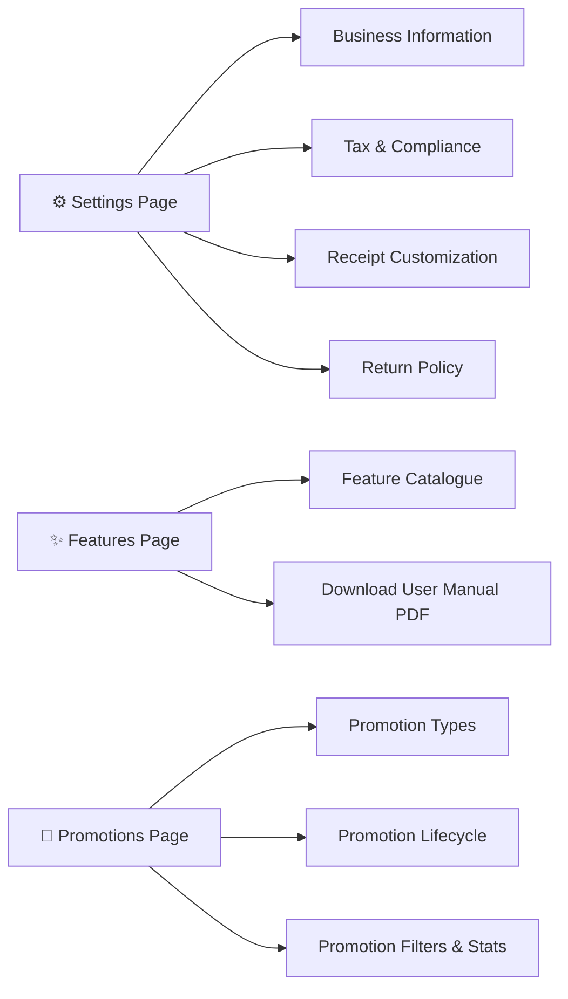
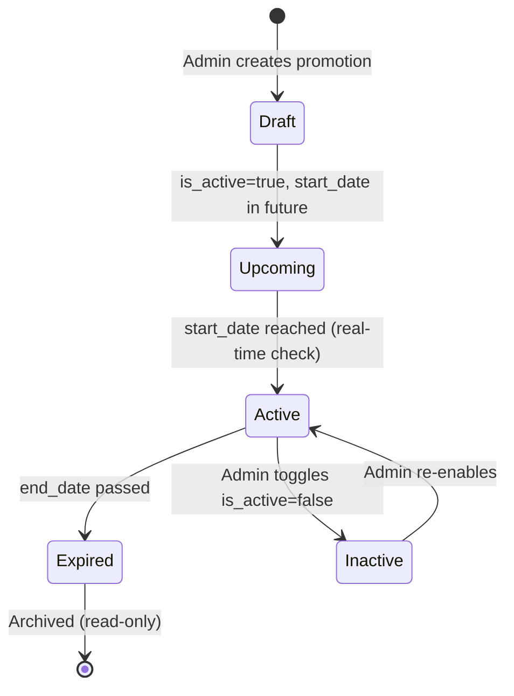

# Chapter 13: System Settings & Customization

---

## 13.1 Overview

DukaPOS provides a centralized configuration hub accessible to **Admin** users under the **Settings** route (`/settings`). Configuration is split into four focused panels: Business Information, Tax & Compliance, Receipt Customization, and Return Policy. Adjacent to settings is the **Features** showcase (`/features`) and the **Promotions** engine (`/promotions`).



---

## 13.2 Business Settings

Accessed via **Admin Sidebar → Settings** (route: `/settings`). All settings are persisted to the `BusinessSettings` model on the backend via a **create-or-update** API call. Only one `BusinessSettings` record is maintained per tenant.

### Business Information Panel
| Field | Type | Example | Notes |
|---|---|---|---|
| **Business Name** *(required)* | Text | `Naivas Supermarket` | Appears on every printed receipt header |
| **Business Type** | Radio tile | `sme` | Options: `individual`, `sme`, `merchant`, `enterprise` |
| **Phone Number** | Text | `+254 712 345 678` | Printed on receipts; used for customer callbacks |
| **Email** | Text | `info@business.co.ke` | Appears in digital receipt delivery |
| **Address** | Text | `Moi Avenue, Nairobi` | Printed on receipts below business name |

#### Business Type Descriptions
| Type ID | Label | Description |
|---|---|---|
| `individual` | Individual | Solo trader / freelancer |
| `sme` | SME | Small & medium enterprise |
| `merchant` | Merchant | Retail / wholesale operation |
| `enterprise` | Enterprise | Large multi-department organisation |

---

### Tax & Compliance Panel
| Field | Default | Notes |
|---|:---:|---|
| **KRA PIN** | — | Format: `P051234567A`. Printed on every receipt; embedded in KRA eTIMS submission payload |
| **Default VAT Rate (%)** | `16` | Kenya standard VAT rate. All shelf prices are VAT-inclusive; VAT is extracted for display |
| **Currency** | `KES` | Displayed as currency prefix on all amounts throughout the system |

> [!IMPORTANT]
> The KRA PIN is mandatory for eTIMS fiscalization. Invoices cannot be submitted to the Kenya Revenue Authority without a valid PIN on file. See Chapter 10 for full eTIMS compliance documentation.

---

### Receipt Customization Panel
Admins can personalize the footer text that appears at the bottom of every printed and digital receipt.

| Field | Default Value | Purpose |
|---|---|---|
| **Receipt Footer Message** | `Thank you for shopping with us!` | Friendly closing message; can include a promotion teaser, social media handle, or loyalty program reminder |

**Example custom footers:**
```
Follow us on Instagram @DukaKe for weekly offers!
Karibu tena. Loyalty points earned on this purchase.
Returns accepted within 7 days with original receipt.
```

---

### Return Policy Panel
The return policy text is surfaced to cashiers within the POS interface when a refund is requested. It can also optionally print on receipts.

| Field | Placeholder Example |
|---|---|
| **Policy Terms** | *Items can be returned within 7 days of purchase with original receipt. Perishable goods are non-refundable. Exchanges accepted within 14 days for defective products.* |

> [!TIP]
> Keep the return policy concise and in both **English** and **Swahili** to accommodate all customers. Clear policies reduce cashier-customer disputes at the counter.

---

### Saving Settings
Click **Save Settings** at the bottom of the page. The button is disabled if `business_name` is empty. On success a toast notification confirms: *"Settings saved successfully"*.

```
[ 💾 Save Settings ]
```

Changes take effect immediately across all active cashier sessions — no restart required.

---

## 13.3 Features Showcase

The **Features** page (`/features`) is a reference catalogue open to both **Cashiers** and **Admins** (it is a `SharedRoute`). It provides a searchable, visual breakdown of every capability in DukaPOS — useful during onboarding, sales demos, or staff training.

### Feature Categories
| Category | Icon | Key Features |
|---|---|---|
| **Speed & Efficiency** | ⚡ | Quick Keys Panel, Barcode Scanner, F1–F9 Keyboard Shortcuts, Hold/Recall, Favorites Bar |
| **Manager Controls** | 🛡️ | Approval Workflow, Shift Audits, Employee Ratings, Access Control |
| **Customer Experience** | 👥 | Loyalty Program (Bronze/Silver/Gold/Platinum), Purchase History, Digital Receipts, Customer Profiles |
| **Inventory Intelligence** | 📦 | Real-time Stock Alerts, Auto Stock Deduction, Bulk CSV Import, Barcode Printing, Category Management |
| **Analytics & Reporting** | 📊 | Sales Dashboard, Hourly Analytics, Top Products, Payment Breakdown, Cashier Comparison |
| **Payments** | 💳 | Multi-payment (Cash/M-Pesa/Card/Bank), Split Payments, M-Pesa Integration, Auto Change Calculation |
| **Compliance** | 🌐 | KRA eTIMS Auto-Submission, CUIN Generation, 16% VAT Auto-Applied, Full Audit Trail |

### Download User Manual PDF
A **Download PDF** button on the Features page calls the backend function `generateUserManualPDF` which returns a binary PDF document downloaded as:

```
DukaPOS_User_Manual_YYYY-MM-DD.pdf
```

This PDF is suitable for printing and distributing to new staff members as a quick-start offline reference.

---

## 13.4 Promotions & Discount Campaigns

The **Promotions** page (`/promotions`) is an **Admin-only** route for creating and managing time-bound promotional campaigns. Active promotions are automatically applied at the POS checkout based on configured rules.

### Promotion Status Dashboard

Four summary cards give a real-time overview of the campaign portfolio:

```
┌──────────────────┬──────────────────┬──────────────────┬──────────────────┐
│  Active          │  Upcoming        │  Expired         │  Total           │
│  ██ 3            │  ██ 2            │  ██ 7            │  ██ 12           │
│  Currently       │  Scheduled       │  Past end        │  All campaigns   │
│  running         │  to start        │  date            │                  │
└──────────────────┴──────────────────┴──────────────────┴──────────────────┘
```

### Promotion Status Logic
A promotion's effective status is calculated in real time by comparing the current timestamp against `start_date` and `end_date`:

| Status | Condition |
|---|---|
| **Active** | `is_active = true` AND `start_date ≤ now ≤ end_date` |
| **Upcoming** | `is_active = true` AND `start_date > now` |
| **Expired** | `end_date < now` OR `is_active = false` |

---

### Promotion Types

DukaPOS supports four promotion mechanics:

| Type ID | Label | Description | Config Fields |
|---|---|---|---|
| `percentage_discount` | **Percentage Discount** | Reduces cart/item price by a % | `discount_value` (e.g. `15` = 15% off) |
| `fixed_discount` | **Fixed Amount Discount** | Reduces price by a flat KES amount | `discount_value` (e.g. `200` = KES 200 off) |
| `buy_x_get_y` | **Buy X Get Y Free** | Customer gets Y free items when buying X | `buy_quantity`, `get_quantity` |
| `bundle` | **Bundle Deal** | Multi-item grouped pricing | `discount_value`, `minimum_purchase` |

---

### Creating a Promotion

Navigate to **Promotions → New Promotion** to open the campaign creation dialog:

```
┌─────────────────────────────────────────────────────────────┐
│  Create New Promotion                                        │
├─────────────────────────────────────────────────────────────┤
│  Promotion Name *       [Summer Sale 2025             ]     │
│  Description            [20% off all beverages        ]     │
│                                                             │
│  Promotion Type *       [▼ Percentage Discount        ]     │
│  Status                 ● Active  ○ Inactive                │
│                                                             │
│  Discount Value (%)     [  20  ]                            │
│  Minimum Purchase (KES) [   0  ]                            │
│                                                             │
│  Start Date             [2025-06-01  10:00]                 │
│  End Date               [2025-06-30  23:59]                 │
│                                                             │
│            [ Cancel ]        [ Create Promotion ]           │
└─────────────────────────────────────────────────────────────┘
```

### Promotion Form Fields
| Field | Type | Notes |
|---|---|---|
| `name` *(required)* | Text | Internal campaign identifier displayed in the promotions table |
| `description` | Text | Short summary shown to admins |
| `type` *(required)* | Select | One of the four promotion types |
| `discount_value` | Decimal | Percentage (%) or fixed KES amount depending on type |
| `buy_quantity` | Integer | Number of items customer must buy (for Buy X Get Y) |
| `get_quantity` | Integer | Number of free items customer receives (for Buy X Get Y) |
| `start_date` | DateTime | Campaign go-live timestamp (`YYYY-MM-DD HH:mm`) |
| `end_date` | DateTime | Campaign expiry timestamp; defaults to 7 days from creation |
| `is_active` | Toggle | Manually enable or disable a campaign |
| `minimum_purchase` | Decimal | Minimum cart value in KES before promotion applies |

---

### Promotion Lifecycle



---

### Filtering & Searching Promotions

The promotions table supports multi-dimensional filtering:

| Filter | Options |
|---|---|
| **Search** | Free-text search across `name` and `description` |
| **Status** | All / Active / Upcoming / Expired |
| **Promotion Type** | All / Percentage Discount / Fixed Discount / Buy X Get Y / Bundle |

Results are paginated at 10 items per page with first/previous/next/last navigation controls.

---

### Editing & Deleting Promotions

- **Edit**: Click the ✏️ (Edit) icon on any promotion row to reopen the form pre-populated with existing values.
- **Delete**: Click the 🗑️ (Delete) icon to permanently remove the promotion. This action cannot be undone.
- **Toggle Active**: Use the toggle switch directly on the promotion card to quickly pause or resume a campaign without editing.

> [!WARNING]
> Deleting an active promotion immediately removes its discount rules from the POS engine. Cashiers mid-transaction may experience unexpected price changes if a promotion is deleted while their cart is open.

---

## 13.5 Features & Settings Quick Reference

| Setting | Location | Who Can Change | Effect |
|---|---|---|---|
| Business Name | Settings → Business Info | Admin | Receipt header, KRA submission label |
| KRA PIN | Settings → Tax & Compliance | Admin | eTIMS invoice identity; printed on receipt |
| Default VAT Rate | Settings → Tax & Compliance | Admin | VAT extraction on all future sales |
| Currency | Settings → Tax & Compliance | Admin | Currency prefix on all UI amounts |
| Receipt Footer | Settings → Receipt | Admin | Bottom of every thermal receipt printout |
| Return Policy | Settings → Return Policy | Admin | Displayed to cashiers on refund screens |
| Promotions | Promotions Page | Admin | Applied automatically at POS checkout |
| Feature Guide | Features Page | All Staff | Reference-only; no system changes |
