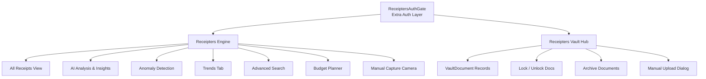
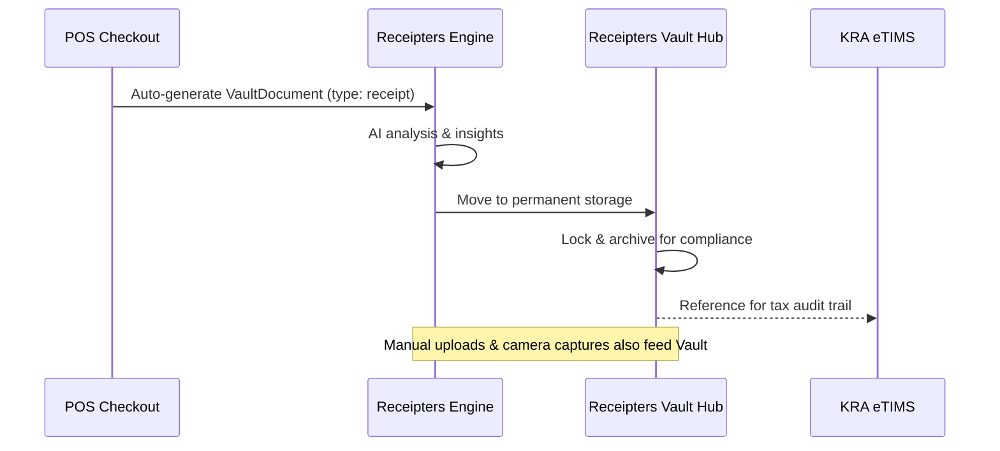

# Chapter 14: Superadmin & Platform Engines

---

## 14.1 Overview

DukaPOS includes two advanced administrative modules accessible only to Superadmin-level users: **Receipters Engine** and **Receipters Vault Hub**. Both are protected by a special `ReceiptersAuthGate` component that adds an extra layer of authentication on top of the standard JWT login.

These pages live under the `/admin/` path prefix and are **not visible** in the standard Admin sidebar. They are accessed directly or via platform-level navigation.

| Module | Route | Purpose |
|---|---|---|
| **Receipters Engine** | `/admin/receipters-engine` | AI-powered receipt intelligence, capture, analytics, budgeting |
| **Receipters Vault Hub** | `/admin/receipters-vault` | Secure long-term storage and retrieval of financial documents |



---

## 14.2 Receipters Engine

**Route:** `/admin/receipters-engine`

### Purpose
The Receipters Engine is an AI-powered receipt intelligence and analytics command center. It aggregates all POS checkout receipts stored as `VaultDocument` records, enriches them with AI-driven insights, flags anomalies, and provides a budget planning tool.

### Authentication Gate
Both admin modules require authentication via **`ReceiptersAuthGate`**, which wraps the entire page. Users who have not separately authenticated this gate are shown an access-denied prompt even if they are logged in as Admin.

---

### 14.2.1 Header Controls
The Receipters Engine header displays real-time counters and action buttons:

```
RECEIPTERS ENGINE  — AI-powered receipt intelligence & analytics
  ● 142 analyzed    ● 3 insights
  [ Export ]  [ View Guide ]  [ Download PDF ↓ ]
```

| Action | Behaviour |
|---|---|
| **Export** | Downloads all engine data as a CSV file |
| **View Guide** | Opens the built-in usage guide |
| **Download PDF** | Generates and downloads a full PDF report of all insights |

---

### 14.2.2 Navigation Tabs

The engine has two top-level view modes (chip buttons):

| Tab | Description |
|---|---|
| **All Receipts** | Displays all `VaultDocument` records of type `receipt` |
| **My Receipts** | Filters to receipts generated by the current logged-in user |

Below the view mode, nine **filter/tool chips** refine the workspace:

| Filter Chip | Icon | Description |
|---|---|---|
| **AI Analysis** | ⚡ Activity | AI-generated insights cards (positive trends & anomalies) |
| **Anomaly Detection** | 🛡️ ShieldAlert | Flags unusual spending patterns, duplicate transactions, outlier amounts |
| **Trends** | 📈 TrendingUp | Time-series analysis of receipt volumes and spend patterns |
| **Real-time** | ⚡ Zap | Live receipt feed as POS checkouts complete |
| **Search** | 🔍 Search | Advanced multi-field search form |
| **Categorize** | 🏷️ Tag | Tag and categorize receipt records by type |
| **Alerts & Monitoring** | 🔔 Bell | Configure spend threshold alerts |
| **Manual Capture** | 📷 Camera | Take or upload a photo of a physical receipt |
| **Budget** | 💵 Banknote | Budget planner and session archiver |

---

### 14.2.3 AI Analysis Panel
When the **AI Analysis** chip is selected, the engine calls `/receipters/engine-stats` which returns an `insights` array. Each insight card displays:

```
┌──────────────────────────────────────────┐
│ 📈  Top Selling Category               │
│ Beverages account for 42% of all        │
│ receipts in the last 30 days.           │
│                          [ TREND ]      │
└──────────────────────────────────────────┘
```

| Field | Description |
|---|---|
| `title` | Insight name (e.g., "Top Selling Category") |
| `description` | Detailed explanatory text |
| `impact` | `positive` (green TrendingUp icon) or `negative` (amber AlertTriangle icon) |
| `type` | Insight category badge: `TREND`, `ANOMALY`, `FORECAST`, etc. |

---

### 14.2.4 Advanced Search Panel
When the **Search** chip is active, a 9-field advanced search form appears:

| Field | Type | Example |
|---|---|---|
| **Product** | Text | `Coca-Cola 500ml` |
| **Min Price** | Number | `50` |
| **Max Price** | Number | `5000` |
| **City** | Text | `Nairobi` |
| **Zipcode** | Text | `00100` |
| **Store ID** | Text | Branch identifier |
| **From Date** | Date | `2025-01-01` |
| **To Date** | Date | `2025-03-31` |
| **Payment** | Text | `M-Pesa`, `Cash`, `Card` |

---

### 14.2.5 Manual Capture Panel

The **Manual Capture** tool uses the device's native camera (via `navigator.mediaDevices.getUserMedia`) to photograph physical paper receipts and submit them to the Vault.

```
┌──────────────────────────────────────────────────────────┐
│  📷  Manual Capture                                      │
│  Take or upload a photo of a receipt.                    │
│                                                          │
│   ┌──────────────────────────────────────────────────┐  │
│   │                                                  │  │
│   │   [ 📷 Camera Icon ]                            │  │
│   │   Capture or upload a receipt                   │  │
│   │   Take a photo or choose an existing image      │  │
│   │                                                  │  │
│   │   [ 📷 Take Photo ]   [ ⬆ Upload Image ]        │  │
│   └──────────────────────────────────────────────────┘  │
│                                                          │
│   Tips: Flat surface · All text visible · No shadows     │
│   Formats: JPG, PNG, HEIC, WEBP                          │
└──────────────────────────────────────────────────────────┘
```

**Workflow:**
1. Click **Take Photo** → device camera activates with a live video viewfinder overlay showing corner alignment guides.
2. Click **Capture Photo** → frame is captured as JPEG at 92% quality via HTML5 Canvas.
3. Preview is shown with **Retake** and **Send to Vault** options.
4. Alternatively, click **Upload Image** to pick an existing image file (JPG, PNG, HEIC, WEBP).
5. **Send to Vault** dispatches the image to the Receipters Vault Hub with a toast confirmation.

---

### 14.2.6 Budget Planner

The **Budget** chip opens a three-sub-tab budget management tool:

#### Sub-tabs
| Sub-tab | Purpose |
|---|---|
| **Budget Note** | Free-text description or title for the current budget session |
| **Budget Items** | Line-item table: Item name, Quantity, Price/Unit, calculated Total |
| **Archived Budgets** | Read-only history of all previously saved budget sessions |

#### Budget Items Table
Each row is computed as:

$$\text{Row Total} = \text{Qty} \times \text{Price/Unit (KES)}$$

$$\text{Session Total} = \sum_{i=1}^{n} \text{Qty}_i \times \text{Price}_i$$

| Column | Example |
|---|---|
| Item | `Unga 2kg` |
| Qty | `10` |
| Price/Unit | KES `120.00` |
| Total | KES `1,200.00` |

Rows support inline **Edit** (pencil icon) and **Delete** (trash icon) actions.

#### Saving & Archiving
When you click **Save**:
1. The entire item list, session note, total, and phone number are packaged into a budget object.
2. The object is pushed to the **Archived Budgets** list with a timestamp.
3. The working items list is cleared, ready for a new session.

Archived budgets display: session note, save timestamp, item count, phone number, and grand total. They cannot be edited after archiving.

---

### 14.2.7 Receipts List
Below all filter panels, the full receipts list is always visible:

| Column | Source |
|---|---|
| Reference / Title | `receipt.reference_number` or `receipt.title` |
| Payment Method Badge | `receipt_data.payment_method` (green for Cash, blue for M-Pesa/Card) |
| Date & Time | `receipt.created_at` formatted as "Jan 15, 2025 · 10:45 AM" |
| Item Count | Length of `receipt_data.items` array |
| Cashier | `receipt.stored_by_name` |
| Item Summary | Comma-joined product names with quantities |
| Amount | `KES {receipt.amount}` right-aligned |

Each row has three action buttons: **View**, **Download**, and **Print** — all open the `ReceiptModal` overlay showing the full formatted receipt.

---

## 14.3 Receipters Vault Hub

**Route:** `/admin/receipters-vault`

### Purpose
The Receipters Vault Hub is a **secure digital filing system** for storing, organising, locking, and archiving financial documents. Documents can originate from the POS checkout (auto-generated receipts), the Receipters Engine (captured images), expense records, or manual uploads.

---

### 14.3.1 Vault Dashboard Summary

Three metric cards give an instant overview:

```
┌──────────────────┬──────────────────┬──────────────────┐
│  🛡️ Active       │  🔒 Locked       │  📁 Archived     │
│     28           │     5            │     14           │
│  Active docs     │  Access          │  Off the main    │
│  in vault        │  restricted      │  view            │
└──────────────────┴──────────────────┴──────────────────┘
```

| Metric | Calculation |
|---|---|
| **Active Documents** | `documents.filter(d => !d.is_archived).length` |
| **Locked** | `documents.filter(d => d.is_locked).length` |
| **Archived** | `documents.filter(d => d.is_archived).length` |

---

### 14.3.2 Document Types
The Vault supports the following `document_type` classifications:

| Type | Use Case |
|---|---|
| `invoice` | Supplier invoices, service invoices |
| `receipt` | POS checkout receipts, purchase receipts |
| `contract` | Supplier or employment contracts |
| `report` | Financial reports, audit summaries |
| `statement` | Bank statements, M-Pesa statements |
| `expense` | Expense vouchers (highlighted in amber) |
| `other` | Miscellaneous financial documents |

---

### 14.3.3 Document Sources
The Vault tracks where each document originated:

| Source Group | Options |
|---|---|
| **POS Generated** | `POS Checkout`, `POS Expense` |
| **Imported** | `Receipters Engine`, `Transactions` |
| **Manual** | `Manual Upload`, `Unknown` |

---

### 14.3.4 Document Record Fields
Each `VaultDocument` record displays:

| Field | Description |
|---|---|
| **Title** | Document name (bold) |
| **Document Type** | Badge (blue for standard, amber for expenses) |
| **Source** | Origin system label |
| **Lock Icon** | 🔒 shown if `is_locked = true` |
| **Reference Number** | Unique doc reference (`Ref: INV-2025-001`) |
| **Stored By** | Staff member who uploaded the document |
| **Date** | `created_at` formatted date |
| **Category** | Uppercase category tag (e.g., `GENERAL`, `PROCUREMENT`) |
| **Amount** | `KES {amount}` right-aligned |

---

### 14.3.5 Document Actions
Each document row has four action buttons:

| Action | Icon | Behaviour |
|---|---|---|
| **View** | 👁️ Eye | For `receipt`/`invoice` types: calls `/receipters/vault-sign` to generate a signed S3 URL, then opens the file in a new tab. For other types: opens a detail dialog. |
| **Lock / Unlock** | 🔒 Lock | Calls `PUT /entities/VaultDocument/{id}` with `{ is_locked: true/false }`. Locked documents cannot be edited or deleted by non-superadmin users. |
| **Archive** | 📦 Archive | Moves the document off the main active list into archived view |
| **Delete** | 🗑️ Trash | Calls `DELETE /entities/VaultDocument/{id}`. Permanently removes the record. |

> [!CAUTION]
> Deleting a `VaultDocument` is **permanent and irreversible**. Always archive instead of delete if there is any chance the document may be needed for future audits or KRA tax reviews.

---

### 14.3.6 Adding Documents to the Vault (Manual Upload)

Click **Add Document** in the top-right header to open the upload dialog:

```
┌─────────────────────────────────────────────┐
│  ☁️  Add Document to Vault                  │
│                                             │
│  Document Title    [Q3 Server Invoice    ]  │
│  Document Type     [▼ Invoice            ]  │
│  Amount (optional) [  45,000             ]  │
│                                             │
│  ┌─────────────────────────────────────┐   │
│  │  ☁️  Drag & drop or click to upload │   │
│  │   PDF, JPG, PNG  up to 10MB         │   │
│  └─────────────────────────────────────┘   │
│                                             │
│       [ Cancel ]    [ Save to Vault ]       │
└─────────────────────────────────────────────┘
```

| Field | Notes |
|---|---|
| **Document Title** *(required)* | Free-form name for the document |
| **Document Type** | `invoice`, `receipt`, `contract`, `report`, `statement`, `other` |
| **Amount** | Optional KES value for reporting purposes |
| **File Upload** | PDF, JPG, or PNG up to 10MB; supports drag-and-drop |

On submit, the record is created in the backend via `POST /entities/VaultDocument` and the vault list refreshes automatically.

---

### 14.3.7 Filtering & Searching the Vault

| Filter | Options |
|---|---|
| **Search** | Free-text match against `title` and `reference_number` |
| **Document Type** | All Types / Receipts / Expenses / Invoices / Budgets / Contracts / Reports / Statements / Other |
| **Source / POS** | All Sources / POS Checkout / POS Expense / Receipters Engine / Transactions / Unknown |
| **View Archived** | Toggles display of archived documents |

Results support **Export CSV** for external reporting and auditing.

---

## 14.4 Receipters Ecosystem Architecture

The two modules work together as a complete financial document lifecycle system:



| Stage | System | Action |
|---|---|---|
| **Capture** | POS / Engine Manual Capture | Transaction receipt or photo created as `VaultDocument` |
| **Analyse** | Receipters Engine | AI insights, anomaly detection, trend analysis |
| **Store** | Vault Hub | Permanent, locked, auditable document storage |
| **Retrieve** | Vault Hub | Signed S3 URL delivery for secure viewing |
| **Audit** | Vault Hub | Locked + archived records for KRA / external auditor access |
