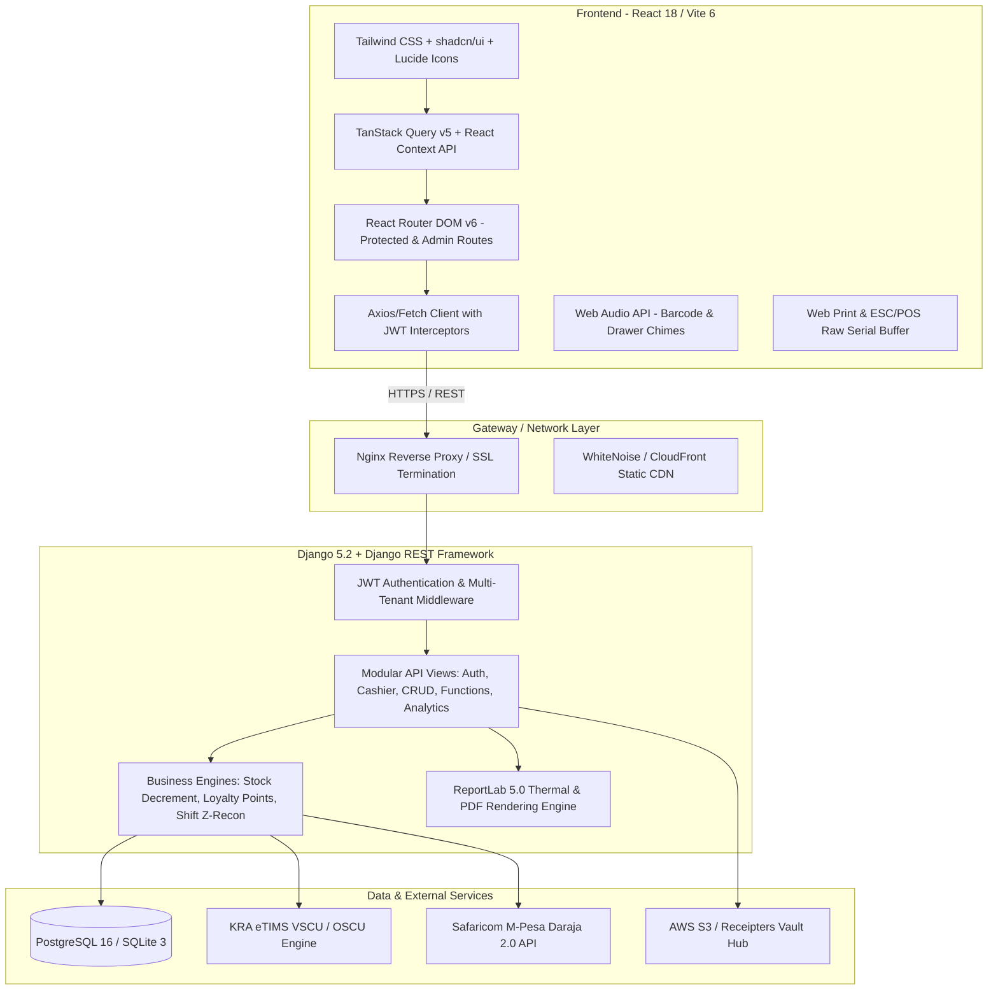
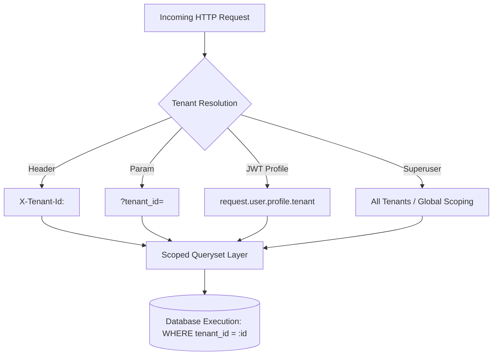
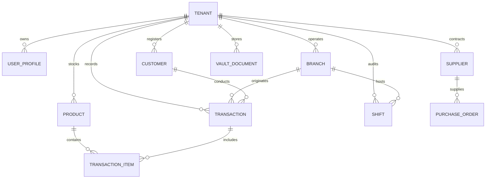
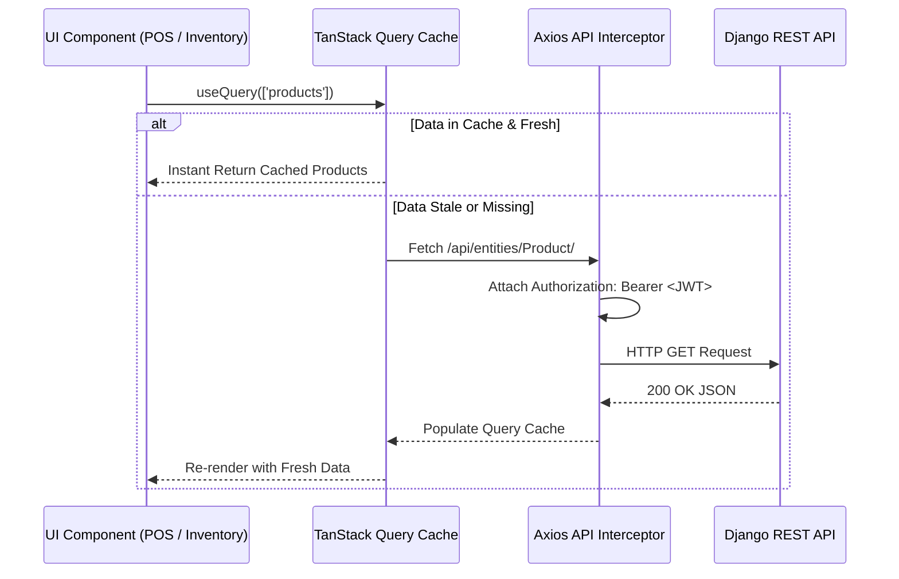

# Chapter 15: Technical Architecture & Developer Reference

---

## 15.1 System Architecture Overview

DukaPOS is built with a modern decoupled **Single-Page Application (SPA) + Stateless RESTful Backend** architecture, tailored for high throughput, sub-second checkout latency, and robust multi-tenancy.



---

## 15.2 Technology Stack Breakdown

### Frontend Stack
- **Framework**: React 18.2.0 bundled via Vite 6.1.
- **Design System & Styling**: Tailwind CSS 3.4, Radix UI primitives (`@radix-ui`), shadcn/ui components, Lucide icons (`lucide-react`).
- **Server-State Synchronization**: TanStack React Query v5 (`@tanstack/react-query`) with automatic query caching, background refetching (e.g. 10-second polling on executive dashboards), and optimistic UI updates.
- **Client Routing**: React Router DOM v6 with declarative route guards (`ProtectedRoute`, `AdminRoute`, `SharedRoute`).
- **Hardware Integrations**:
  - Web Audio API synthesizer for positive chime (440Hz $\to$ 880Hz) and error tone (150Hz).
  - Web Print API and ESC/POS raw buffer formatting.
  - HTML5 Canvas & `html2canvas` for visual receipt snapshot generation.
  - `JsBarcode` for high-resolution CODE128, EAN13, and UPC barcode generation.
- **Data Analytics**: Recharts 2.15 for interactive sales velocity curves, payment mix donuts, and cashier performance graphs.

### Backend Stack
- **Framework**: Python 3.10+ / Django 5.2 LTS with Django REST Framework (DRF) 3.17.
- **Authentication**: Stateless JSON Web Tokens (`djangorestframework-simplejwt`) with automatic token rotation and blacklisting.
- **Database ORM**: Django ORM with native PostgreSQL support (production) and zero-config SQLite support (local development/demo).
- **Document Rendering**: ReportLab 5.0 for binary thermal receipt PDF generation and enterprise audit sheets.
- **Static Assets & Storage**: WhiteNoise for high-performance static asset streaming; AWS S3 (`boto3`, `django-storages`) for Receipters Vault document records.
- **CORS & Security**: `django-cors-headers`, secure HTTP cookies, CSRF protection, and PBKDF2-SHA256 password hashing.

---

## 15.3 Multi-Tenancy & Row-Level Data Isolation

DukaPOS implements **Row-Level Shared Database Multi-Tenancy**. Every tenant (business) shares the same database schema while maintaining strict cryptographic and logical boundaries.



### Tenant Resolution Hierarchy
When any request hits the Django backend, `get_tenant_for_user(request)` resolves the active tenant through a 4-tier hierarchy:
1. **Explicit Request Header / Query Param**: `X-Tenant-Id: <uuid>` or `?tenant_id=<uuid>`.
2. **User Profile Association**: The `tenant` foreign key stored on `request.user.profile`.
3. **Superadmin Delegation**: If `is_staff` or `is_superuser`, allows cross-tenant query execution.
4. **Onboarding Zero-State**: Points to newly initialized workspace if `is_onboarded = False`.

### Scoped Queryset Implementation
All models inherit from or link to `Tenant`. Generic and custom views filter data via:
```python
def get_scoped_queryset(request, ModelClass):
    queryset = ModelClass.objects.all()
    tenant = get_tenant_for_user(request)
    if tenant:
        queryset = queryset.filter(Q(tenant=tenant) | Q(tenant__isnull=True))
    elif not is_admin_user(request.user):
        queryset = queryset.none()
    return queryset
```

---

## 15.4 Database Schema & Model Relationships



### Core Entities Summary
| Model | Purpose | Key Attributes |
|---|---|---|
| `Tenant` | Top-level business account | `name`, `subdomain`, `kra_pin`, `is_onboarded` |
| `UserProfile` | User credentials & permissions | `user`, `role` (admin/cashier), `tenant`, `branch` |
| `Branch` | Physical store / outlet | `name`, `code`, `location`, `phone`, `is_active` |
| `Product` | Retail merchandise | `name`, `sku`, `barcode`, `buying_price`, `selling_price`, `stock_quantity`, `min_stock_alert` |
| `Transaction` | Completed POS sale | `receipt_number`, `total_amount`, `vat_amount`, `payment_method`, `etims_status`, `daraja_ref` |
| `Shift` | Cashier register session | `cashier`, `start_time`, `end_time`, `opening_cash`, `closing_cash`, `discrepancy` |
| `PurchaseOrder` | Supplier stock procurement | `supplier`, `status`, `total_cost`, `expected_delivery` |
| `Customer` | CRM & Loyalty record | `name`, `phone`, `email`, `loyalty_points`, `tier` |
| `VaultDocument` | Audit-locked financial files | `title`, `document_type`, `amount`, `is_locked`, `s3_key` |

---

## 15.5 REST API Blueprint & Endpoint Specification

Base API URL: `/api/`

### 1. Authentication & Session
- `POST /api/auth/register/` — Register new business owner & provision tenant.
- `POST /api/auth/token/` — Issue JWT Access & Refresh token pair.
- `POST /api/auth/token/refresh/` — Rotate expired access token.
- `GET /api/auth/me/` — Retrieve active user identity, role, and tenant metadata.

### 2. POS Operations
- `POST /api/pos/checkout/` — Atomic transaction submission:
  - Validates cart line items and stock availability.
  - Decrements product inventory quantities.
  - Computes 16% VAT and loyalty points accrued.
  - Queues KRA eTIMS invoice generation.
  - Returns formatted receipt payload.
- `POST /api/pos/hold/` & `GET /api/pos/recall/` — Park and resume unfinalized carts.
- `POST /api/pos/shifts/start/` & `POST /api/pos/shifts/close/` — Manage register cash balance.

### 3. Kenya Integrations
- `POST /api/payments/mpesa/stk-push/` — Initiate Daraja M-Pesa push to customer phone.
- `POST /api/payments/mpesa/callback/` — Safaricom webhook receiver.
- `POST /api/etims/submit-invoice/` — Transmit fiscal invoice payload to KRA eTIMS server.
- `GET /api/etims/invoices/` — Filter and monitor fiscalization statuses.

### 4. Dynamic Entities CRUD (`/api/entities/<ModelName>/`)
Generic CRUD router for standard entities: `Product`, `Customer`, `Supplier`, `PurchaseOrder`, `Expense`, `Promotion`, `VaultDocument`.
- `GET /api/entities/<ModelName>/` — List scoped records (supports pagination, filtering, search).
- `POST /api/entities/<ModelName>/` — Create new entity record.
- `GET /api/entities/<ModelName>/<id>/` — Retrieve single record details.
- `PUT /api/entities/<ModelName>/<id>/` — Full record update.
- `DELETE /api/entities/<ModelName>/<id>/` — Soft or hard delete record.

---

## 15.6 Frontend Architecture & State Management

The React client utilizes a modern **Unidirectional Server-State Cache Architecture**:



### Key Client-Side Utilities
- `src/api/apiClient.js` — Axios client configured with JWT auto-refresh interceptors and tenant routing headers.
- `src/utils/audio.js` — Web Audio API helper generating synth bleeps for barcode scans (`playSuccessBeep`) and warnings (`playErrorBeep`).
- `src/components/ReceiptersAuthGate.jsx` — Security gate verifying superadmin session privileges before granting access to platform engines.

---
