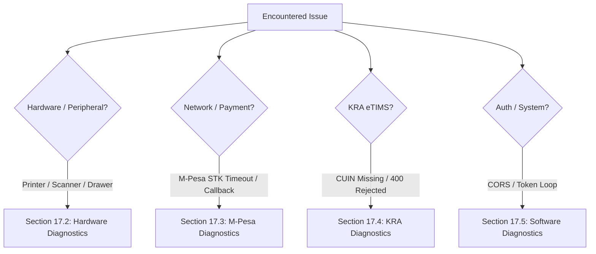

# Chapter 17: Troubleshooting & Security Best Practices

---

## 17.1 Common Troubleshooting Scenarios & Solutions

Below is a structured diagnostic guide for resolving operational, network, peripheral, and integration issues encountered during store operations.



---

## 17.2 Hardware & Peripheral Troubleshooting

### 1. Electronic Cash Drawer Does Not Pop Open
- **Cause 1: Cable plugged into wrong port.** Ensure the RJ11/RJ12 cable runs from the cash drawer **directly into the thermal printer's DK (Drawer Kick) port**, not into an Ethernet router or POS PC.
- **Cause 2: Non-cash payment.** DukaPOS only fires the drawer-kick ESC/POS sequence (`ESC p 0 25 250`) on **Cash** transactions. Card and M-Pesa checkouts intentionally leave the drawer locked.
- **Cause 3: Key cylinder locked.** Check if the keyhole on the front face of the drawer is turned to the "Deadlock" position. Turn it to "Neutral / Electronic Open".
- **Cause 4: Voltage mismatch.** Verify the drawer solenoid is rated for **24V** (compatible with retail thermal printers) rather than 12V automotive solenoids.

### 2. Barcode Scanner Types Numbers but Fails to Add Item to Cart
- **Cause: Missing Carriage Return (Enter) suffix.** DukaPOS listens for the `Enter` key event (`keyCode: 13`) to submit the scanned SKU.
- **Resolution**: Scan the configuration barcode titled **"Add CR/LF Suffix"** or **"Enter Key Postfix"** from your scanner manufacturer's manual (Honeywell, Zebra, Netum).

### 3. Thermal Printer Prints Gibberish or Cuts Off Receipts
- **Cause 1: Baud rate mismatch (Serial/USB).** Ensure the printer driver is set to `9600` or `115200` baud.
- **Cause 2: Incorrect paper width selected.** In DukaPOS **Settings → Receipt Customization**, ensure paper width is matched to your roll (`58mm` vs `80mm`).
- **Cause 3: Missing UTF-8 support.** If currency symbols or accents print as distorted characters, enable UTF-8 character encoding in the printer dip-switches or driver settings.

---

## 17.3 M-Pesa Daraja Payment Diagnostics

| Symptom | Probable Cause | Corrective Action |
|---|---|---|
| **Customer does not receive STK PIN prompt** | Phone locked, airplane mode, or phone number format invalid | Ensure phone number is formatted as `2547XXXXXXXX` or `07XXXXXXXX`. Verify customer has active SIM reception. |
| **STK prompt appears but expires after 30s** | Customer took too long to enter PIN | Click **Retry STK Push** in the POS payment modal. |
| **STK prompt completed on phone, but POS stays "Waiting..."** | Public callback URL unreachable or firewall blocking Safaricom IP | 1. Verify `DARAJA_CALLBACK_URL` is a publicly accessible HTTPS endpoint (not `localhost`).<br>2. Use the **Manual M-Pesa Reference Search** feature on POS to input the customer's SMS receipt code (e.g. `RKG89J12K4`) to verify and clear the transaction immediately. |
| **HTTP 401 Unauthorized from Daraja API** | Expired or incorrect Consumer Key / Secret | Regenerate Daraja credentials on Safaricom Developer Portal and update `server/.env`. |

---

## 17.4 KRA eTIMS Compliance Diagnostics

| Error Code / Message | Cause | Resolution |
|---|---|---|
| `Invalid PIN / Taxpayer Not Found` | Business or buyer KRA PIN entered incorrectly | Verify KRA PIN format: 11 characters starting with letter, ending with letter (e.g. `P051234567A`). Validate via KRA iTax portal. |
| `Duplicate Invoice Number` | Previous transmission already used this invoice sequence | Check eTIMS Compliance page (`/etims`); re-synchronize the last acknowledged sequence number. |
| `Missing HS / Item Code` | Product missing KRA classification code | Update the product in **Inventory** to include a valid 8-digit HS Code or standard description. |
| `eTIMS Server Timeout (504)` | KRA central servers under high load or network downtime | The invoice remains queued under `failed` or `not_submitted`. Use the bulk **"Resubmit to KRA"** button once connectivity restores. Offline POS operations are unaffected. |

---

## 17.5 Software & Network Troubleshooting

### 1. Cross-Origin Resource Sharing (CORS) Errors
- **Error in Browser Console**: `Access to fetch at 'https://api.domain.co.ke' from origin 'https://pos.domain.co.ke' has been blocked by CORS policy.`
- **Resolution**: Add the frontend origin to `CORS_ALLOWED_ORIGINS` in `server/.env`:
  ```env
  CORS_ALLOWED_ORIGINS=https://pos.domain.co.ke
  ```
  Restart Gunicorn: `sudo systemctl restart dukapos`.

### 2. Infinite Redirect to `/onboarding`
- **Cause**: User's tenant has `is_onboarded = False`.
- **Resolution**: Complete the 9-step setup wizard, or update the database directly:
  ```sql
  UPDATE dukapos_tenant SET is_onboarded = TRUE WHERE id = 'YOUR_TENANT_ID';
  ```

### 3. JWT Token Refresh Loop / Session Expiry
- **Cause**: Client clock out of sync with server clock by > 5 minutes.
- **Resolution**: Synchronize system time on the POS terminal via NTP (`sudo timedatectl set-ntp on`).

---

## 17.6 Security Best Practices & Internal Controls

Retail businesses face acute risks of internal stock shrinkage, cash skimming, and unauthorized transaction overrides. DukaPOS embeds deep defenses against these risks.

### 1. Cash Register Security & Anti-Skimming Controls
- **Dual Verification Shifts**: Cashiers declare opening float and perform blind physical cash counts at shift close. DukaPOS automatically calculates discrepancies ($Z$-report variance) and logs them for managerial audit.
- **Strict Cash Drawer Opening Logic**: The physical cash drawer solenoid cannot be opened electronically without a corresponding recorded cash transaction.
- **Mid-Shift Cash Drops**: High-volume stores should enforce periodic mid-shift cash drops to the store safe when drawer balance exceeds KES 20,000, minimizing counter risk.

### 2. Fraud Prevention & Manager Overrides
- **Threshold Discounter Lock**: Any discount exceeding **KES 1,000** or **20% of cart total** requires explicit manager approval with authorization PIN.
- **Void & Refund Audits**: Voids and item reversals are recorded with timestamp, cashier ID, and reason code. Audits are permanently logged in `/shift-audits`.
- **Ghost Transactions**: Products cannot be sold if marked inactive or if stock is non-existent, preventing off-the-books cash sales.

### 3. POS Network & Hardware Isolation

```mermaid
graph TD
    subgraph Corporate & Guest Network
        Guest[Guest WiFi]
        Office[Office Computers]
    end

    subgraph Secure POS VLAN [Isolated VLAN 10]
        Router[Firewall Router]
        Terminal1[POS Terminal 1]
        Terminal2[POS Terminal 2]
        Printer[LAN Receipt Printer]
    end

    Guest -.->|Blocked| Secure POS VLAN
    Router --> Terminal1
    Router --> Terminal2
    Router --> Printer
```

- **Dedicated POS VLAN**: POS terminals and network receipt printers should reside on an isolated VLAN with no access from public/guest store WiFi.
- **WPA3-Enterprise WiFi**: Use enterprise wireless authentication or wired Ethernet drops for all fixed cashier stations.
- **Browser Kiosk Mode**: On dedicated touch terminals, launch Chrome in Kiosk mode to restrict cashiers from accessing external websites or settings:
  ```bash
  google-chrome --kiosk --app=https://pos.yourdomain.co.ke
  ```

### 4. Data Protection & Kenya DPA (2019) Compliance
- **Customer Consent**: Collecting customer phone numbers for loyalty points and digital receipts requires clear verbal or printed customer consent.
- **Data Minimization**: Never store full credit or debit card numbers on DukaPOS. Card payments are handled by certified bank PIN pads or M-Pesa STK Push.
- **Right to Erasure**: Customers have the right to request deletion of their profile and contact numbers from the CRM (`/customers`) under the Kenya Data Protection Act 2019.
- **Encrypted Transmission**: All communication between POS terminals, cloud servers, KRA eTIMS, and Safaricom Daraja must be encrypted using **TLS 1.3**.

---
