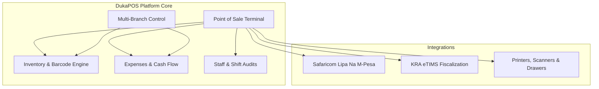
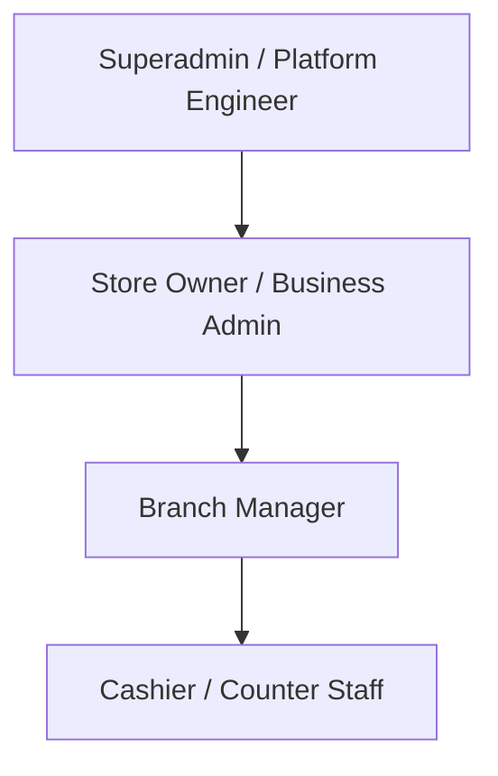

# Chapter 1: System Overview & Introduction

---

## 1.1 About DukaPOS

### The Retail Landscape in Kenya & East Africa
Retail commerce across Kenya and the broader East African region operates within a distinct and fast-evolving commercial landscape characterized by several unique operational realities:

1. **Prevalence of Mobile Money**: Mobile money—predominantly **Safaricom Lipa Na M-Pesa** (Buy Goods Till Numbers and Paybill Numbers)—alongside cash, drives the vast majority of retail transactions. Traditional POS systems built for credit/debit card-heavy markets fail to address the complexities of real-time mobile payment verification, manual SMS checks, and the risk of cashier fraud or fraudulent payment reversals.
2. **Strict Tax & Fiscalization Mandates**: The Kenya Revenue Authority (KRA) mandates compliance with the **electronic Tax Invoice Management System (eTIMS)**. Every taxable transaction must generate a cryptographically valid fiscal invoice with a unique Control Unit Invoice Number (CUIN) and verification QR code. Non-compliance exposes business owners to statutory penalties.
3. **Inventory Shrinkage & Pilferage**: Retailers face inventory leaks, unaccounted cash drawer shortages, unrecorded petty cash withdrawals, and stockouts of high-velocity fast-moving consumer goods (FMCG).
4. **Multi-Store Operational Blind Spots**: Retailers operating multiple branches often struggle with disconnected records, decentralized inventory ledgers, and fragmented reporting across locations.

### The DukaPOS Mission
**DukaPOS** (also referred to within platform tools as *Receipters*) is an enterprise-grade, multi-tenant Point of Sale (POS) and Retail ERP solution built specifically to solve these challenges. It bridges modern web technology, automated fiscal compliance, mobile payments, and robust store operations into a single intuitive platform.

### Key Highlights & Value Proposition
- **High-Velocity POS Terminal**: Engineered for speed with full keyboard shortcut mapping (F1–F12), barcode scanner wedge integration, item search, and quick-access favorites.
- **Embedded Mobile Payments**: Instant Safaricom Daraja 2.0 STK Push triggers prompts directly on customer handsets, eliminating manual phone checks and reconciling transactions instantly.
- **Turnkey KRA eTIMS Fiscalization**: Automated tax calculation, fiscal invoice payload compilation, and QR code generation for compliant receipts.
- **Strict Cash Drawer Control**: Blind drawer counting protocols, shift float tracking, variance logging, and automated Z-reports.
- **Automated Real-Time Stock Engine**: Real-time stock decrement on checkout, automated cost of goods sold (COGS) tracking, low-stock reorder thresholds, and Purchase Order stock increments upon delivery.
- **Secure Row-Level Multi-Tenancy**: Complete isolation of business data, ensuring independent operation for stores and multiple branches while hosted on a shared scalable infrastructure.

---

## 1.2 Core System Modules at a Glance

| Module | Primary Route(s) | Target Users | Key Capabilities |
|---|---|---|---|
| **Point of Sale (POS)** | `/pos`, `/my-shifts` | Cashiers, Managers | Fast product lookup, barcode scanning, cart holding, split tender (Cash/M-Pesa), receipt printing, drawer kicking. |
| **Shift & Float Control** | `/my-shifts`, `/shift-audits` | Cashiers, Managers | Opening float declaration, mid-shift payouts, blind shift closure, automated cash variance calculations. |
| **Inventory & Catalog** | `/inventory`, `/promotions` | Managers, Owners | Stock tracking, categories, barcode label generator, low-stock thresholds, promotional discount rules. |
| **Procurement & Vendors** | `/suppliers`, `/purchase-orders` | Managers, Owners | Supplier master directory, purchase order generation, Goods Received Notes (GRN), automated stock additions. |
| **Customers & Loyalty** | `/customers` | Cashiers, Managers | Customer CRM, dynamic loyalty tiers (Bronze, Silver, Gold, Platinum), points earning and checkout redemption. |
| **Cash Flow & Expenses** | `/expenses`, `/cash-flow`, `/transactions` | Owners, Accountants | Petty cash tracking, operating expense categorization, multi-channel cash flow ledgers (Drawer, Till, Bank). |
| **Staff & HR** | `/staff`, `/employees`, `/employee-scheduling`, `/staff-performance` | Owners, Managers | Staff directory, invite token onboarding, shift scheduling calendar, cashier sales performance & ratings. |
| **Multi-Branch Operations** | `/branches` | Owners | Multi-outlet setup, branch-specific inventory, localized cash desks, consolidated performance comparisons. |
| **Compliance & Tax** | `/etims` | Owners, Accountants | KRA eTIMS transmission logs, fiscal invoice status, offline queues, VAT band configurations (A, B, C, E). |
| **Analytics & Reports** | `/`, `/reports`, `/advanced-reports` | Owners, Executives | Daily gross profit, net margin, P&L statements, inventory turnover rate, dead stock analysis. |
| **Platform Administration** | `/admin/receipters-engine`, `/admin/receipters-vault` | Platform Superadmins | Tenant provisioning, subscription plan management, tenant database backups, regulatory vault archives. |

---

## 1.3 Supported Retail Formats & Business Models

DukaPOS is engineered with flexible workflows adaptable to various retail environments:

### 1. General Retail Dukas & Convenience Stores
- **Environment**: High foot-traffic, single or dual cashier stations, large proportion of cash and micro M-Pesa payments.
- **Key Modules Utilized**: POS quick-sale keys, M-Pesa STK push, shift float reconciliation, low-stock alerts.

### 2. Supermarkets & Multi-Lane Grocery Outlets
- **Environment**: Multiple checkout lanes, extensive SKU catalogs (10,000+ items), barcode scanners, integrated thermal printers, electronic cash drawers.
- **Key Modules Utilized**: Barcode scanner integration, customer cart holding (queue management), high-speed ESC/POS receipt generation, cashier shift audit logs.

### 3. Pharmacies & Chemist Shops
- **Environment**: Regulated product dispensing, batch tracking, price lookups, corporate and customer invoicing.
- **Key Modules Utilized**: Customer transaction records, detailed receipts with customer tax details, eTIMS fiscalization, expense tracking.

### 4. Agro-dealers, Hardware & Farm Supplies
- **Environment**: Bulk products, trade accounts, commercial customer credit, supplier order management.
- **Key Modules Utilized**: Purchase Orders, Supplier Management, Customer Credit Ledgers, Wholesale vs. Retail price checks.

### 5. Wholesalers & Multi-Branch Distributors
- **Environment**: Centralized inventory warehouse feeding multiple retail satellite stores.
- **Key Modules Utilized**: Multi-branch stock allocation, inter-branch reporting, advanced profit & loss analytics.

---

## 1.4 Roles, User Hierarchy & Permissions Matrix

DukaPOS employs Role-Based Access Control (RBAC) enforced on both the React frontend and Django REST backend.

### Role Descriptions

1. **Superadmin (Platform Level)**:
   - Full global visibility across all business tenants.
   - Manages platform billing, tenant provisioning, system health, and secure vault backups via Receipters Engine.
2. **Store Owner (Business Admin)**:
   - Complete operational authority over their specific business tenant.
   - Access to financial analytics, profit margins, branch creation, bank accounts, staff salary settings, and tax configuration.
3. **Branch Manager**:
   - Operational authority over one or more assigned store branches.
   - Manages stock adjustments, reviews cashier shift audits, issues purchase orders, and inspects daily sales.
   - Restricted from altering enterprise billing or viewing sensitive owner-level company bank accounts.
4. **Cashier (Point of Sale Operator)**:
   - Focused execution role centered on checkout speed and customer service.
   - Can ring up sales, accept payments, open/close personal shifts, hold carts, and look up product prices.
   - Strictly blocked from viewing product cost prices, modifying past transactions, changing system settings, or viewing company-wide reports.

---

### Comprehensive Permissions Matrix

| Feature / Action | Cashier | Branch Manager | Store Owner | Superadmin |
|---|:---:|:---:|:---:|:---:|
| **Execute Sales at POS** | ✅ | ✅ | ✅ | ✅ |
| **Open & Close Own Shift** | ✅ | ✅ | ✅ | ✅ |
| **View Own Sales & Float History** | ✅ | ✅ | ✅ | ✅ |
| **Hold & Resume Carts** | ✅ | ✅ | ✅ | ✅ |
| **Apply Line Item Discounts** | ❌ *(Needs Manager)* | ✅ | ✅ | ✅ |
| **Void Completed Transactions** | ❌ | ❌ *(Audit Logged)* | ✅ | ✅ |
| **Inspect Product Cost Price & Margins** | ❌ | ✅ | ✅ | ✅ |
| **Create & Edit Products / SKUs** | ❌ | ✅ | ✅ | ✅ |
| **Perform Manual Stock Adjustments** | ❌ | ✅ | ✅ | ✅ |
| **Create & Receive Purchase Orders** | ❌ | ✅ | ✅ | ✅ |
| **Manage Suppliers & Vendor Accounts** | ❌ | ✅ | ✅ | ✅ |
| **Access Shift Audits & Cash Variances** | ❌ | ✅ | ✅ | ✅ |
| **Record General Store Expenses** | ❌ | ✅ | ✅ | ✅ |
| **View Cash Flow & Liquidity Ledgers** | ❌ | ❌ | ✅ | ✅ |
| **View Executive P&L Analytics** | ❌ | ❌ | ✅ | ✅ |
| **Invite, Hire & Deactivate Staff** | ❌ | ❌ | ✅ | ✅ |
| **Configure KRA eTIMS & M-Pesa Credentials** | ❌ | ❌ | ✅ | ✅ |
| **Create & Configure New Store Branches** | ❌ | ❌ | ✅ | ✅ |
| **Cross-Tenant Administration & Engine Vault** | ❌ | ❌ | ❌ | ✅ |
