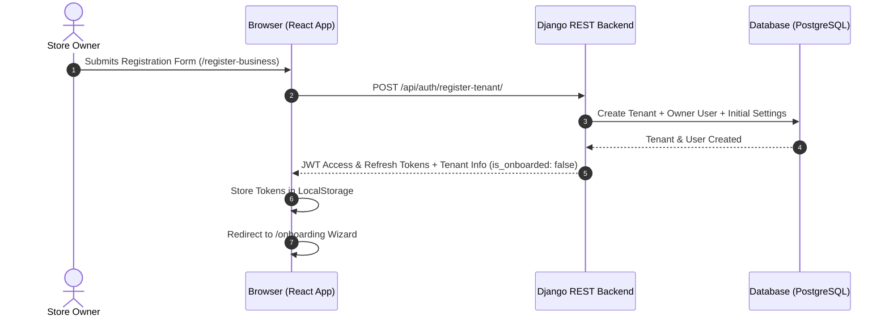
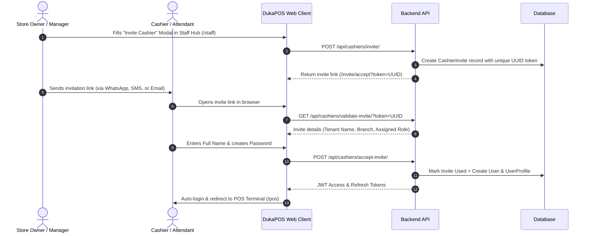

# Chapter 2: Getting Started & Onboarding

---

## 2.1 Account Creation & Authentication

DukaPOS uses JWT (JSON Web Token) authentication with access and refresh tokens. All user accounts belong to a specific business tenant (or the platform administration layer).



### 1. Store Owner Registration (`/register-business`)
New enterprise customers start by provisioning their company workspace at `/register-business`:
- **Business Details**:
  - **Business Legal Name**: Official registered company name.
  - **Business Type**: Selectable from presets:
    - *General Retail / Duka*
    - *Supermarket / Grocery*
    - *Pharmacy / Chemist*
    - *Hardware & Construction*
    - *Electronics & Mobile*
    - *Fashion & Boutique*
    - *Restaurant & Bakery*
- **Owner Profile**:
  - **Owner Full Name**: Primary administrator's name.
  - **Email Address**: Used for login and administrative notices.
  - **Mobile Phone Number**: Used for SMS alerts, M-Pesa notifications, and account recovery.
  - **Password**: Minimum 8 characters with security validation.
- **Subscription Tier Selection**:
  - **Starter / Free**: 1 store location, 2 cashier accounts, POS terminal, basic stock tracking.
  - **Pro Growth (Popular)**: 3 store locations, unlimited cashiers, advanced AI analytics, Vault Hub backup, KRA eTIMS sync.
  - **Enterprise**: Unlimited locations, custom domain, dedicated account manager, priority 24/7 SLA.

### 2. User Sign-In (`/login`)
Registered store owners, branch managers, and cashiers sign in via `/login`:
- Enter registered email and password.
- Upon successful authentication, the backend returns:
  - `access`: Bearer token for authorization headers.
  - `refresh`: Long-lived token to refresh expired sessions.
  - `user`: User profile, assigned role (`admin`, `manager`, `cashier`), assigned branch, and tenant metadata.
- **Onboarding Interceptor**: If the user belongs to a tenant with `is_onboarded === false`, the system intercepts navigation and immediately routes the user to `/onboarding`.

### 3. Password Recovery Flow (`/forgot-password` & `/reset-password`)
- **Step 1 (`/forgot-password`)**: The user provides their registered email. If matched, the system generates a secure, time-limited token.
- **Step 2 (`/reset-password?token=...`)**: The user follows the reset link, supplies their new password with confirmation, and the credentials update securely with salted hashing.

---

## 2.2 First-Time Store Onboarding Wizard (`/onboarding`)

The onboarding wizard is a guided 9-step setup process designed to configure business defaults before retail operations begin.


### Step 1: User Type
- Captures whether the person configuring the system is the **Sole Owner**, an **Employed Managing Director**, or a **Designated Systems Administrator**.

### Step 2: Business Classification
- Selects the operational retail category (e.g., General FMCG, Supermarket, Pharmacy, Hardware, Electronics).
- Defines POS interface defaults (e.g., whether barcode-first mode or touch-grid mode is prioritized).

### Step 3: Goods & Services Catalog Profiles
- Selects common product departments sold by the store (e.g., Beverages, Dry Groceries, Household Cleaning, Bakery, Agro-chemicals).
- Seeds default product categories into the inventory database.

### Step 4: Business Profile & Receipt Branding
- **Trading Name & Brand**: Public-facing name displayed on printed receipts.
- **Logo Upload**: Store logo formatted for 58mm/80mm thermal receipt headers and digital invoices.
- **Business Registration Number**: County government single business permit or registrar of companies registration number.
- **Receipt Header & Footer Notices**:
  - *Receipt Header*: Address, phone numbers, and welcome message.
  - *Receipt Footer*: Thank-you message and social media handles.
- **Store Policies**:
  - *Return Policy*: e.g., "Goods returned within 48 hours with original receipt."
  - *Exchange Policy*: e.g., "Exchange allowed for items in original condition."

### Step 5: Branch & Outlet Setup
- **Main Branch Name**: Default physical store (e.g., "Moi Avenue Flagship" or "Main Town Duka").
- **Physical Address**: Building name, street, town/county.
- **Multi-Branch Expansion**: Ability to define satellite branches upfront.

### Step 6: Subscription Package Confirmation
- Confirms chosen operational package (Starter, Pro, Enterprise) and payment terms.

### Step 7: Key Personnel & Emergency Contacts
- **Primary Business Contact**: Full name, direct mobile number, and role.
- **Store Manager Contact**: Contact details for the on-site supervisor.
- **Emergency & Backup Contacts**: Secondary phone numbers for after-hours operational alerts.

### Step 8: Currency, Taxes & Mobile Money Defaults
- **Operational Currency**: Standardized to **KES (Kenyan Shilling)** by default (supports UGX, TZS, USD).
- **Default Tax Rate**: Set to standard VAT (16%), Zero-rated (0%), or Exempt.
- **Safaricom Lipa Na M-Pesa Setup**:
  - **M-Pesa Till Number** (Buy Goods) or **Paybill Number**.
  - **Account Reference Number** (for Paybill setups).

### Step 9: KRA eTIMS & Fiscal Compliance
- **KRA PIN**: 11-character taxpayer identification number (e.g., `P051234567Z`).
- **VAT Registration Toggle**: Enables or disables VAT calculation across the product catalog.
- **eTIMS Integration Toggle**: Enables automatic electronic fiscal device (ESD/OSCU) synchronization.

> [!NOTE]
> Upon completing Step 9 and clicking **Finish Setup**, the wizard sends a consolidated payload to `POST /api/tenants/onboard/`. The tenant status updates to `is_onboarded = true`, default categories and branches are seeded, and the user is redirected to the main dashboard (`/`).

---

## 2.3 Inviting & Onboarding Staff

DukaPOS allows store owners and managers to add cashiers and branch supervisors without sharing root admin credentials.



### Generating a Staff Invite
1. Navigate to **Staff Hub** (`/staff`) or **Employees** (`/employees`).
2. Click **Invite Staff / Add Cashier**.
3. Fill in the invite parameters:
   - **Full Name / Staff Identifier**: Name of the cashier or manager.
   - **Email Address**: Recipient email for official invitation.
   - **Assigned Branch**: Designate which physical store branch the employee belongs to.
   - **Role**: Choose between `Cashier` (sales terminal only) or `Manager` (supervisory access).
4. Click **Generate Invite Link**. The system generates a cryptographic URL:
   ```
   https://app.dukapos.co.ke/invite/accept?token=9b1deb4d-3b7d-4bad-9bdd-2b0d7b3dcb6d
   ```
5. Copy the invite link to share via email, SMS, or WhatsApp.

### Staff Invitation Acceptance (`/invite/accept`)
When the invited staff member clicks the link:
1. **Token Validation**: The page verifies that the token exists, is unexpired, and has not already been accepted.
2. **Account Creation Form**:
   - Displays the inviting Business Name and Assigned Branch.
   - Staff member inputs their **Full Name**.
   - Staff member sets and confirms a **Password** (minimum 6 characters).
3. **Activation & Instant Session**:
   - The backend transitions the invite status from `pending` to `accepted`.
   - A new `User` record and linked `UserProfile` are provisioned in the database with the pre-assigned role and branch.
   - JWT session tokens are issued immediately, bypassing manual login and directing the cashier straight to the **POS Terminal** (`/pos`).

---
