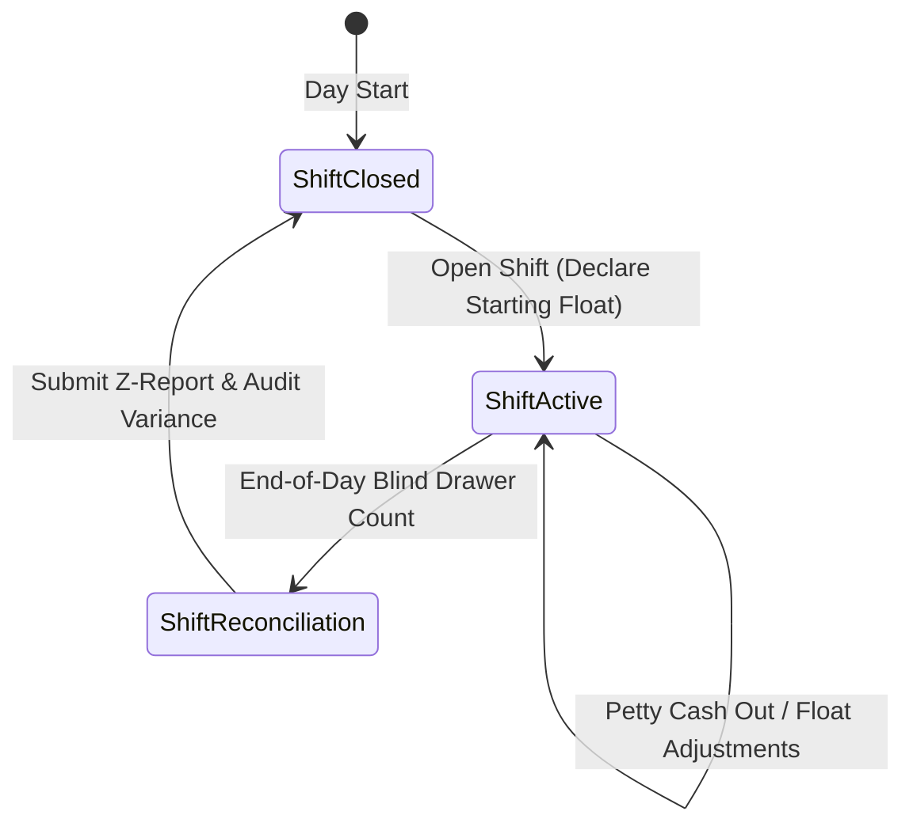
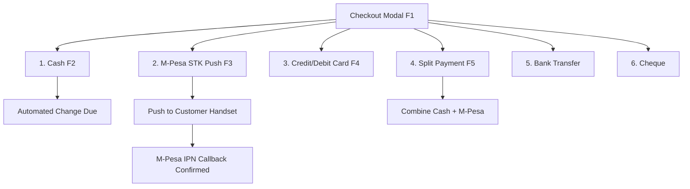

# Chapter 3: Point of Sale (POS) & Cashier Operations

---

## 3.1 Shift Management & Cash Floats (`/my-shifts`)

Accurate cash handling and shift governance form the frontline defense against cash shrinkage. DukaPOS enforces a strict shift lifecycle for all cashiers and counter attendants.



### 1. Opening a Shift & Setting the Opening Float
1. Before ringing up any sale in `/pos`, a cashier must start an active shift.
2. The system prompts the cashier for the **Starting Cash Float** (petty cash notes and coins placed in the drawer for customer change).
3. The system records:
   - `cashier_id` & `cashier_name`
   - `branch_id`
   - `started_at` timestamp
   - `opening_float` amount (in KES)
   - Shift status transitions to `open`.

### 2. Active Shift Monitoring (`/my-shifts`)
During trading hours, cashiers can inspect their personal shift metrics at `/my-shifts`:
- **Real-Time Revenue**: Total sales revenue processed by the cashier today.
- **Transaction Count**: Number of customer orders completed.
- **Tender Distribution**: Real-time breakdown across Cash, M-Pesa, Card, and Split payments.
- **7-Day Trend**: Historical performance graph comparing current vs. past velocity.
- **Shift Export**: One-click download of personal sales log as a `.csv` file.

### 3. Shift Closure & Blind Cash Drawer Counting
At the conclusion of a shift or trading day:
1. The cashier triggers **Close Shift** (or presses `F9` for End of Day Reconciliation).
2. **Blind Drawer Count Protocol**: To eliminate bias and temptation to conceal discrepancies, the cashier is **not shown** the system’s expected cash balance.
3. The cashier counts the physical currency in the drawer and inputs the physical totals:
   - Currency breakdown or lump-sum physical cash counted.
4. **Variance Calculation**:
   $$\text{Variance} = \text{Actual Cash Counted} - (\text{Opening Float} + \text{Total Cash Sales} - \text{Cash Expenses})$$
   - $\text{Variance} = 0$: **Balanced Drawer** (Clean reconciliation).
   - $\text{Variance} < 0$: **Cash Shortage** (Flagged in manager shift audit).
   - $\text{Variance} > 0$: **Cash Overage** (Flagged for investigation).
5. Upon confirmation, the shift status updates to `closed`, a timestamped Z-Report is compiled, and a `ShiftAudit` record is created for management review.

---

## 3.2 POS Interface Overview (`/pos`)

The DukaPOS Point of Sale screen is built for high throughput and distraction-free operation.

```
+-------------------------------------------------------------------------------+
| [POS] [Cart: 3] [2 Held] | Price Check (F8) | Hold (F6) | Shift: #124 | 21:45 |
+-------------------------------------------------------------------------------+
| [ Category Filters: All | Groceries | Beverages | Bakery | Snacks ... ]       |
| [ Search or Scan Barcode (Ctrl + /) .................................... ]   |
+----------------------------------------------------+--------------------------+
|  Product Catalog Grid                              | Cart Summary             |
|                                                    |--------------------------|
|  +--------------+  +--------------+  +-----------+ | 2x Unga Maize Flour 2kg  |
|  | Unga 2kg     |  | Chai Tea     |  | Milk 500ml| |    KES 360.00            |
|  | KES 180.00   |  | KES 95.00    |  | KES 65.00 | | 1x Brookside Milk 500ml|
|  | Stock: 42    |  | Stock: 15    |  | Stock: 8  | |    KES 65.00             |
|  +--------------+  +--------------+  +-----------+ |--------------------------|
|                                                    | Subtotal:     KES 425.00 |
|  [ Favorites Quick-Bar ]                           | Tax (16% incl):KES 58.62 |
|  [★ Milk 500ml] [★ Sugar 1kg] [★ Bread 400g]       | Total:        KES 425.00 |
|                                                    |--------------------------|
|                                                    | [  CHECKOUT (F1)  ]      |
+----------------------------------------------------+--------------------------+
```

### 1. Catalog Search & Filter Engine
- **Instant Search**: Type product names, SKUs, or keywords in the search bar. The grid updates in real time with zero latency.
- **Category Filter Tabs**: Quick filtering across departments: *Groceries, Beverages, Dairy, Bakery, Snacks, Household, Personal Care, Electronics, Clothing*.
- **Visual Stock Status**: Cards feature stock quantity badges. Low-stock products (below 10 units) display amber badges, and out-of-stock items are disabled.

### 2. Favorites & Quick-Pick Bar
- Fast-moving staples (e.g., 500ml Milk, 2kg Sugar, 400g Bread) can be starred as favorites.
- The **Favorites Quick Bar** sits directly above the catalog for one-click basket addition without typing or scanning.

### 3. Barcode Scanner Wedge Operation
- DukaPOS supports plug-and-play USB and Bluetooth laser/2D barcode scanners running in keyboard wedge emulation mode.
- When an item barcode is scanned, the scanner transmits the digits followed by a carriage return (`Enter`).
- DukaPOS catches the sequence:
  - If the product exists in the catalog, it emits a cheerful success chime (`playSuccessBeep()`), flashes the screen border green, and increments the cart quantity.
  - If the barcode is unrecognized, an alert sound (`playErrorBeep()`) sounds, and a toast notifies the cashier to verify the SKU.

---

## 3.3 Cart Operations & Queue Management

### 1. Line Item Adjustments
- **Quantity Increment/Decrement**: Click `+` / `-` buttons, or type custom quantities directly.
- **Line Removal**: Click the trash icon to discard an erroneous line.
- **Tax-Inclusive Pricing**: Standard Kenyan retail prices are tax-inclusive. Shelf prices reflect the exact amount paid by the customer; VAT is extracted for KRA receipt display.

### 2. Cart Holding & Resuming (`F6` / `F7`)
In busy retail stores, customers frequently forget items or experience mobile wallet delays. To prevent checkout bottlenecks:
- **Hold Cart (`F6`)**: Moves the current cart into a non-destructive holding queue with a timestamp and item count. The active screen clears immediately to serve the next customer.
- **Recall Cart (`F7`)**: Opens the **Held Transactions** modal. Cashiers review pending tickets and resume the customer’s session with a single click.

### 3. Price Check Utility (`F8`)
- Pressing `F8` launches **Price Check Mode**.
- Cashiers or floor staff scan an item or type its name to view price, tax classification, and available stock without modifying the active customer cart.

### 4. Manager Discounts & Override Approvals
- Cashiers can apply modest promotional discounts up to pre-configured limits.
- If a discount exceeds **KES 1,000** or **20% of cart value**, DukaPOS opens the **Manager Approval Dialog**.
- A store manager or admin must authenticate using their authorized PIN or credentials to validate the discount.

---

## 3.4 Payment Methods & Processing (`CheckoutDialog`)

Pressing `F1` or clicking **Proceed to Checkout** opens the modal supporting six distinct payment rails:



### 1. Cash Payment (`F2`)
- Enter the tendered amount.
- Quick-cash shortcut chips (+KES 100, +500, +1,000) allow single-click entry of common currency notes.
- The system computes exact **Change Due** in real time.

### 2. Safaricom Lipa Na M-Pesa (`F3`)
- **Automated STK Push**:
  1. Cashier enters the customer's Safaricom mobile number (e.g. `0712345678` or `254712345678`).
  2. Click **Trigger M-Pesa Prompt**.
  3. Safaricom's Daraja API sends an instant STK prompt to the customer's phone requesting their M-Pesa PIN.
  4. The system polls for the callback. Once the customer inputs their PIN, payment verifies automatically, and the checkout completes without typing confirmation codes.
- **Manual M-Pesa Reference Entry**:
  - If the customer pays via an external till/paybill prompt, the cashier enters the 10-character alphanumeric transaction code (e.g. `SHB4X79Q1L`).

### 3. Split Payment (`F5`)
- When a customer wishes to pay part in Cash and part via M-Pesa or Card:
  - Select **Split Payment**.
  - Add line entries for each method and amount.
  - The remaining unallocated balance updates live until it reaches KES 0.00.

### 4. Customer Loyalty Points Redemption
- If a registered customer is attached to the sale, their available reward points display in checkout.
- Points can be redeemed for a monetary deduction against the order total based on the store's points-to-shilling exchange ratio.

---

## 3.5 Thermal Receipt Printing & Hardware Peripherals

Upon successful sale completion, DukaPOS immediately prepares the fiscal receipt:

```
=========================================
              DUKA ENTERPRISE
           Moi Avenue, Nairobi CBD
            Tel: +254 712 345 678
            KRA PIN: P051234567Z
=========================================
Receipt No: RC2609092145102
Date: 09/09/2026 21:45    Cashier: Mary
Branch: Nairobi Central
-----------------------------------------
Item              Qty   Price      Total
-----------------------------------------
Unga Maize 2kg     2   180.00     360.00
Brookside Milk     1    65.00      65.00
-----------------------------------------
Subtotal:                      KES 425.00
Discounts:                       KES 0.00
TOTAL:                         KES 425.00

Payment: M-Pesa (REF: QHD419AK2L)
-----------------------------------------
Tax Breakdown:
Rate 16% (VAT):                 KES 58.62
Taxable Value:                 KES 366.38
-----------------------------------------
eTIMS CUIN: KRA-ESD-20260909-084920
[ QR CODE PLACEHOLDER FOR FISCAL VERIFY ]
-----------------------------------------
   Goods once sold cannot be returned
        Thank you for shopping with us!
=========================================
```

### Hardware Behaviors:
- **Receipt Formats**: Supports both standard **80mm** (high-volume) and **58mm** (compact mobile) thermal paper rolls.
- **ESC/POS Drawer Kick**: Sends the standard ESC/POS electrical pulse (`27, 112, 0, 25, 250`) via the printer's RJ11/RJ12 port to pop the cash drawer when cash payments are completed.
- **Auditory Tones**: Embedded HTML5 Web Audio API triggers pleasant tones for successful barcode scans and distinct alert buzzers for errors or out-of-stock items.

---

## 3.6 POS Keyboard Shortcuts Reference Sheet

To maximize transaction throughput and minimize mouse dependency, cashiers can operate the entire POS interface via hotkeys:

| Key | Context | Action |
|:---:|---|---|
| <kbd>F1</kbd> | Global POS | **Open Checkout Modal** |
| <kbd>F2</kbd> | Checkout Modal | **Select Cash Payment Method** |
| <kbd>F3</kbd> | Checkout Modal | **Select M-Pesa Payment Method** |
| <kbd>F4</kbd> | Checkout Modal | **Select Card Payment Method** |
| <kbd>F5</kbd> | Checkout Modal | **Select Split Payment Method** |
| <kbd>F6</kbd> | Global POS | **Hold Current Transaction** (Park cart) |
| <kbd>F7</kbd> | Global POS | **Recall Held Transactions** (Restore parked cart) |
| <kbd>F8</kbd> | Global POS | **Launch Price Check Mode** |
| <kbd>F9</kbd> | Global POS | **Open End-of-Day Reconciliation (Z-Report)** |
| <kbd>Ctrl</kbd> + <kbd>/</kbd> | Global POS | **Focus Barcode / Catalog Search Input** |
| <kbd>Enter</kbd> | Search / Scanner | **Add Selected Scanned Item to Cart** |
| <kbd>Esc</kbd> | Any Dialog | **Close Dialog / Clear Search Filter** |
| <kbd>?</kbd> | Global POS | **Show Keyboard Shortcuts Reference Modal** |

---
