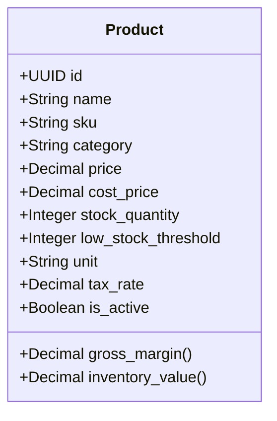
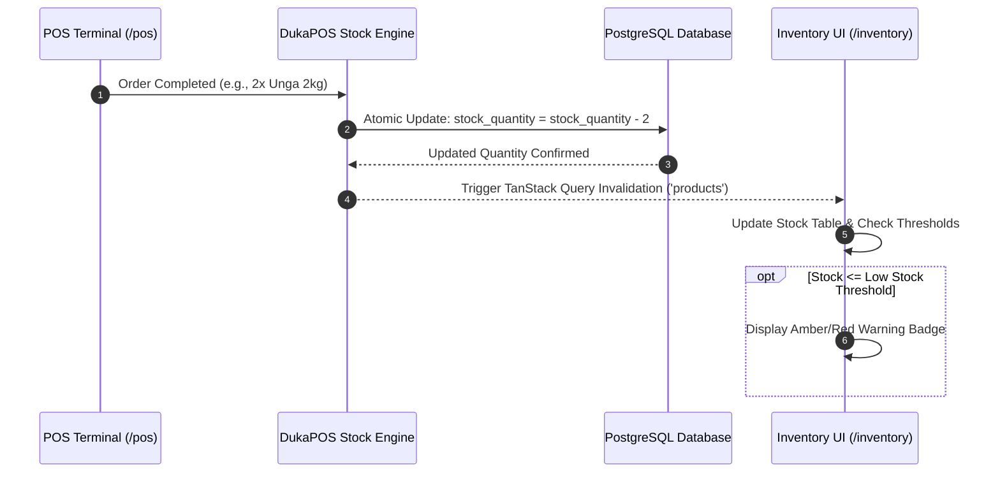

# Chapter 4: Inventory & Catalog Management

---

## 4.1 Product Catalog Architecture

The Inventory module (`/inventory`) functions as the master repository for all stock-keeping units (SKUs) sold across a retail business.



### 1. Product Data Attributes
Each product record comprises the following operational attributes:
- **Product Name**: Commercial label of the item (e.g., *Brookside Fresh Milk 500ml*).
- **SKU / Barcode**: Unique identification code (supports EAN-13, UPC-A, Code 128, or internal alphanumeric codes).
- **Category**: Departmental classification (*Groceries, Beverages, Dairy, Bakery, Snacks, Household, Personal Care, Electronics, Clothing*).
- **Selling Price**: The gross customer-facing retail shelf price (VAT inclusive).
- **Cost Price**: The wholesale acquisition price paid to the supplier.
- **Stock Quantity**: Current physical units available on shelf or backroom.
- **Low Stock Threshold**: Warning threshold (defaults to 10 units) triggering replenishment alerts.
- **Unit of Measure (UOM)**: Unit classification (*piece, kg, liter, meter, pack, carton*).
- **Tax Rate**: VAT percentage applicable (*16% standard, 0% zero-rated, or exempt*).
- **Status (`is_active`)**: Active trading flag (inactive items are hidden from the POS terminal).

### 2. Profit Margin & Markup Calculation
DukaPOS automatically calculates profitability metrics to protect store margins:
$$\text{Gross Profit per Unit} = \text{Selling Price} - \text{Cost Price}$$
$$\text{Gross Profit Margin (\%)} = \left( \frac{\text{Selling Price} - \text{Cost Price}}{\text{Selling Price}} \right) \times 100$$
$$\text{Stock Asset Value} = \text{Stock Quantity} \times \text{Selling Price (or Cost Price)}$$

### 3. Creating & Editing Products
- **Single Product Entry**: Click **Add Product** to open the modal. Fill in name, SKU, category, cost price, retail price, opening stock, and tax classification.
- **Bulk Product Import (CSV)**: For stores migrating from legacy spreadsheets, click **Bulk Upload**:
  - Download the pre-formatted CSV template.
  - Fill in `name`, `sku`, `category`, `price`, `cost_price`, `stock_quantity`, `unit`, `tax_rate`.
  - Upload the file to import hundreds of items in a single transaction.

---

## 4.2 Stock Control & Inventory Tracking

DukaPOS employs real-time transactional synchronization to ensure physical stock matches digital records.



### 1. Real-Time Automated Stock Deduction
- Every completed sale instantly executes an atomic SQL decrement on the respective `Product.stock_quantity`.
- Deductions prevent overselling during simultaneous checkouts across multiple cash desks.

### 2. Threshold Alerts & Visual Badges
- **Normal Stock**: $\text{Stock Quantity} > \text{Threshold}$ (Neutral / Green indicator).
- **Low Stock**: $1 \le \text{Stock Quantity} \le \text{Threshold}$ (Amber badge warning).
- **Out of Stock**: $\text{Stock Quantity} = 0$ (Red alert badge; item is disabled on POS).

### 3. Rapid Restocking Workflows
Store supervisors have three distinct pathways to replenish inventory:
- **Scan-to-Restock Bar**:
  - Enable **Scan Mode** on the inventory page.
  - Scan any incoming crate or box barcode with the handheld scanner.
  - The restock modal pops up with the item pre-selected; type the received quantity and confirm.
- **Quick Restock Action**:
  - Click the restock icon on any table row to increment units directly without opening the full edit dialog.
- **Bulk Stock Adjustment**:
  - Select checkboxes for multiple products.
  - Click **Bulk Stock Update** to adjust counts across selected items simultaneously.

---

## 4.3 Barcode Generation & Label Printing

DukaPOS includes an integrated SVG barcode engine that transforms internal SKUs into printable barcode labels for merchandise lacking manufacturer barcodes.

```
+-------------------------------------------------------------+
| Print Product Barcodes                                      |
+-------------------------------------------------------------+
| Label Size: [ Medium (price tag - 160px)                 v] |
| Selected Items: 12 SKUs selected                            |
+-------------------------------------------------------------+
| Preview:                                                    |
|  +-------------------------+   +-------------------------+  |
|  | Unga Maize Flour 2kg    |   | White Sugar 1kg         |  |
|  | ||||||||||||||||||||||| |   | ||||||||||||||||||||||| |  |
|  |       UNG-2KG-001       |   |       SUG-1KG-004       |  |
|  |       KES 180.00        |   |       KES 160.00        |  |
|  +-------------------------+   +-------------------------+  |
+-------------------------------------------------------------+
|                                  [ Cancel ]  [ Print Labels]|
+-------------------------------------------------------------+
```

### Label Formats & Dimensions
The print dialog renders responsive print-ready sheets optimized for standard thermal label printers (Zebra, Xprinter, Rongta) and standard A4 adhesive paper:

| Format Name | Label Width | Target Use Case | Display Content |
|---|:---:|---|---|
| **Small (Shelf Label)** | `120px` | Shelf-edge tagging, small cosmetic items | Product Name, Compact Barcode, Price |
| **Medium (Price Tag)** | `160px` | General grocery, bags, bottled goods | Product Name, Full Barcode, Human-Readable SKU, Price |
| **Large (A4 Full)** | `220px` | Warehouse carton identification, bulk sacks | Product Name, High-Density Barcode, Price |

### Printing Workflow
1. Select items in the inventory table (or click **Select All**).
2. Click **Print Barcodes** in the action bar.
3. Choose the label size profile (**Small**, **Medium**, or **Large**).
4. Click **Print Labels**. A clean, CSS print-optimized window opens and triggers the browser’s native print dialog for output to your label printer.

---
