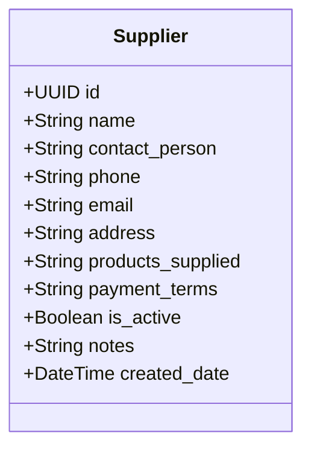
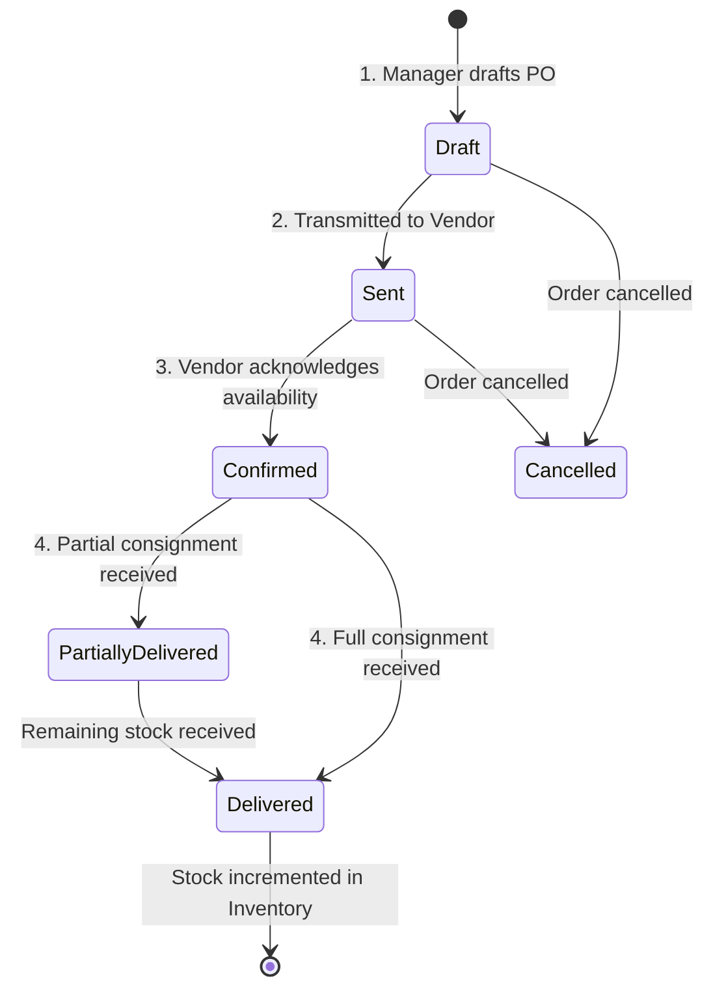
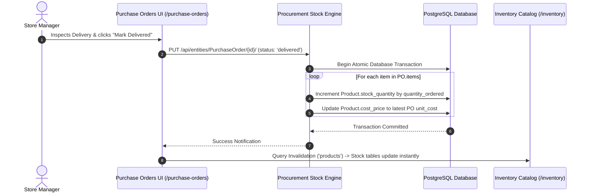

# Chapter 5: Procurement, Suppliers & Purchase Orders

---

## 5.1 Supplier Directory (`/suppliers`)

The Supplier module serves as the central vendor relationship manager. Maintaining accurate supplier records ensures reliable replenishment, consistent cost tracking, and clear credit accounting.

### 1. Supplier Profiles & Attributes
Each supplier directory card records:
- **Business Legal Name**: Corporate or trade name of the distributor/wholesaler (e.g., *Unga Limited*, *Brookside Dairy*, *Bidco Africa*).
- **Primary Contact Person**: Lead sales representative or account manager.
- **Phone Number & Email**: Direct telephone contact for reorder coordination.
- **Physical Address & Warehouse**: Depots, delivery staging areas, and dispatch locations.
- **Categories / Products Supplied**: Departmental tag list of goods supplied (e.g., *Dairy, Edible Oils, Dry Grains*).
- **Payment Terms**:
  - **Cash on Delivery (COD)**: Payment settled upon offloading.
  - **Net 7 Days**: Payment due one calendar week post-delivery.
  - **Net 15 Days**: Bi-weekly settlement cycle.
  - **Net 30 Days**: Standard monthly credit invoice term.
  - **Credit Account**: Flexible revolving balance account.
- **Status (`is_active`)**: Active trading vendor or archived contact.

### 2. Managing the Vendor Directory
- **Search & Filter**: Search suppliers by business name, contact person, or phone number. Filter by active vs. inactive vendor relationships.
- **Editing Information**: Update credit terms, dispatch contacts, and physical addresses as supplier terms evolve.

---

## 5.2 Purchase Orders Workflow (`/purchase-orders`)

The Purchase Orders (PO) workflow standardizes how retail managers plan, execute, and verify stock procurement from suppliers, preventing unplanned out-of-pocket expenses and uncontrolled inventory receipts.

### 1. Purchase Order Lifecycle & Statuses

| Status | Visual Badge | Operational Meaning |
|---|:---:|---|
| **`draft`** | Slate Grey | Internal procurement requisition created by a store manager. Stock quantities and prices can still be modified. |
| **`sent`** | Cool Blue | The official order document has been generated and transmitted to the supplier via email, PDF, or WhatsApp. |
| **`confirmed`** | Indigo | Supplier has verified order availability and committed to a delivery schedule. |
| **`partially_delivered`** | Amber/Orange | The delivery truck arrived with only a portion of the ordered goods. A partial Goods Received Note (GRN) is issued. |
| **`delivered`** | Emerald Green | The entire shipment has arrived, passed inspection, and been checked into the warehouse or stock room. |
| **`cancelled`** | Crimson Red | The requisition was voided due to stock unavailability, price disputes, or changing store demand. |

---

### 2. Creating a Purchase Order
1. Navigate to **Purchase Orders** (`/purchase-orders`) and click **New Order**.
2. **Order Number Generation**: The system auto-generates a sequence identifier:
   $$\text{PO-XXXXXX} \quad (\text{e.g. } \text{PO-849102})$$
3. **Vendor Selection**: Select an active vendor from the registered supplier directory.
4. **Order & Delivery Dates**: Set the requisition creation date and the expected arrival date for delivery bay scheduling.
5. **Line Item Specification**:
   - Select product SKUs from the master catalog.
   - Enter ordered units ($\text{Qty}$) and negotiated wholesale acquisition unit cost ($\text{Cost Price}$).
   - The total procurement commitment updates automatically:
     $$\text{Total Order Amount} = \sum (\text{Quantity Ordered} \times \text{Unit Cost Price})$$
6. **Delivery Notes & Special Instructions**: Add gate instructions, offloading specifications, or quality assurance inspection notes.
7. Click **Create Order** to persist the record in `draft` or `sent` status.

---

### 3. Goods Received Notes (GRN) & Automated Stock Increment

When the delivery vehicle arrives at the retail store:

1. **Physical Inspection**: The store manager or receiving clerk inspects physical packaging, verifying unit counts and expiry dates against the vendor's delivery note.
2. **Order Status Update**:
   - In the Purchase Orders screen, locate the order card and click **Update Status**.
   - Transition the order from `sent`/`confirmed` to **`delivered`**.
3. **Automated Stock Increment**:
   - The backend runs an atomic transaction that adds the received units directly into the active product record:
     $$\text{New Stock Quantity} = \text{Current Stock Quantity} + \text{Received Quantity}$$
   - The product's recorded `cost_price` is updated with the latest acquisition cost, recalculating downstream gross margins for subsequent sales.
4. **Financial Settlement Reconciliation**:
   - An accounts payable liability is established or an expense is recorded in `/expenses` if settled immediately via store cash float or corporate bank transfer.

---
