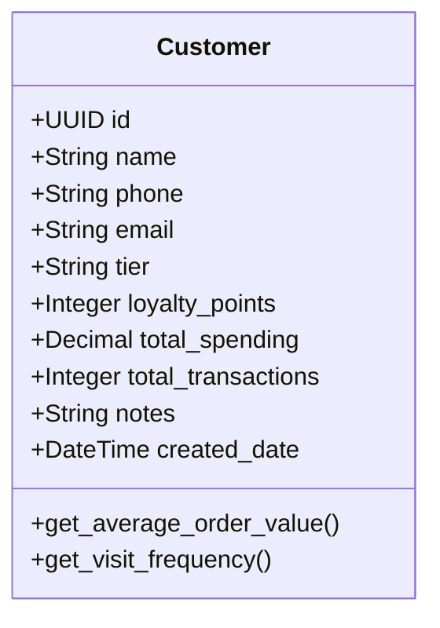
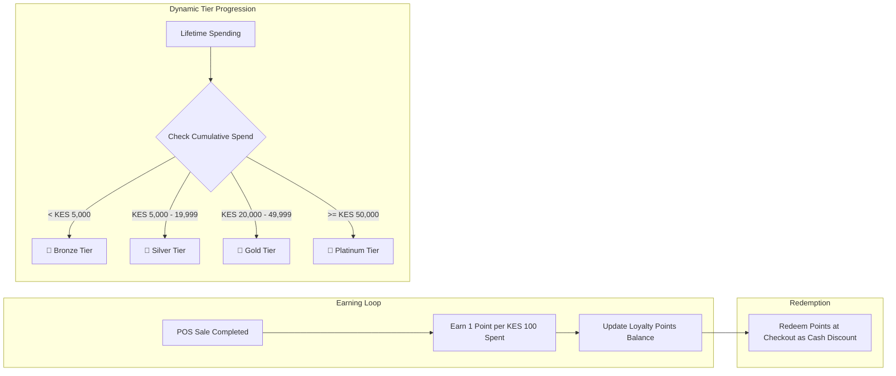

# Chapter 6: Customers & Customer Loyalty

---

## 6.1 Customer Relationship Management (CRM)

The Customer Management module (`/customers`) tracks shopper relationships, purchase frequencies, average basket sizes, and credit balances.

### 1. Customer Profiles & Information
Store managers and cashiers can register customer details either in advance via `/customers` or on-the-fly at the POS terminal during checkout:
- **Full Name**: Customer's full or business name.
- **Mobile Number**: Primary identifier (crucial for M-Pesa STK prompts and SMS receipts).
- **Email Address**: Digital invoice and e-receipt delivery.
- **Customer Notes**: Special preferences, delivery addresses, dietary needs, or trade terms.

### 2. CRM Analytics & Purchase History
Clicking on any customer card launches the **Customer 360 Profile Dialog**:
- **Lifetime Revenue & Basket Metrics**:
  $$\text{Average Order Value (AOV)} = \frac{\text{Total Spending}}{\text{Total Transactions}}$$
- **Purchase Frequency & Recency**: Tracks the average interval between store visits (in days) and days since last purchase.
- **Preferred Tender Channel**: Displays whether the shopper predominantly pays via Cash, M-Pesa, or Card.
- **Historical Receipts Ledger**: Complete chronological record of every receipt number, items purchased, discounts applied, and cashier involved.
- **Export to CSV**: Export the customer directory, tiers, and spending totals for localized SMS marketing campaigns.

---

## 6.2 Customer Loyalty & Dynamic Tier Engine

DukaPOS incorporates an automated customer loyalty algorithm that drives repeat retail visits without requiring external plastic cards.

### 1. Points Earning Mechanics
Loyalty points are awarded automatically on every completed sale where a customer profile is attached:
$$\text{Points Earned} = \left\lfloor \frac{\text{Sale Subtotal}}{100} \right\rfloor$$
*Example*: A grocery purchase of **KES 1,480** automatically awards **14 Loyalty Points** to the customer's account.

---

### 2. Dynamic Tier Classification
As customers accumulate lifetime spending, DukaPOS dynamically upgrades their membership tier:

| Tier | Icon | Qualifying Lifetime Spending | Customer Benefit & Standing |
|---|:---:|:---:|---|
| **Bronze** | 🥉 | **KES 0 – 4,999** | Standard entry-level tier for newly registered shoppers. |
| **Silver** | 🥈 | **KES 5,000 – 19,999** | Regular customer status; eligible for seasonal promotional pricing. |
| **Gold** | 🥇 | **KES 20,000 – 49,999** | High-value customer status; priority customer support & special discount events. |
| **Platinum** | 💎 | **$\ge$ KES 50,000** | VIP retail shopper; maximum redemption values and tailored retail privileges. |

---

### 3. Points Redemption at POS Checkout
1. When ringing up a transaction in `/pos`, the cashier attaches the customer by typing their name or mobile phone number into the **Customer Search Bar**.
2. The current point balance and active tier badge display prominently on the cashier screen.
3. At checkout (`CheckoutDialog`):
   - If the customer has accumulated points, the cashier checks **Redeem Loyalty Points**.
   - The cashier enters the number of points the customer wishes to redeem.
   - The system converts the points into an instant monetary deduction:
     $$\text{Final Payable Total} = \text{Order Total} - \text{Loyalty Discount}$$
   - The points balance is deducted immediately upon sale confirmation.

---
