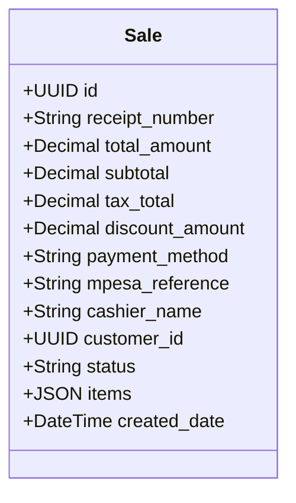
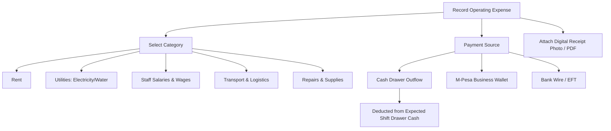
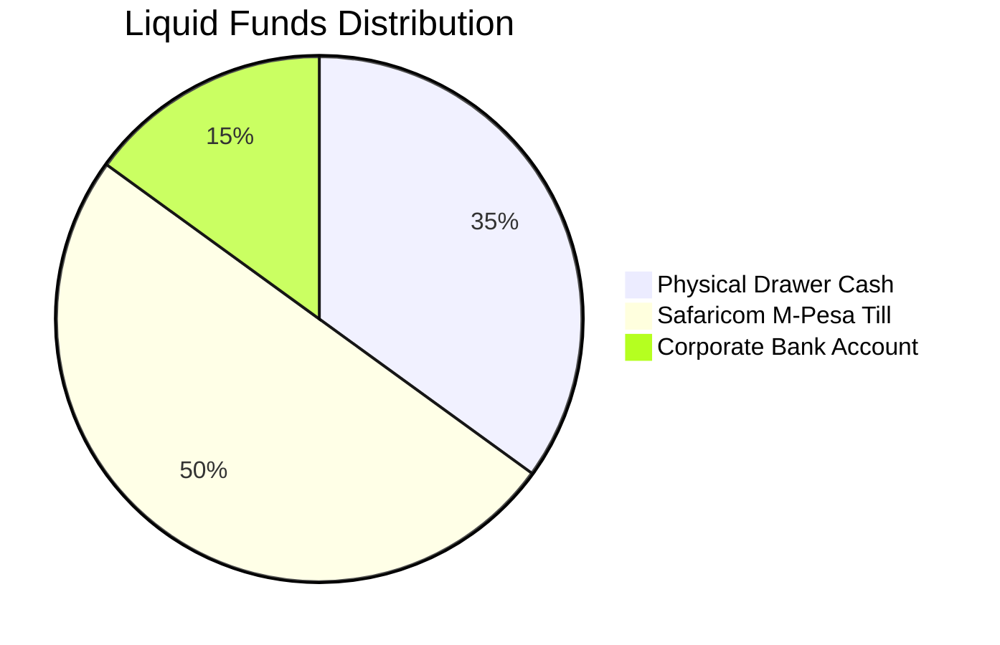

# Chapter 7: Financial Accounting, Expenses & Cash Flow

---

## 7.1 Sales & Transaction History (`/transactions`)

The Transactions ledger records every sale processed across all cash registers, providing complete financial transparency and auditing.

### 1. Transaction Inspection & Line-Item Drilldown
- Every record displays the **Receipt Number**, timestamp, cashier, customer name, total amount, and color-coded payment badge.
- Clicking **View** launches the **Interactive Receipt Modal**:
  - Itemized lines with unit prices, quantity multipliers, and line totals.
  - Tax computation breakdown (Standard 16% VAT vs. Exempt).
  - M-Pesa confirmation reference codes.
  - Options to **Reprint Receipt** on connected ESC/POS thermal printers or **Export as PDF Document**.

### 2. Multi-Criteria Transaction Filters
Cashiers and accountants can locate specific historical tickets using specialized filter parameters:
- **Search Scopes**: Filter globally or restrict search to *Receipt #*, *Customer Name*, *Cashier Name*, *Product Title*, or *M-Pesa Reference*.
- **Tender Type**: Filter by Cash, M-Pesa, Card, Bank Transfer, Cheque, or Split.
- **Date Range**: Specify custom start (`dateFrom`) and end (`dateTo`) boundaries.
- **Amount Thresholds**: Filter by minimum and maximum transaction values.

### 3. Returns, Refunds & Voiding Protocol
When a customer returns merchandise in accordance with store policy:
1. Locate the original transaction in `/transactions` and click **Process Return**.
2. **Item-Level Returns**: Select which specific items and quantities from the ticket are being returned.
3. **Restocking Automation**: Returned units are automatically returned to `Product.stock_quantity`.
4. **Refund Tender**: Refund is issued via the original payment method (Cash or M-Pesa reversal).
5. The sale status is updated to `refunded` or `partially_refunded` with full audit trail logging.

---

## 7.2 Operating Expense Management (`/expenses`)

Small and medium retail establishments often suffer revenue loss from unrecorded cash drawer withdrawals. DukaPOS enforces rigorous expense logging for all operational overheads.

### 1. Standard Expense Classifications
DukaPOS categorizes expenditures into 10 standard general ledger accounts:
- **Rent**: Store premises lease payments.
- **Utilities**: Kenya Power (KPLC) tokens, water bills, internet subscriptions.
- **Salaries**: Casual daily labor, security guards, and staff wage advances.
- **Supplies**: Thermal receipt paper rolls, packaging carrier bags, cleaning materials.
- **Maintenance**: Equipment repairs, refrigeration servicing, lighting fixes.
- **Transport**: Bodaboda delivery costs, matatu fares for inventory errands, fuel.
- **Marketing**: Signboards, flyers, and local SMS promotional broadcasts.
- **Insurance**: Public liability, stock fire and burglary premiums.
- **Taxes & Licenses**: County government single business permits, music copyrights (MCSK), signage permits.
- **Other**: Miscellaneous operational petty cash items.

### 2. Cash Drawer Outflow vs. Digital Payments
- **Paid from Cash Drawer**: When petty cash is taken directly from the till, the system links the expense to the cashier's active shift. The physical cash drawer reconciliation formula automatically accounts for this outflow:
  $$\text{Expected Drawer Cash} = \text{Opening Float} + \text{Cash Sales} - \text{Cash Expenses}$$
- **Paid from Digital Channels**: Payments made from the owner's bank account or corporate M-Pesa Paybill update the general ledger without penalizing the cashier's physical drawer count.

### 3. Receipt Attachment & Recurring Schedules
- **Proof of Expense**: Attach a photograph or PDF voucher of the vendor's physical receipt directly into the secure document vault.
- **Recurring Expenses**: Toggle the `is_recurring` flag for predictable monthly overheads like rent and internet.

---

## 7.3 Cash Flow & Liquidity Tracker (`/cash-flow`)

The Cash Flow dashboard provides business owners with real-time insight into store liquidity across all holding accounts.

### 1. Multi-Channel Cash Movements
DukaPOS categorizes movements into **Inflows** (money entering the business) and **Outflows** (money exiting):
- **Transaction Types**:
  - `inflow`: Sales revenues, owner capital injections, loan proceeds, vendor refunds.
  - `outflow`: Operating expenses, stock purchase order settlements, owner drawings, debt servicing.
- **Holding Accounts Tracked**:
  - *Cash in Drawer*: Physical cash sitting in store cash drawers.
  - *M-Pesa Till / Paybill*: Digital funds accumulating in Safaricom merchant accounts.
  - *Bank Accounts*: Commercial checking or savings accounts.

### 2. Real-Time Net Cash Flow Formula
Store owners monitor enterprise solvency using live liquidity indicators:
$$\text{Net Cash Flow} = \sum \text{Inflows} - \sum \text{Outflows}$$
$$\text{Total Business Liquidity} = \text{Drawer Cash} + \text{M-Pesa Merchant Balance} + \text{Bank Balance}$$

---
