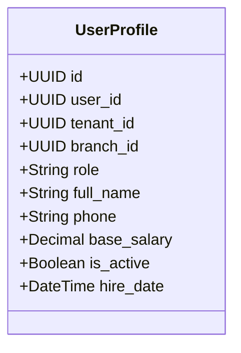
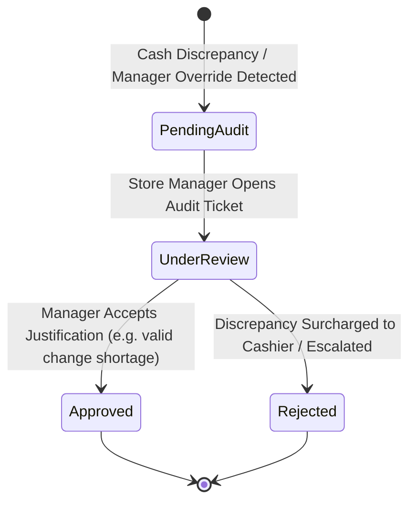
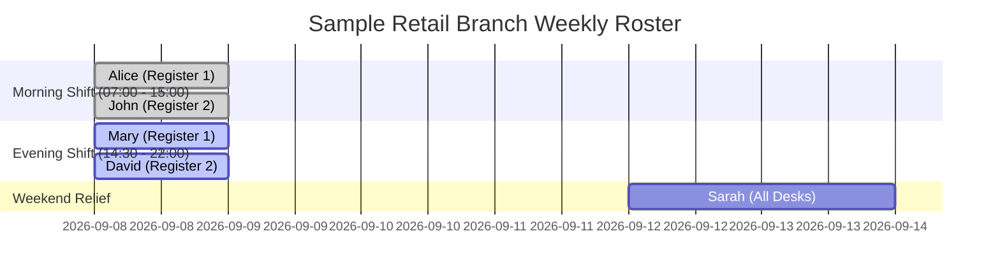
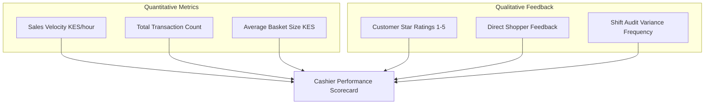

# Chapter 8: Staff Management, Scheduling & Audits

---

## 8.1 Staff Directory & Permissions (`/staff`, `/employees`)

The Staff Hub and Employee Directory provide comprehensive oversight of retail human resources, user credentials, access privileges, and employment profiles.

### 1. Staff Profiles & Role Assignment (`/employees/profile`)
Each staff member record maintains both operational and HR attributes:
- **Identity & Contact**: Full name, national ID number, telephone number, and emergency contact details.
- **Role Assignment**: Defines the user's role hierarchy (`cashier`, `manager`, `admin`).
- **Assigned Branch Outlet**: Restricts access so cashiers can only ring up sales and access cash registers within their designated branch.
- **Remuneration & Terms**: Records base salary, hourly wage rates, hire date, and contract status.
- **Account State (`is_active`)**: Immediately revokes system access upon termination or disciplinary suspension without deleting historical transaction audit logs.

### 2. Cashier Invitation & Secret Code Revocation
- Managers generate secure invitation links for new hires (`/invite/accept`).
- In case of lost mobile devices or compromised credentials, managers can instantly reset passwords, invalidate active JWT refresh tokens, or deactivate cashier accounts from the dashboard.

---

## 8.2 Shift Auditing & Loss Prevention (`/shift-audits`)

The Shift Audit module acts as the internal control clearinghouse, systematically cataloging cash drawer variances and manager overrides.

### 1. Shift Discrepancy Audits
Whenever a shift is closed with a non-zero cash variance, DukaPOS automatically generates a `ShiftAudit` ticket:
$$\text{Cash Discrepancy} = \text{Actual Cash Counted} - \text{Expected System Balance}$$
- **Shortage (Negative Variance)**: Physical cash counted is less than expected. The ticket records the deficit and requires the cashier to submit an explanation.
- **Overage (Positive Variance)**: Physical cash counted exceeds rung sales.

### 2. Audit Record Types (`audit_type`)
The audit trail monitors five distinct frontline operational risks:

| Audit Type | Trigger Event | Risk Mitigated |
|---|---|---|
| **`cash_discrepancy`** | End-of-shift drawer count mismatch | Till skimming, improper change dispensing, unrecorded cash-outs. |
| **`manual_adjustment`** | Mid-shift cash float deposit or withdrawal | Unrecorded float transfers between registers. |
| **`refund_override`** | Cash refund issued to customer for returned goods | Fictitious refunds processed by counter staff. |
| **`discount_override`** | Discount applied exceeding KES 1,000 or 20% | Unauthorized clerk markdowns for friends/family. |
| **`void_transaction`** | Whole cart cancellation after items rung | Ringing sales, taking cash, and voiding the receipt. |

### 3. Manager Approval Workflow
- Store managers review all pending audit items at `/shift-audits`.
- Each record links directly to the associated cashier name, timestamp, shift ID, and receipt snapshot.
- The manager can click **Approve** (accepting the variance explanation) or **Reject** (flagging the employee profile for wage deduction or disciplinary review).

---

## 8.3 Employee Scheduling & Rostering (`/employee-scheduling`)

The Employee Scheduling module prevents understaffing during peak retail trading windows and ensures equitable shift distribution.

### 1. Shift Types & Roster Planning
- **Morning Shift**: Opening shift covering morning store deliveries, inventory unpacking, and early commuters (e.g., 07:00 – 15:00).
- **Evening Shift**: Prime afternoon and peak evening rush covering closing drawer counts and store lockdown (e.g., 14:30 – 22:00).
- **Full Day Shift**: Weekend or holiday shifts with scheduled meal rotations.

### 2. Scheduling Calendar
- Interactive calendar displays shift coverage per day.
- Managers assign staff to specific registers or departments with automated clash detection.

---

## 8.4 Staff Performance & Ratings (`/staff-performance`)

The Staff Performance module delivers quantitative and qualitative KPIs, helping management recognize top-performing cashiers and identify retraining needs.

### 1. Quantitative Performance KPIs
- **Sales Velocity**: Total gross revenue rung up by the cashier per hour of active shift time.
- **Transaction Throughput**: Average number of customer carts processed per hour.
- **Average Basket Size (AOV)**: Average spend per customer served by the attendant.
- **Drawer Accuracy Index**: Percentage of shifts closed with zero or near-zero variance ($< \text{KES } 50$).

### 2. Customer Service Ratings & Feedback (`EmployeeRating`)
- Digital receipts sent via SMS or email include a 1-click star rating link (1 to 5 stars).
- Customers can rate their checkout experience and leave qualitative remarks regarding cashier friendliness, speed, and packaging care.
- Real-time rating leaderboards display top-rated cashiers on the management dashboard.

---
