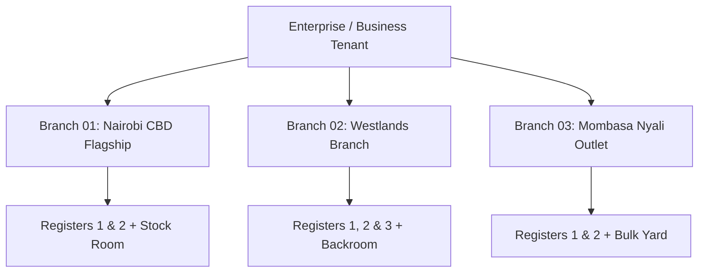
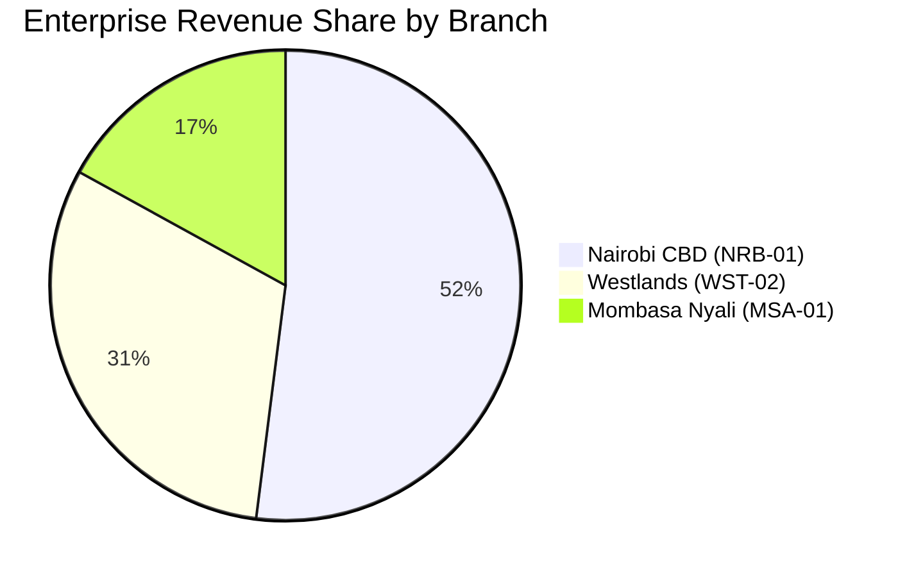

# Chapter 9: Multi-Branch & Store Management

---

## 9.1 Multi-Store Configuration (`/branches`)

As retail businesses scale from a single shop into a chain or franchise network, DukaPOS enables centralized governance over geographically dispersed outlets while maintaining strict local accountability.

### 1. Branch Data Structure
Each branch entity is registered with specific operational parameters:
- **Branch Name**: Commercial label (e.g., *Moi Avenue Flagship*, *Nyali Centre Outlet*).
- **Branch Code**: Short identifier used for prefixing receipts and SKU transfers (e.g., `NRB-CBD`, `MSA-01`, `KSM-02`).
- **Physical Location**: Physical address, county, building, and delivery bay directions.
- **Store Manager**: Designated supervisor in charge of daily cash reconciliations and shift approvals.
- **Direct Telephone**: On-site customer service or dispatch telephone number.
- **Operating Hours**: Standard trading window (e.g., `07:30 - 21:00`).
- **Fixed Overheads**: Branch monthly rent and outstanding premises liabilities for branch-level profitability calculations.
- **Operational Status**: Active trading or temporarily paused for renovations.

### 2. Staff & Cash Desk Localization
- Staff members are linked directly to an assigned branch outlet.
- When cashiers sign into `/pos`, the terminal automatically binds their sales, shifts, cash drawer floats, and receipts to their physical branch code.
- Store managers are granted supervisory authority restricted to their designated branch's shifts and inventory.

---

## 9.2 Inter-Branch Inventory & Performance Analytics

Managing multiple branches introduces the challenge of identifying which locations generate net cash versus which drain working capital.

### 1. Branch Profitability & Net Position
DukaPOS calculates the true financial standing of each individual outlet by factoring in localized overheads:
$$\text{Branch Revenue} = \sum \text{Sales Rung at Branch Registers}$$
$$\text{Branch Net Position} = \text{Branch Revenue} - \text{Monthly Rent} - \text{Branch Debt / Overheads}$$

### 2. Multi-Branch Comparative Visualizations
The Branches overview page presents interactive analytics:
- **Revenue Share (%)**: Contribution of each branch to overall company turnover:
  $$\text{Revenue Share (\%)} = \left( \frac{\text{Branch Revenue}}{\text{Total Enterprise Revenue}} \right) \times 100$$
- **Cross-Branch Financial Bar Charts**: Grouped visual bars comparing gross revenue, net position, rent expense, and liabilities across all operational outlets.
- **Top Performer Recognition**: Identifies the highest-velocity store location based on gross sales and transaction count over trailing trading cycles.
- **Staffing Density**: Ratios of cashiers and floor attendants allocated relative to branch transaction volume, highlighting understaffed or overstaffed locations.

---
