# DukaPOS — Database Models & Schema Reference

This document provides a comprehensive technical reference for all database models implemented in DukaPOS (`server/api/models.py`).

```mermaid
erDiagram
    Tenant ||--o{ UserProfile : has
    Tenant ||--o{ BusinessSettings : configures
    Tenant ||--o{ Branch : operates
    Tenant ||--o{ CashierInvite : issues
    Tenant ||--o{ Product : stocks
    Tenant ||--o{ Customer : registers
    Tenant ||--o{ Supplier : purchases_from
    Tenant ||--o{ Shift : records
    Tenant ||--o{ Sale : transacts
    Tenant ||--o{ Expense : tracks
    Tenant ||--o{ EmployeeRating : reviews
    Tenant ||--o{ EmployeeSchedule : schedules
    Tenant ||--o{ Promotion : publishes
    Tenant ||--o{ MpesaPayment : receives
    Tenant ||--o{ ShiftAudit : audits
    Tenant ||--o{ CashFlow : monitors
    Tenant ||--o{ PurchaseOrder : procures
    Tenant ||--o{ VaultDocument : archives
    Tenant ||--o{ ReceiptFeedback : collects
    Tenant ||--o{ Subscription : pays
```

---

## 1. Core Tenant & Identity Models

### `Tenant`
Represents an independent business entity or retail enterprise operating within the system.
- **`id`**: Auto-increment integer primary key.
- **`name`** (`CharField(255)`): Legal or official business name.
- **`slug`** (`SlugField(100, unique=True)`): URL-friendly unique identifier for the tenant.
- **`owner_name`** (`CharField(255)`): Full legal name of the primary proprietor.
- **`owner_email`** (`EmailField`): Contact email for billing, alerts, and owner notifications.
- **`owner_phone`** (`CharField(50, null=True, blank=True)`): Telephone / M-Pesa number.
- **`business_type`** (`CharField(100, default='sme')`): Enterprise classification (e.g. `sme`, `supermarket`, `pharmacy`, `hardware`).
- **`currency`** (`CharField(10, default='KES')`): Default currency symbol and pricing unit.
- **`plan`** (`CharField(50, default='starter')`): SaaS plan (`starter`, `professional`, `enterprise`).
- **`is_active`** (`BooleanField(default=True)`): Operational status flag.
- **`is_onboarded`** (`BooleanField(default=False)`): Indicates if initial wizard setup is completed.
- **`created_at`** / **`updated_at`**: ISO timestamps.

### `UserProfile`
Links a standard Django `User` model to a specific `Tenant` and associates an app-level role.
- **`user`** (`OneToOneField(User, on_delete=CASCADE, related_name='profile')`): Underlying authentication record.
- **`tenant`** (`ForeignKey(Tenant, on_delete=CASCADE, null=True, blank=True)`): Operating business context.
- **`role`** (`CharField(50, default='admin')`): System role: `admin`, `manager`, or `cashier`.

### `CashierInvite`
Manages tokenized email invitations sent to onboarding cashiers or branch operators.
- **`tenant`** (`ForeignKey(Tenant, on_delete=CASCADE)`): Issuing business.
- **`email`** (`EmailField`): Invitee destination email.
- **`role`** (`CharField(50, default='cashier')`): Assigned role upon acceptance.
- **`token`** (`UUIDField(default=uuid.uuid4, unique=True)`): High-entropy validation token.
- **`invited_by`** (`ForeignKey(User, on_delete=SET_NULL, null=True)`): Issuer admin.
- **`accepted`** (`BooleanField(default=False)`): True once the account password has been established.
- **`expires_at`** (`DateTimeField`): Expiry deadline (default: 48 hours).

---

## 2. Configuration & Branch Infrastructure

### `BusinessSettings`
Stores granular store operational configurations, fiscal registration details, and hardware preferences.
- **`tenant`** (`ForeignKey(Tenant)`): Owner business.
- **`business_name`** & **`trading_name`**: Formal and public-facing business names.
- **`kra_pin`** (`CharField(50, default='A001234567Z')`): Kenya Revenue Authority Tax Identification PIN.
- **`vat_number`** & **`vat_registered`** (`BooleanField`): VAT registration status.
- **`etims_enabled`** (`BooleanField(default=False)`): Toggle for automatic KRA eTIMS transmission.
- **`default_tax_rate`** (`FloatField(default=16.0)`): Standard VAT rate in Kenya (16%).
- **`mpesa_paybill`**, **`mpesa_till`**, **`mpesa_account`**: Daraja payment routing credentials.
- **`receipt_header`** & **`receipt_footer`**: Custom greeting and return terms printed on receipts.
- **`return_policy`** & **`exchange_policy`**: Store dispute guidelines.
- **`branches`**, **`selected_goods`**, **`selected_services`**: JSON metadata stores.

### `Branch`
Supports multi-store retail operations with location-specific managers, rental metrics, and status tracking.
- **`tenant`** (`ForeignKey(Tenant)`): Enterprise owner.
- **`name`** (`CharField(255)`): Branch identifier (e.g. `Nairobi CBD`, `Westlands`).
- **`code`** (`CharField(50)`): Internal branch code (e.g. `NBI-01`).
- **`location`** (`TextField`): Physical street address and building name.
- **`manager`** (`CharField(255)`): Designated branch supervisor name.
- **`phone`** & **`working_hours`**: Branch operating schedule.
- **`status`** (`CharField(50, default='active')`): `active`, `maintenance`, `closed`.
- **`monthly_rent`** & **`debt`** (`FloatField`): Fixed overheads for branch P&L tracking.

---

## 3. Product Catalog & Inventory Models

### `Product`
Master catalog item record storing pricing, tax rates, inventory levels, and replenishment alerts.
- **`tenant`** (`ForeignKey(Tenant)`): Business owner.
- **`name`** (`CharField(255)`): Item title.
- **`sku`** (`CharField(100, unique=True, null=True, blank=True)`): Stock Keeping Unit or EAN barcode.
- **`category`** (`CharField(100)`): Product classification (e.g. `Beverages`, `Bakery`, `Electronics`).
- **`price`** (`FloatField`): Retail selling price (VAT inclusive or exclusive based on settings).
- **`cost_price`** (`FloatField`): Landed cost / purchasing price for Gross Profit calculation.
- **`stock_quantity`** (`IntegerField(default=0)`): Current shelf / warehouse balance.
- **`low_stock_threshold`** (`IntegerField(default=10)`): Reorder trigger point.
- **`unit`** (`CharField(50, default='piece')`): Unit of measurement (`piece`, `kg`, `litre`, `pack`).
- **`tax_rate`** (`FloatField(default=16.0)`): Applicable VAT percentage (16%, 8% for fuel, 0% for exempt).
- **`is_active`** (`BooleanField(default=True)`): Soft-delete visibility flag.

---

## 4. Sales, POS & Fiscal Models

### `Shift`
Tracks cashier work sessions, cash drawer floats, and shift performance.
- **`tenant`** (`ForeignKey(Tenant)`)
- **`cashier_id`** & **`cashier_name`**: Cashier identifiers.
- **`status`** (`CharField(50, default='active')`): `active` or `closed`.
- **`started_at`** & **`ended_at`**: Session duration timestamps.
- **`starting_cash`** (`FloatField(default=0.0)`): Opening float placed in the physical drawer.
- **`total_sales`** (`FloatField(default=0.0)`): Gross sales processed during session.
- **`total_transactions`** (`IntegerField(default=0)`): Number of checkouts executed.

### `Sale`
The immutable ledger record of completed checkout transactions.
- **`tenant`** (`ForeignKey(Tenant)`)
- **`receipt_number`** (`CharField(100, unique=True)`): Unique human-readable receipt code (e.g. `RC-2026-0012`).
- **`shift_id`** (`CharField(100, null=True, blank=True)`): Linked cashier shift.
- **`cashier_id`** & **`cashier_name`**: Staff member who finalized the transaction.
- **`subtotal`** (`FloatField`): Gross item totals before tax.
- **`tax_total`** (`FloatField`): Total VAT assessed.
- **`total_amount`** (`FloatField`): Final tender amount.
- **`payment_method`** (`CharField(50)`): `cash`, `mpesa`, `card`, or `split`.
- **`status`** (`CharField(50, default='completed')`): `completed`, `refunded`, `voided`.
- **`items`** (`JSONField`): Array of line items snapshotting product ID, name, quantity, unit price, and line total.
- **`etims_status`** (`CharField(50, default='pending')`): `pending`, `submitted`, `failed`.
- **`cuin`** (`CharField(100, null=True, blank=True)`): KRA eTIMS Control Unit Internal Number.

### `MpesaPayment`
Tracks mobile money transactions via Safaricom Daraja STK Push or C2B confirmation.
- **`tenant`** (`ForeignKey(Tenant)`)
- **`merchant_request_id`** & **`checkout_request_id`**: Safaricom gateway transaction identifiers.
- **`amount`** (`FloatField`): Tendered sum in KES.
- **`phone_number`** (`CharField(50)`): Customer MSISDN (e.g. `254712345678`).
- **`status`** (`CharField(50, default='pending')`): `pending`, `success`, `failed`, `cancelled`.
- **`receipt_number`** (`CharField(100, null=True)`): Safaricom M-Pesa transaction reference (e.g. `QHD4583921`).
- **`transaction_date`** (`DateTimeField`): Gateway execution timestamp.

---

## 5. Customers, CRM & Loyalty

### `Customer`
Customer relationship profile with automated loyalty engine calculations.
- **`tenant`** (`ForeignKey(Tenant)`)
- **`name`** (`CharField(255)`): Customer full name.
- **`phone`** (`CharField(50)`): Primary identifier / SMS notification destination.
- **`email`** (`EmailField, null=True`)
- **`loyalty_points`** (`IntegerField(default=0)`): Earned redeemable loyalty balance (1 point per 100 KES spent).
- **`total_spending`** (`FloatField(default=0.0)`): Cumulative lifetime purchase volume.
- **`total_transactions`** (`IntegerField(default=0)`): Total checkout counter visits.
- **`tier`** (`CharField(50, default='bronze')`): Dynamic tier (`bronze` < 5,000 KES; `silver` >= 5,000 KES; `gold` >= 20,000 KES).
- **`is_active`** (`BooleanField(default=True)`)

### `ReceiptFeedback`
Customer satisfaction feedback linked to physical or digital receipts.
- **`receipt_number`** (`CharField(100)`)
- **`merchant_name`** (`CharField(255)`)
- **`rating`** (`IntegerField(default=5)`): 1 to 5 stars.
- **`comment`** (`TextField, null=True`)
- **`customer_name`** (`CharField(255, null=True)`)

---

## 6. Procurement, Suppliers & Stock Transfers

### `Supplier`
Vendor profile for merchandise sourcing and trade accounts.
- **`tenant`** (`ForeignKey(Tenant)`)
- **`name`** (`CharField(255)`): Supplier / Wholesaler company title.
- **`contact_person`** & **`phone`** & **`email`**: Representative details.
- **`address`** (`TextField`): Physical depot address.
- **`products_supplied`** (`TextField`): Supply category descriptions.
- **`payment_terms`** (`CharField(100, default='net_30')`): Trade credit terms (`cash_on_delivery`, `net_15`, `net_30`, `net_60`).

### `PurchaseOrder`
Procurement document managing item orders and automatic inventory restock upon receipt.
- **`tenant`** (`ForeignKey(Tenant)`)
- **`order_number`** (`CharField(100, unique=True)`): Unique PO reference (e.g. `PO-2026-0045`).
- **`supplier_id`** & **`supplier_name`**: Vendor linkage.
- **`order_date`** & **`expected_delivery_date`**: Delivery scheduling.
- **`items`** (`JSONField`): Array of ordered items, SKUs, quantities, and agreed cost prices.
- **`subtotal`**, **`tax_amount`**, **`total_amount`**: Procurement financial totals.
- **`status`** (`CharField(50, default='draft')`): `draft`, `submitted`, `approved`, `delivered`, `cancelled`.
  > **Automated Stock Increment**: When status transitions to `delivered`, `process_purchase_order_stock_increase()` automatically raises product inventory levels!

---

## 7. Financial Auditing, Cash Flow & Expenses

### `Expense`
Records operational expenditures (rent, utilities, courier, casual wages, repairs).
- **`tenant`** (`ForeignKey(Tenant)`)
- **`shift_id`** (`CharField(100, null=True)`): Linked shift if paid directly out of the cash drawer float.
- **`amount`** (`FloatField`): Expenditure sum.
- **`category`** (`CharField(100)`): Category (e.g. `Utilities`, `Inventory Restock`, `Salaries`, `Maintenance`).
- **`description`** (`TextField`)
- **`date`** (`DateField`)
- **`payment_method`** (`CharField(50, choices=PAYMENT_METHOD_CHOICES, default='cash')`): `cash`, `mpesa`, `card`, `bank_transfer`, `cheque`.
- **`reference_number`** (`CharField(255, null=True)`): Voucher, receipt, or M-Pesa code.
- **`is_recurring`** (`BooleanField(default=False)`): Recurring expense indicator.
- **`receipt_url`** (`URLField(1000, null=True)`): Cloud image/document attachment.
- **`status`** (`CharField(50, default='approved')`)

### `CashFlow`
Comprehensive money-in / money-out ledger across banking, till, and physical drawer channels.
- **`tenant`** (`ForeignKey(Tenant)`)
- **`transaction_type`** (`CharField(50, default='inflow')`): `inflow` or `outflow`.
- **`amount`** (`FloatField`)
- **`category`** (`CharField(100)`)
- **`payment_method`** (`CharField(50, default='cash')`)
- **`reference_number`** & **`notes`**
- **`date`** (`DateTimeField(auto_now_add=True)`)

### `ShiftAudit`
Immutable security and loss prevention audit trail capturing critical cash drawer events and End-of-Day Z-Reports.
- **`tenant`** (`ForeignKey(Tenant)`)
- **`shift_id`** (`CharField(100)`): Associated session.
- **`action`** (`CharField(100)`): `close`, `openDrawer`, `voidItem`, `managerOverride`, `priceAdjustment`.
- **`performed_by`** (`CharField(255)`): Staff username responsible.
- **`timestamp`** (`DateTimeField(auto_now_add=True)`)
- **`notes`** (`TextField`): Diagnostic details, including cash variance analysis:
  $$\text{Expected Cash} = \text{Starting Cash} + \text{Cash Sales} - \text{Cash Drawer Expenses}$$
  $$\text{Variance} = \text{Actual Counted Cash} - \text{Expected Cash}$$

---

## 8. Vault, Telemetry & Subscriptions

### `VaultDocument`
Digital records vault preserving electronic invoices, warranties, tax certificates, and compliance proofs.
- **`tenant`** (`ForeignKey(Tenant)`)
- **`title`** (`CharField(255)`)
- **`document_type`** (`CharField(50)`): `receipt`, `invoice`, `budget`, `compliance`, `contract`.
- **`file_url`** (`URLField(1024)`)
- **`file_name`** & **`file_type`**
- **`tags`** (`JSONField`)
- **`amount`** & **`reference_number`**
- **`is_locked`** (`BooleanField(default=False)`)
- **`is_archived`** (`BooleanField(default=False)`)

### `Subscription`
SaaS account billing model tracking tier, renewals, and M-Pesa payment confirmations.
- **`tenant`** (`ForeignKey(Tenant)`)
- **`plan_name`** (`CharField(100, default='Starter')`)
- **`amount`** (`FloatField`)
- **`billing_cycle`** (`CharField(50, default='monthly')`)
- **`status`** (`CharField(50, default='active')`)
- **`payment_status`** (`CharField(50, default='paid')`)
- **`mpesa_reference`** (`CharField(100, null=True)`)
- **`start_date`** & **`end_date`**
