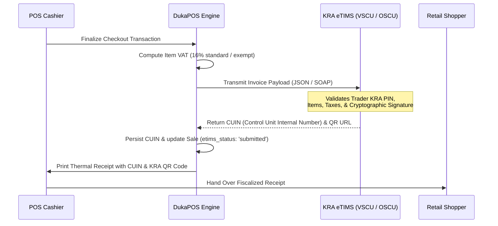
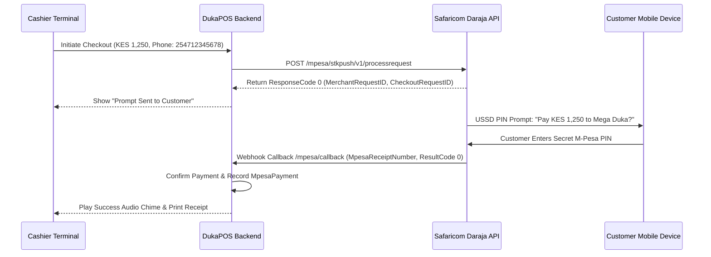

# DukaPOS — KRA eTIMS & Safaricom M-Pesa Integration Guide

This guide provides an in-depth technical overview of regulatory compliance with the **Kenya Revenue Authority (KRA) electronic Tax Invoice Management System (eTIMS)** and payment processing with **Safaricom Lipa Na M-Pesa (Daraja API)**.

---

## 1. KRA eTIMS Compliance Architecture

Under the Kenya Revenue Authority regulations, all registered businesses and VAT-registered entities must transmit electronic invoices in real-time or near-real-time to the KRA Tax Invoice Management System.



### eTIMS Data Model Requirements
For each fiscal receipt transmitted, DukaPOS structures the invoice with:
- **Seller Details**: Business Trading Name, Seller KRA PIN (e.g. `P051234567Z`).
- **Buyer Details**: Optional Buyer KRA PIN (mandatory for B2B or purchases above statutory thresholds).
- **Control Unit Internal Number (CUIN)**: Unique 19-character alphanumeric identifier generated upon signature (e.g. `KRAETIMS8492018471`).
- **Tax Breakdown**:
  - **Class A (Standard 16%)**: Default taxable commodities.
  - **Class B (Zero-Rated 0%)**: Exports, specific agricultural supplies.
  - **Class C (Exempt)**: Unprocessed foods, medicines, educational materials.
  - **Class E (Fuel VAT 8% / special rates)**.

### Mock vs Production Configuration
In development mode, DukaPOS generates high-entropy simulation CUINs to allow uninterrupted testing.

To connect to live KRA eTIMS Virtual Sales Control Unit (VSCU) or Online Sales Control Unit (OSCU):
1. Navigate to **Settings** (`/settings`) or update `.env`.
2. Configure:
   ```env
   ETIMS_ENVIRONMENT=production # or sandbox
   ETIMS_KRA_PIN=P051234567Z
   ETIMS_DEVICE_SERIAL=VSCU-DUKAPOS-001
   ETIMS_API_KEY=your_kra_vscu_signing_key
   ETIMS_BASE_URL=https://etims-api.kra.go.ke/v1
   ```
3. Automatic background retry logic queues offline receipts if internet connectivity drops, ensuring zero lost sales and automatic batch sync when connection resumes.

---

## 2. Safaricom Lipa Na M-Pesa (Daraja API)

DukaPOS natively supports Kenyan mobile money workflows, which comprise over 80% of retail transactions in the country.

### Supported Channels
1. **Lipa Na M-Pesa Buy Goods & Services (Till Number)**:
   - Zero-fee transactions for standard retail shoppers.
   - Merchant Till number configured in `BusinessSettings.mpesa_till`.
2. **Lipa Na M-Pesa Paybill**:
   - For accounts requiring customer reference IDs (e.g. branch code, account number).
   - Configured via `BusinessSettings.mpesa_paybill` and `BusinessSettings.mpesa_account`.
3. **Automated STK Push (M-Pesa Express)**:
   - Pushes an interactive prompt directly to the customer's mobile phone screen.

### STK Push Transaction Flow


### Daraja Configuration
In `server/server/settings.py` or your environment file:
```env
MPESA_ENVIRONMENT=production # or sandbox
MPESA_CONSUMER_KEY=your_daraja_consumer_key
MPESA_CONSUMER_SECRET=your_daraja_consumer_secret
MPESA_PASSKEY=your_lipa_na_mpesa_passkey
MPESA_SHORTCODE=174379 # Paybill or Till Shortcode
MPESA_CALLBACK_URL=https://your-domain.com/api/functions/mpesa-callback
```

### Manual Till Reference Fallback
If the customer pays directly by dialing the store's printed Till Number counter placard:
- The cashier selects **M-Pesa** payment method.
- The cashier enters the Safaricom confirmation code (e.g. `QHD5920381`).
- DukaPOS verifies transaction authenticity and prints the receipt without delay.
