# DukaPOS Documentation Hub

Welcome to the comprehensive, official documentation library for **DukaPOS** — the retail Point of Sale (POS) and Enterprise Resource Planning (ERP) platform engineered for East African commerce.

---

## 📚 Master Table of Contents

```mermaid
graph TD
    Hub[DukaPOS Documentation Hub] --> Part1[Part I: Getting Started & POS Operations]
    Hub --> Part2[Part II: Core Retail Operations]
    Hub --> Part3[Part III: People, Multi-Branch & Compliance]
    Hub --> Part4[Part IV: Hardware, Settings & Superadmin]
    Hub --> Part5[Part V: Engineering, Deployment & Security]

    Part1 --> Ch1[Ch 1: System Overview]
    Part1 --> Ch2[Ch 2: Onboarding & Setup]
    Part1 --> Ch3[Ch 3: POS & Cashier Operations]

    Part2 --> Ch4[Ch 4: Inventory Management]
    Part2 --> Ch5[Ch 5: Procurement & POs]
    Part2 --> Ch6[Ch 6: Customers & Loyalty]
    Part2 --> Ch7[Ch 7: Financials & Cash Flow]

    Part3 --> Ch8[Ch 8: Staff & Scheduling]
    Part3 --> Ch9[Ch 9: Multi-Branch Management]
    Part3 --> Ch10[Ch 10: Kenya eTIMS & M-Pesa]
    Part3 --> Ch11[Ch 11: Reports & BI Analytics]

    Part4 --> Ch12[Ch 12: Hardware & Peripherals]
    Part4 --> Ch13[Ch 13: Settings & Customization]
    Part4 --> Ch14[Ch 14: Superadmin Engines]

    Part5 --> Ch15[Ch 15: Technical Architecture]
    Part5 --> Ch16[Ch 16: Deployment & Operations]
    Part5 --> Ch17[Ch 17: Troubleshooting & Security]
```

---

### Part I: Foundations & Front-of-House
- **[Chapter 1: System Overview & Architecture](./CHAPTER_1_SYSTEM_OVERVIEW.md)**  
  *Product mission, core capabilities, supported retail formats, and granular Role-Based Access Control (RBAC) matrix.*
- **[Chapter 2: Getting Started & Onboarding](./CHAPTER_2_GETTING_STARTED_ONBOARDING.md)**  
  *Account creation, the 9-step initial store onboarding wizard, branch provisioning, and cashier invitation flow.*
- **[Chapter 3: POS & Cashier Operations](./CHAPTER_3_POS_AND_CASHIER_OPERATIONS.md)**  
  *Shift lifecycle, POS UI walkthrough, barcode scanning, cart adjustments, payment methods (Cash/M-Pesa/Card), hold & recall, and keyboard shortcuts.*

---

### Part II: Inventory, Supply Chain & Financials
- **[Chapter 4: Inventory Management & Tracking](./CHAPTER_4_INVENTORY_MANAGEMENT.md)**  
  *Product schema, category trees, real-time stock alerts, CSV bulk import, and thermal barcode label printing.*
- **[Chapter 5: Procurement & Purchase Orders](./CHAPTER_5_PROCUREMENT_AND_PURCHASE_ORDERS.md)**  
  *Supplier directory, procurement lifecycle (Draft $\to$ Sent $\to$ Delivered), Goods Received Notes (GRN), and auto-restock triggers.*
- **[Chapter 6: Customers & Loyalty Engine](./CHAPTER_6_CUSTOMERS_AND_LOYALTY.md)**  
  *Customer relationship management (CRM), loyalty points calculation, dynamic reward tiers (Bronze to Platinum), and store credit.*
- **[Chapter 7: Financials, Expenses & Cash Flow](./CHAPTER_7_FINANCIALS_EXPENSES_CASHFLOW.md)**  
  *Immutable transaction ledger, store expense categories, daily cash flow reconciliation, and profit forecasting.*

---

### Part III: People, Multi-Branch & Regulatory Compliance
- **[Chapter 8: Staff Management, Scheduling & Audits](./CHAPTER_8_STAFF_SCHEDULING_AND_AUDITS.md)**  
  *Staff directory, weekly shift scheduling, register variance audits, and employee sales performance rankings.*
- **[Chapter 9: Multi-Branch & Multi-Location Management](./CHAPTER_9_MULTI_BRANCH_MANAGEMENT.md)**  
  *Centralized branch registry, inter-branch inventory transfers, centralized vs store-level analytics, and branch profitability.*
- **[Chapter 10: Kenya Compliance, KRA eTIMS & M-Pesa](./CHAPTER_10_KENYA_COMPLIANCE_AND_MPESA.md)**  
  *KRA eTIMS automated fiscalization, CUIN issuance, 16% VAT breakdown, and Safaricom Daraja 2.0 Lipa Na M-Pesa STK Push.*
- **[Chapter 11: Reports, Analytics & Business Intelligence](./CHAPTER_11_REPORTS_ANALYTICS_AND_BI.md)**  
  *Executive dashboard (16 real-time widgets), sales velocity, P&L reporting, dead stock detection, and CSV/PDF data exports.*

---

### Part IV: Hardware, Customization & Superadmin
- **[Chapter 12: Hardware Setup & Peripherals](./CHAPTER_12_HARDWARE_SETUP_AND_PERIPHERALS.md)**  
  *POS terminal selection, 58mm/80mm ESC/POS thermal printers, 1D/2D barcode scanners, RJ11 24V electronic cash drawers, and UPS backup.*
- **[Chapter 13: System Settings & Customization](./CHAPTER_13_SETTINGS_AND_CUSTOMIZATION.md)**  
  *Business profile, KRA PIN & VAT configuration, custom receipt headers/footers, store return policies, and promotional discount campaigns.*
- **[Chapter 14: Superadmin & Platform Engines](./CHAPTER_14_SUPERADMIN_AND_PLATFORM_ENGINES.md)**  
  *Receipters Engine (AI receipt intelligence, manual camera capture, budget planner) and Receipters Vault Hub (secure document lock & archive).*

---

### Part V: Technical Architecture, Deployment & Security
- **[Chapter 15: Technical Architecture & Developer Reference](./CHAPTER_15_TECHNICAL_ARCHITECTURE_AND_DEVELOPER_REFERENCE.md)**  
  *Stateless RESTful Django backend, React 18 frontend, row-level multi-tenancy scoping, database ERD, and REST API blueprint.*
- **[Chapter 16: Installation, Deployment & Operations](./CHAPTER_16_INSTALLATION_DEPLOYMENT_AND_OPERATIONS.md)**  
  *Local development quickstart, Docker Compose orchestration, Ubuntu 22.04/24.04 Linux production deployment (Nginx, Gunicorn, PostgreSQL, SSL).*
- **[Chapter 17: Troubleshooting & Security Best Practices](./CHAPTER_17_TROUBLESHOOTING_AND_SECURITY.md)**  
  *Hardware, M-Pesa, and KRA diagnostic guides, internal anti-theft controls, POS network isolation, and Kenya Data Protection Act compliance.*

---

## 🛠️ Supplemental Technical Documentation

For quick developer reference, these technical sheets are also available:
- **[System Architecture Reference](./ARCHITECTURE.md)**
- **[Database Schema & Models Reference](./DATABASE_MODELS.md)**
- **[REST API Reference](./API_REFERENCE.md)**
- **[Quick Setup & Deployment Guide](./SETUP_AND_DEPLOYMENT.md)**
- **[Kenya Compliance & M-Pesa Reference](./KENYA_COMPLIANCE_MPESA.md)**
- **[Cashier Quick Guide](./USER_GUIDE.md)**

---

## ⚡ Quick Reference Cheatsheet

| Service | Environment | Port | Default URL | Purpose |
|---|---|:---:|---|---|
| **Vite Frontend** | Local Dev | `5173` | `http://localhost:5173` | Cashier, POS & Manager UI |
| **Django API** | Local Dev | `5000` | `http://localhost:5000/api/` | REST API, Auth & Business Logic |
| **Django Admin** | Local Dev / Prod | `5000` | `http://localhost:5000/admin/` | Raw database administration |
| **Nginx (Prod)** | Production | `443` | `https://pos.yourdomain.co.ke` | Public entrypoint & SSL termination |
