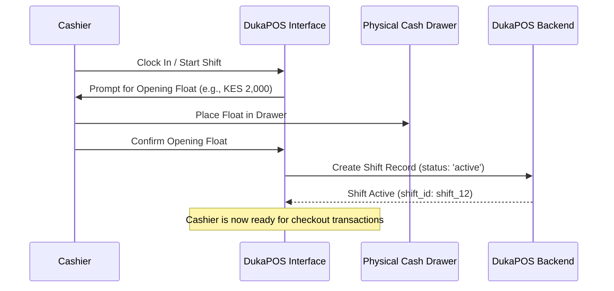

# DukaPOS — Operations & User Manual

Welcome to the **DukaPOS User Manual**. This guide walks store owners, managers, and cashiers through day-to-day point of sale, inventory, and back-office operations.

---

## 1. Getting Started & Store Onboarding

When an administrator registers a business on DukaPOS, the system presents a **9-Step Setup Wizard** (`/onboarding`) to configure the workspace:

1. **Business Identity**: Legal name, trading name, business type (duka, supermarket, pharmacy, etc.), and contact information.
2. **Tax & Fiscal Settings**: KRA PIN, VAT status (Registered vs Non-VAT), standard VAT rate (default: 16%).
3. **M-Pesa & Payment Routing**: M-Pesa Buy Goods Till number, Paybill business number, and bank accounts.
4. **Receipt Customization**: Custom header greeting, logo upload, return policy, and footer thank you message.
5. **Initial Product Catalog**: Quick creation or CSV import of initial fast-moving inventory items.
6. **Branch Setup**: Primary retail branch location and operating hours.
7. **Cashier / Staff Accounts**: Creation of cashier PINs and staff profiles.
8. **Subscription Selection**: Plan selection (Starter, Growth, Enterprise).
9. **Verification & Launch**: One-click initialization into the live POS dashboard!

---

## 2. Cashier Shift Management & Cash Float

Before ringing up any sales, cashiers must begin an audited work session.

### Starting a Shift
1. Log in with your cashier credentials or PIN.
2. Navigate to **POS** (`/pos`) or **My Shifts** (`/my-shifts`).
3. Enter your **Starting Cash Float** (the initial small change placed in the physical drawer).
4. Click **Start Shift**.

### End-of-Day Shift Close & Z-Report
1. At the conclusion of your shift, click **End of Day Reconciliation** or **Close Shift**.
2. Count the physical cash in your drawer.
3. Enter the counted **Actual Cash**.
4. The system calculates the **Z-Report**:
   - **Cash Sales** + **Starting Float** - **Cash Drawer Expenses** = **Expected Cash**
   - **Actual Cash** - **Expected Cash** = **Variance**
5. If the variance is zero, the drawer is perfectly balanced. If a discrepancy exists, input an explanatory note.
6. Click **Confirm & Close Shift**. A printable Z-Report summary is recorded in the Shift Audit ledger.

---

## 3. Point of Sale (POS) & Checkout Guide

The POS interface is optimized for rapid checkout speed via touchscreen, barcode scanner, or keyboard shortcuts.

### Scanning & Adding Items
- **Barcode Scanner**: Connect any USB or Bluetooth laser scanner. Scanning a barcode automatically adds the product to the active cart with audio confirmation.
- **Product Grid**: Browse items by category tab or use the instant search input (`Ctrl + F`).
- **Quick Keys / Favorites Bar**: Tap top frequent items (Milk, Bread, Airtime, Eggs, Sodas) for instant one-click addition.
- **Quantity Adjustments**: Use `+` and `-` buttons or click the quantity number to type a specific count.

### Keyboard Shortcuts Reference Table
| Key Shortcut | Action |
|:---:|---|
| **F1** | Help / Keyboard Shortcuts Modal |
| **F2** | Focus Product Search Bar |
| **F4** | Hold / Park Current Cart |
| **F5** | Retrieve Held Transactions |
| **F8** | Toggle Price Check Mode |
| **F9** | Apply Discount / Coupon Code |
| **F12** or **Space** | Open Checkout Payment Dialog |
| **Esc** | Cancel / Close Active Modal |

### Customer Loyalty & Disounts
1. **Search Customer**: Type customer phone number or name in the customer search bar.
2. **Loyalty Accrual**: The system automatically adds **1 Point per 100 KES spent**.
3. **Points Redemption**: If the customer has accumulated points, specify the points to redeem during checkout to discount the subtotal.
4. **Customer Tiers**: Customers automatically upgrade to **Silver** (KES 5,000+) or **Gold** (KES 20,000+).

### Processing Tender & Multi-Payment
Click **Checkout** (`F12` or `Space`):
- **Cash**: Enter the amount tendered. The UI calculates exact change due and triggers the cash drawer sound / signal.
- **M-Pesa STK Push**: Enter the customer's phone number and click **Send STK Push**. The customer receives an instant prompt on their Safaricom handset to enter their M-Pesa PIN.
- **Card**: Swipe or tap the customer card on the terminal and enter the reference approval code.
- **Split Tender**: Combine cash with M-Pesa or card for large orders.

### Printing Receipts
Once finalized:
- A digital receipt modal displays immediately with the KRA eTIMS CUIN number.
- Click **Print Receipt** to send an ESC/POS command to an 80mm thermal receipt printer.
- Receipts can also be downloaded as high-resolution PDFs or sent digitally via SMS/WhatsApp.

---

## 4. Inventory Management & Stock Alerts

Navigate to **Inventory** (`/inventory`) to supervise catalog items.

### Stock Status Indicators
- **Normal (Green)**: Stock level is healthy.
- **Low Stock (Amber)**: Stock has reached or fallen below `low_stock_threshold`. Trigger a restock.
- **Out of Stock (Red)**: Stock is 0. Cashiers are prevented or warned during checkout.

### Quick Restock & Scan-to-Restock
- **Scan-to-Restock**: Click the **Scan to Restock** bar. Scan any product barcode; the system prompts for the incoming delivery quantity and instantly credits the inventory.
- **Bulk Upload**: Import product lists via CSV or Excel templates.
- **Barcode Generator**: Click **Print Barcodes** to render standard Code128 barcode labels for products lacking manufacturer packaging.

---

## 5. Procurement & Purchase Orders

Navigate to **Purchase Orders** (`/purchase-orders`):

1. Click **New Purchase Order**.
2. Select an approved vendor from your **Suppliers** directory (`/suppliers`).
3. Add required items, ordered quantities, and agreed purchase unit costs.
4. Set the status to **Submitted** or **Approved**.
5. When the supplier delivers the goods to the store:
   - Change status to **Delivered**.
   - **Automated Stock Increment**: DukaPOS automatically increases the stock quantity of all delivered items!

---

## 6. Expenses & Cash Flow Management

Track non-merchandise operating expenses directly from the store back-office (`/expenses`):

1. Click **Add Expense**.
2. Select the category: `Rent`, `Utilities (KPLC, Water)`, `Casual Wages`, `Packaging`, `Courier / Transport`, or `Maintenance`.
3. Choose Payment Channel: `Cash Drawer (Float)`, `Store M-Pesa Till`, or `Bank Transfer`.
   > **Note**: Expenses paid via **Cash Drawer** are automatically factored into the end-of-day Z-Report to maintain cash balance integrity.
4. Attach a digital receipt image or invoice voucher.
5. Save to immediately reflect in the **Cash Flow** statement (`/cash-flow`) and P&L statements.
